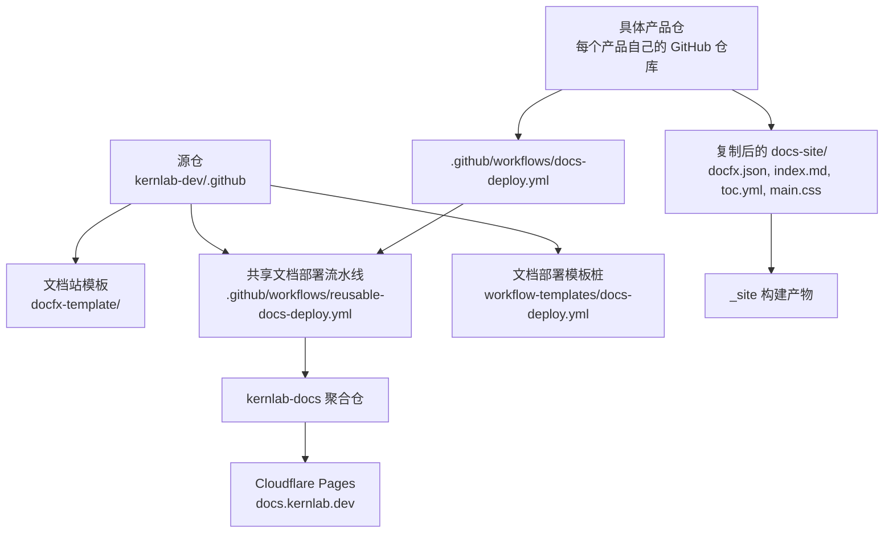
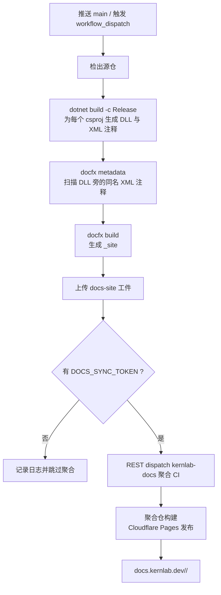
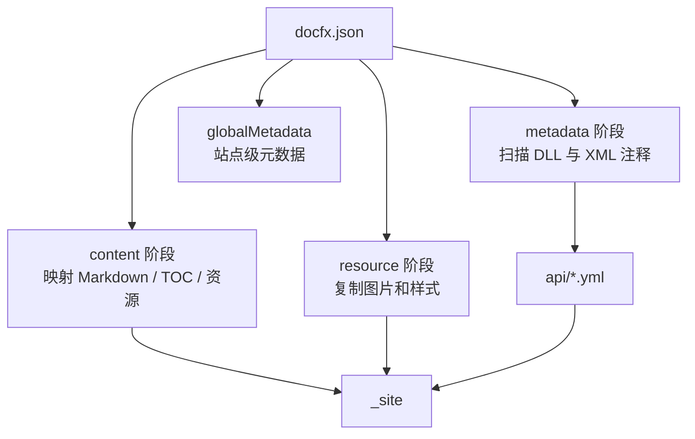
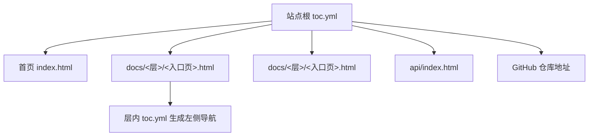
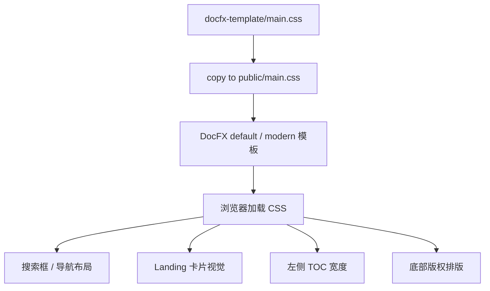
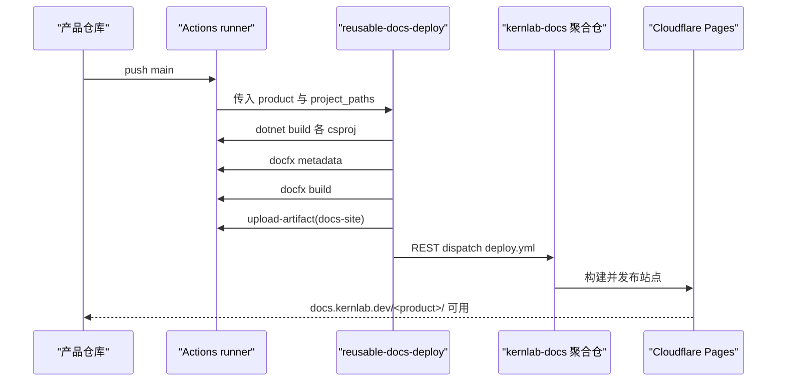
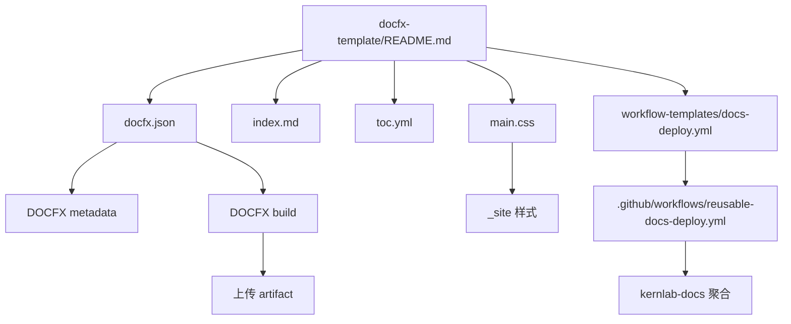

# DocFX 文档站模板指南

<cite>
**本文引用的文件**
- [README.md](file://README.md)
- [docfx-template/README.md](file://docfx-template/README.md)
- [docfx-template/docfx.json](file://docfx-template/docfx.json)
- [docfx-template/index.md](file://docfx-template/index.md)
- [docfx-template/toc.yml](file://docfx-template/toc.yml)
- [docfx-template/main.css](file://docfx-template/main.css)
- [.github/workflows/reusable-docs-deploy.yml](file://.github/workflows/reusable-docs-deploy.yml)
- [workflow-templates/docs-deploy.yml](file://workflow-templates/docs-deploy.yml)
- [workflow-templates/docs-deploy.properties.json](file://workflow-templates/docs-deploy.properties.json)
- [profile/README.md](file://profile/README.md)
</cite>

## 目录
1. [简介](#简介)
2. [项目结构](#项目结构)
3. [核心组件](#核心组件)
4. [架构总览](#架构总览)
5. [详细组件分析](#详细组件分析)
6. [依赖关系分析](#依赖关系分析)
7. [性能与可维护性](#性能与可维护性)
8. [常见问题与排错](#常见问题与排错)
9. [结论](#结论)
10. [附录：从模板到上线的完整流程](#附录从模板到上线的完整流程)

## 简介

DocFX 是一个面向 .NET 项目的开源静态文档站点生成工具。它同时承担两类任务：

| 能力 | 说明 | 与传统博客 / Markdown 静态站的区别 |
|---|---|---|
| **API 元数据提取** | 扫描 .NET 程序集的 XML 注释，生成 API 参考页面和 YML 元数据 | 传统静态站不会自动扫描代码，API 描述需要手动编写和维护 |
| **Markdown 站点构建** | 把 `content` 中的 Markdown、TOC、资源打包为最终 HTML 站点 | 传统站更多是主题 + Markdown；DocFX 强调“文档即产物”，并可与 NuGet 包/程序集绑定 |
| **多来源聚合输出** | 支持 metadata、build、content、resource、template、output 等 pipeline | 普通 MkDocs / Docusaurus 更偏“内容驱动”，KernLab 方案则强制“代码 + 文档 + 发布配置”一体化 |
| **家族标准化** | kernlab-dev 通过 `docfx-template` 统一样式、导航、构建和部署契约 | 团队内部不再各自选择不同引擎，降低维护成本 |

简单说：如果你只需要一个产品使用手册，任何 Markdown 引擎都能跑；如果你要“让 API 参考与代码一起演进、并且纳入 docs.kernlab.dev 聚合站点”，KernLab 推荐基于本仓库提供的 DocFX 模板。

文档站不是博客，而是产品的对外技术契约入口；它必须稳定、可验证、与发布管线强关联。

**本节来源**
- [README.md:3-20](file://README.md#L3-L20)
- [profile/README.md:7-23](file://profile/README.md#L7-L23)

## 项目结构

在 KernLab 规范中，新产品文档站位于自己仓库的 `docs-site/` 目录下，并由模板仓库提供标准骨架。本次目标仓库的核心关系如下：



**图示来源**
- [README.md:7-19](file://README.md#L7-L19)
- [docfx-template/README.md:2-14](file://docfx-template/README.md#L2-L14)
- [.github/workflows/reusable-docs-deploy.yml:3-11](file://.github/workflows/reusable-docs-deploy.yml#L3-L11)
- [workflow-templates/docs-deploy.yml:1-12](file://workflow-templates/docs-deploy.yml#L1-L12)

### 文档模板仓库的职责

当前仓库不承载某个产品的具体内容，而是承载：

| 组件 | 职责 |
|---|---|
| `docfx-template/` | docfx.json、index.md、toc.yml、main.css、模板自述文档 |
| `.github/workflows/reusable-docs-deploy.yml` | 单份逻辑的文档构建与聚合触发实现 |
| `workflow-templates/docs-deploy.yml` | 产品仓可直接选用的 Actions 调用桩 |
| `profile/README.md` | 组织门面及已接入产品的文档入口示例 |

### 产品仓库的典型落地形式

产品仓库应包含至少：

- `docs-site/docfx.json`
- `docs-site/index.md`
- `docs-site/toc.yml`
- `docs-site/main.css`
- 各发布项目（含 XML 文档注释）
- `.github/workflows/docs-deploy.yml`
- 用于协作说明的协调文档或层内 Markdown

**本节来源**
- [README.md:7-19](file://README.md#L7-L19)
- [docfx-template/README.md:14-41](file://docfx-template/README.md#L14-L41)

## 核心组件

模板由五个关键文件组成，分别对应 DocFX 的配置、首页、左侧 TOC、样式和模板说明：

| 文件 | 角色 | 是否允许直接修改 |
|---|---|---|
| `docfx.json` | metadata + build 配置骨架 | 允许复制后按产品填写 |
| `index.md` | 文档站根入口（landing page） | 允许复制后填写占位符 |
| `toc.yml` | 顶部导航和分层 TOC 骨架 | 允许复制后改写章节名与链接 |
| `main.css` | 全家族统一样式 | **不建议产品仓自行 fork**；需改先改模板再同步 |
| `docfx-template/README.md` | 模板使用说明、坑位清单、版本策略 | 只读引用 |

模板约定：

1. 文档站根入口是 `index.md`，由 DocFX 映射到 `index.html`。
2. 产品侧 TOC 放在 `docs-site/toc.yml`，并通过 `docfx.json` 的 content 映射注入站点根。
3. API 元数据产物位于 `api/`，随后被合并到站点根作为 API 入口。
4. 样式文件 `main.css` 被复制到 `public/`，供 modern/default 模板相对路径加载。
5. 构建输出根是 `_site`，后续上传 artifact 或聚合。

**本节来源**
- [docfx-template/README.md:14-41](file://docfx-template/README.md#L14-L41)
- [docfx-template/docfx.json:2-63](file://docfx-template/docfx.json#L2-L63)

## 架构总览

KernLab 文档站的整体流水线分为六段：**代码编译 → DocFX metadata → DocFX build → 上传 artifact → 触发聚合 → Cloudflare Pages 上线**。



**图示来源**
- [.github/workflows/reusable-docs-deploy.yml:3-11](file://.github/workflows/reusable-docs-deploy.yml#L3-L11)
- [.github/workflows/reusable-docs-deploy.yml:28-83](file://.github/workflows/reusable-docs-deploy.yml#L28-L83)

该流水线明确区分“文档构建”和“聚合部署”。单个产品仓库负责构建自己的 Docs；kernlab-docs 聚合仓再把所有产品文档整合到 `docs.kernlab.dev/<product>`。因此，产品仓库只需保证 `docs-site/_site` 可构建成功，而不需要直接关心最终域名路由。

**本节来源**
- [.github/workflows/reusable-docs-deploy.yml:1-11](file://.github/workflows/reusable-docs-deploy.yml#L1-L11)

## 详细组件分析

### docfx.json：metadata 与 build 配置骨架

`docfx.json` 是模板中最重要也最容易写错的配置文件。它分为两大阶段：

#### metadata 阶段

metadata 阶段会读取一组发布程序的 `.dll`，并从同目录下的同名 XML 文件提取类库签名、成员注释、参数信息，最终产出 `api/*.yml`。如果某 DLL 对应的 XML 没生成，API 参考可能整层消失且构建不一定失败——这是模板中标注的“坑 #1”。

关键约束：

| 键 | 作用 | 维护要求 |
|---|---|---|
| `metadata[0].src[].files` | 列出要扫描的程序集 | 必须与 workflow 构建清单一致 |
| `metadata[0].dest` | API 元数据输出目录 | 默认是 `api` |
| `build.output` | 最终站点目录 | 默认是 `_site` |

#### build.content 阶段

`content` 决定哪些 Markdown/YML 进入站点以及它们的目标路径。模板覆盖以下常见路径：

| 输入 | 输出 | 用途 |
|---|---|---|
| `README.md` | `.` 下 | README 进站根页或就近解析 |
| `<层目录>/toc.yml` | `docs/<层>` | 分层左导航 |
| `../src/<项目>/docs/**/*.md` | `docs/<层>` | 产品主体文档 |
| `../src/<项目>/COORDINATION.md` | `docs/coordination/<短名>` | 协作/编排说明，经短名映射避免深路径死链 |
| `coordination/toc.yml` | `docs/coordination` | Coordination 层导航 |
| `../src/<项目>/docs/perf/**/*.md` | `docs/<层>/perf` | 性能文档，与使用指南分离 |
| `toc.yml` | `.` | 站点根导航 |
| `index.md` | `.` | 文档站首页 |
| `api/**/*.yml` | `.` | API 元数据入口 |
| `api/index.md` | `api` | API 索引页 |

#### build.resource 阶段

资源阶段复制图片资源与全局样式：

| 资源 | 用途 | 约束 |
|---|---|---|
| `src/**/docs/**/*.png/jpg/svg` | 正文配图 | 随构建产出 |
| `main.css` | 全家族样式 | 复制到 `public/`，由页面以相对路径加载 |

#### globalMetadata 阶段

模板注入的站点级元数据包括：

| 字段 | 含义 | 注意事项 |
|---|---|---|
| `_appName` | 应用名称 | 改为产品名称 |
| `_appTitle` | 页面标题 | 建议带一句话定位 |
| `_appFooter` | 底部版权和门户链接 | 包含文档门户入口 |
| `_enableSearch` | 搜索开关 | 启用搜索 |
| `_gitContribute` | “编辑本页”等 Git 贡献入口 | 指向产品公开仓库 |
| `_appBasePath` | 历史概念上的子路径前缀 | **不应在此模板中配置**，现代模板下无效 |

#### template 与 output

- 模板组合 `["default", "modern"]`，由 DocFX 根据页面和主题策略渲染。
- 输出目录固定 `_site`，工作区在 `docs-site/`。



**图示来源**
- [docfx-template/docfx.json:2-63](file://docfx-template/docfx.json#L2-L63)

**本节来源**
- [docfx-template/docfx.json:2-63](file://docfx-template/docfx.json#L2-L63)

### index.md：站点根入口与 landing 区块

`index.md` 不是纯 Markdown 文档，而是混合 Bootstrap 语义类的 Landing Page。它承担三件事：

1. **站点门面**：设置 `title` 和 `description`，配合 SEO 和浏览器标签。
2. **Hero 区域**：产品名、一句话定位、开始阅读按钮、仓库链接。
3. **两大内容区块**：
   - “文档导航”卡片网格，按顶导分类展示主要章节。
   - “快速链接”卡片网格，放置上手捷径、契约/参考入口和源码仓库。

该页面的设计规则来自模板文档与实态页面的一致化需求，核心约束如下：

| 元素 | 规则 |
|---|---|
| Hero | 使用 `landing-hero` 背景渐变容器 |
| 特性卡 | 使用 bootstrap-icons 图标和柔和色阶 |
| 文档导航卡片 | 整张卡片可点击，边框颜色轮换 primary/success/warning/info/secondary/danger |
| 快速链接 | 三列卡片布局，包含上手、契约、仓库入口 |
| 外部仓库链接 | 保持绝对 URL，产品名替换为真实仓库地址 |

对文档作者而言，最需要注意的是：这里的“开始阅读”链接、文档导航链接都必须符合模板约定的文档路径形态，否则会被聚合站点的相对路径规则击穿。

**本节来源**
- [docfx-template/index.md:1-119](file://docfx-template/index.md#L1-L119)

### toc.yml：顶部导航与分层导航规则

`toc.yml` 定义了站点顶部导航和顶层文档入口。它包含：

- 首页
- 若干章节入口，形如 `docs/<层>/<入口页>.html`
- API 参考入口
- GitHub 仓库入口

模板强调三个纪律：

1. **只引用确实生成的页面**，避免构建警告污染真正错误。
2. **coordination 部分用摊平短名**，不使用 `src/<项目名>/` 镜像路径。
3. **全部使用相对路径**，保证部署到 `docs.kernlab.dev/<product>/` 时仍可正常工作。

DocFX 对 TOC 的解析基本遵循 YAML 层级和 `href` 目标；但模板额外约定了命名模式与“不存在的 TOC 链接 = 构建警告”的规则，以便团队保留基线、新增时必须消除新增告警。



**图示来源**
- [docfx-template/toc.yml:1-14](file://docfx-template/toc.yml#L1-L14)
- [docfx-template/docfx.json:20-45](file://docfx-template/docfx.json#L20-L45)

**本节来源**
- [docfx-template/toc.yml:1-14](file://docfx-template/toc.yml#L1-L14)

### main.css：自定义样式注入点与主题定制边界

`main.css` 是模板中的“家族统一样式”。其设计目标不是提供完整的 DocFX 主题替代，而是在 DocFX default/modern 模板基础上做可控局部定制。

主要定制面：

| 定制点 | 行为 | 设计理由 |
|---|---|---|
| 搜索框宽度 | 中等屏缩小至 `6rem` | 让 navbar 一级菜单不被挤压 |
| 窄屏隐藏搜索框 | 小于指定断点隐藏 | 优先保留导航可读性 |
| Landing hero | 增加圆角渐变背景 | 与家族视觉一致 |
| 卡片悬停 | 轻微上浮动画 | 提升可点击感 |
| AnchorJS 外链图标 | 在卡片内隐藏 | 避免重复或干扰视觉 |
| 左侧 TOC 宽度 | 限制最大宽为 `280px` | 原始 `360px` 挤占正文空间 |
| Footer | 居中对齐，继承文字颜色 | 符合常见文档版权排版 |
| 卡片左边框颜色 | 改用 Bootstrap 5 柔和色阶 | 避免亮色原色刺眼 |
| Dark 模式边框 | 调整 200 系列颜色 | 深色背景下可见度更好 |
| 卡片标题图标颜色 | 同样使用柔和色阶 | 避免标题 + 图标同时饱和度过高 |

注意：样式通过 `build.resource` 复制到 `public/main.css`，再由页面以相对路径加载。这要求整个文档站不使用“根绝对路径”的资源引用。



**图示来源**
- [docfx-template/docfx.json:46-63](file://docfx-template/docfx.json#L46-L63)
- [docfx-template/main.css:1-71](file://docfx-template/main.css#L1-L71)

**本节来源**
- [docfx-template/main.css:1-71](file://docfx-template/main.css#L1-L71)
- [docfx-template/docfx.json:46-63](file://docfx-template/docfx.json#L46-L63)

### reusable-docs-deploy：metadata 生成与聚合集成

`reusable-docs-deploy.yml` 是文档部署的逻辑中心，被产品仓库通过 `workflow-templates/docs-deploy.yml` 调用。它的关键输入是：

| 输入 | 类型 | 重要性 |
|---|---|---|
| `product` | 字符串 | 决定聚合仓的站点目录名 |
| `project_paths` | 空格分隔的 csproj 路径 | 决定哪些程序集参与 API 元数据生成 |
| `dotnet_version` | 字符串 | 默认 `8.0.x` |
| `DOCS_SYNC_TOKEN` | secret | 可选；为空时跳过聚合部署，不报错 |

执行流程要点：

1. 安装 .NET SDK。
2. 安装 DocFX 工具。
3. 逐个发布项目构建 Release 配置，生成 DLL 和同目录 XML 注释。
4. 运行 `docfx metadata docfx.json`。
5. 运行 `docfx build docfx.json`。
6. 上传 `_site` 作为名为 `docs-site` 的 artifact。
7. 若存在 `DOCS_SYNC_TOKEN`，调用 REST API 触发聚合仓的工作流。
8. 若没有 token，显式记录日志并退出码 0；这里不是失败，而是可观察地跳过。

聚合端不是当前仓，而是 `kernlab-dev/kernlab-docs`。该接口明确避免使用 `gh workflow run`（因 fine-grained PAT 的限制），转而使用 `/actions/workflows/deploy.yml/dispatches` REST 端点，并附带 `ref=main`。



**图示来源**
- [.github/workflows/reusable-docs-deploy.yml:1-11](file://.github/workflows/reusable-docs-deploy.yml#L1-L11)
- [.github/workflows/reusable-docs-deploy.yml:28-83](file://.github/workflows/reusable-docs-deploy.yml#L28-L83)

**本节来源**
- [.github/workflows/reusable-docs-deploy.yml:1-83](file://.github/workflows/reusable-docs-deploy.yml#L1-L83)

### workflow-templates/docs-deploy.yml：产品仓触发桩

该文件是产品仓可直接复用的 GitHub Actions 定义。它的职责不是实现逻辑，而是“在哪里触发、过滤哪些路径、传给 reusable 什么参数”。

关键维护项：

| 维护项 | 说明 |
|---|---|
| `paths` | 必须覆盖 `src/**/docs/**`、协调文档、站点目录、README、TOC、自身 workflow |
| `product` | 聚合仓 sites 下的目录名，例如 `tier` 或 `traffic` |
| `project_paths` | 所有要生成 API 元数据的 csproj 路径列表 |
| `secrets.DOCS_SYNC_TOKEN` | 传递到 reusable，用于调用聚合仓 |
| `workflow_call` 输入 | reusable 声明 required 的 product、project_paths、可选 dotnet_version |

该模板还提供了 `docs-deploy.properties.json`，用作 GitHub Actions 模板页的描述、图标和分类。

**本节来源**
- [workflow-templates/docs-deploy.yml:1-36](file://workflow-templates/docs-deploy.yml#L1-L36)
- [workflow-templates/docs-deploy.properties.json:1-6](file://workflow-templates/docs-deploy.properties.json#L1-L6)

## 依赖关系分析

模块间的依赖可以分成两层：物理文件和运行时流水线。



**图示来源**
- [docfx-template/README.md:14-49](file://docfx-template/README.md#L14-L49)
- [docfx-template/docfx.json:2-63](file://docfx-template/docfx.json#L2-L63)
- [workflow-templates/docs-deploy.yml:1-36](file://workflow-templates/docs-deploy.yml#L1-L36)
- [.github/workflows/reusable-docs-deploy.yml:28-83](file://.github/workflows/reusable-docs-deploy.yml#L28-L83)

### 耦合关系总结

| 组件 | 被谁依赖 | 主要耦合风险 |
|---|---|---|
| `docfx.json` | metadata/build 阶段、workflow | dll 清单不一致导致 API 缺失 |
| `main.css` | 构建 resource 阶段 | 改变样式优先级或路径后影响全站 |
| `toc.yml` | DocFX TOC 解析、聚合导航 | 引用不存在页面产生构建警告 |
| `index.md` | 首页渲染、聚合站点门面对比 | 链接形态偏离模板约定 |
| `reusable-docs-deploy.yml` | 产品 workflow | Token 缺失或权限不足造成静默跳过 |
| `docs-deploy.yml` | 用户仓库 | paths/project_paths/product 未更新 |

**本节来源**
- [docfx-template/docfx.json:2-63](file://docfx-template/docfx.json#L2-L63)
- [docfx-template/toc.yml:1-14](file://docfx-template/toc.yml#L1-L14)
- [docfx-template/main.css:1-71](file://docfx-template/main.css#L1-L71)
- [.github/workflows/reusable-docs-deploy.yml:12-83](file://.github/workflows/reusable-docs-deploy.yml#L12-L83)
- [workflow-templates/docs-deploy.yml:1-36](file://workflow-templates/docs-deploy.yml#L1-L36)

## 性能与可维护性

从构建角度看，模板已经避免了几个常见低效模式：

1. **增量依赖最小化**：workflow 只在相关路径变化时触发。
2. **逐项目构建**：确保每个发布项目都有 XML 元数据，避免后期补建带来的遗漏。
3. **集中样式**：通过单一 `main.css` 控制家族一致性，减少每产品维护差异。
4. **聚合解耦**：产品站和聚合站分开，变更产品文档不影响聚合仓代码本身。

从可维护性角度，最重要的原则是“单逻辑源”：

- workflow 逻辑集中在 `reusable-docs-deploy.yml`。
- 文档站样式集中在模板。
- 文档站模板使用说明书集中在 `docfx-template/README.md`。
- 产品仓只保留“填充后的模板副本 + 触发桩 + 业务文档”。

这对不熟悉 DocFX 的人尤其重要：不要一开始就追求自定义 DocFX 模板，而应先保证 `docfx.json`、TOC、XML 注释、CSS、workflow 五个位置同步正确。

**本节来源**
- [README.md:7-20](file://README.md#L7-L20)
- [docfx-template/README.md:43-49](file://docfx-template/README.md#L43-L49)

## 常见问题与排错

以下内容整理自模板自带的“踩坑清单”及实际配置逻辑。

### 1. API 参考某层完全消失

**现象**：构建没有报致命错误，但某个项目的 API 文档不存在。  
**原因**：`metadata.files` 或 workflow 构建项目清单缺少某个 DLL。  
**排查**：

1. 确认 `docfx.json` 中所有发布项目的 DLL 都已列入。
2. 确认 workflow 中 `project_paths` 包含相同 csproj。
3. 本地先执行 Release 构建，检查 DLL 旁是否有同名 XML。
4. 对比构建输出中是否生成对应 `api/*.yml`。

**解决方案**：同步维护 dll 清单与 workflow 构建清单。

### 2. coordination 链接深镜像形态产生 404

**现象**：原本路径包含项目深层目录的 coordnation 链接变成死链。  
**原因**：模板将 `../src/<项目>/COORDINATION.md` 映射到 `docs/coordination/<短名>`，而不是保留项目深路径。  
**解决**：对外链接只使用短名映射结果，不要在文档里继续引用 `src/<项目名>/`。

### 3. 根绝对路径资源断链

**现象**：部署到 `docs.kernlab.dev/<product>/` 后 favicon、logo、og:image 等 404。  
**原因**：资源路径写成 `/xxx`，被理解为站点根而不是产品子路径。  
**解决**：全部改用相对路径。模板中所有资源引用都遵循这一契约。

### 4. 配置 `_appBasePath` 无效

**现象**：希望靠 `_appBasePath` 解决子路径问题，但没有效果。  
**原因**：在 DocFX 2.78 modern 模板下该字段无实际作用。  
**解决**：不要配 `_appBasePath`；子路径兼容靠所有链接和资源都是相对路径。

### 5. 本地 serve 根路径看似正常，子路径全坏

**现象**：在 localhost 根路径预览没问题，上站后相对资源失败。  
**原因**：只有部署到非根路径才能暴露相对路径问题。  
**解决**：本地必须模拟产品子路径访问，并按照发布清单逐项验证。

### 6. TOC 构建警告过多

**现象**：控制台刷屏构建警告，掩盖真实问题。  
**原因**：`toc.yml` 引用了不存在的页面。  
**解决**：只引用确实会生成的 Markdown 页面；新增 TOC 条目后必须消除新增警告。

### 7. 样式选择器优先级不足

**现象**：自定义 CSS 不生效，或 Dark/Light 主题下表现异常。  
**原因**：模板已使用 Bootstrap 类、特定 ID（如 `#navbar`）、属性选择器和 `!important` 处理卡片边框；如果产品 CSS 覆盖方式不当，可能被模板或浏览器默认样式覆盖。  
**解决**：优先沿用模板选择器语义；如需扩展，尽量复用已有 class（如 `card.border-start`），并尊重 Dark 模式分支。

### 8. 多 docset 聚合时的 ID 冲突

**现象**：多个产品在同一个聚合站出现导航、锚点或样式问题。  
**原因**：多个站点共用同一聚合容器时，ID 或选择器可能产生干扰；模板强调“不要分叉样式”，以降低差异。  
**解决**：

- 保持每个产品站独立构建，避免在聚合层手动拼写不完整 HTML。
- 样式修改走模板统一路径，不随意引入跨产品副作用。
- 对聚合端裸路径处理使用 301 重定向，防止相对 CSS 解析到根路径。

### 9. workflow paths 漏掉文档源

**现象**：改了文档却触不发展示流程。  
**原因**：push filter 不包含 `src/**/docs/**`、coordination 文件或站点目录。  
**解决**：在产品仓模板 `docs-deploy.yml` 中补全 `paths`。

### 10. DOCS_SYNC_TOKEN 未配置

**现象**：CI 绿，但文档不上聚合站；或聚合调用静默失败。  
**原因**：Token 为空时 workflow 会记录日志并跳过；如果是 fine-grained PAT 也可能权限不足。  
**解决**：在仓库 Settings → Secrets 中添加 `DOCS_SYNC_TOKEN`，并确保具备 `actions:write` 调用聚合仓的权限。

**本节来源**
- [docfx-template/README.md:28-43](file://docfx-template/README.md#L28-L43)
- [docfx-template/docfx.json:8-63](file://docfx-template/docfx.json#L8-L63)
- [.github/workflows/reusable-docs-deploy.yml:15-83](file://.github/workflows/reusable-docs-deploy.yml#L15-L83)

## 结论

KernLab 的 DocFX 模板不只是一个“样式文件夹 + docfx.json”，它是一套从源码注解到聚合站点的完整契约：

- `docfx.json` 定义元数据和构建路径；
- `index.md` 规定产品 Landing 页面结构；
- `toc.yml` 规范导航；
- `main.css` 约束视觉风格；
- `reusable-docs-deploy.yml` 统一构建、artifact 上传和聚合触发；
- `workflow-templates/docs-deploy.yml` 给产品仓提供最小可复制触发桩。

对于初学者，建议先把模板复制到位、填满产品名和 csproj 清单、启用搜索、本地预览，再考虑样式定制；对于有经验开发者，应重点审查 `metadata.files`、`build.content` 路径映射、`globalMetadata` 子路径契约，以及聚合触发所需的 PAT 和 workspace 变量。

**本节来源**
- [docfx-template/README.md:2-49](file://docfx-template/README.md#L2-L49)
- [docfx-template/docfx.json:2-63](file://docfx-template/docfx.json#L2-L63)

## 附录：从模板到上线的完整流程

### 一、初始化产品文档站

1. 在产品仓库创建 `docs-site/`。
2. 复制模板的四个文件：
   - `docfx.json`
   - `index.md`
   - `toc.yml`
   - `main.css`
3. 将文件名、项目 DLL 路径、章节名、仓库 URL 替换为真实值。

### 二、准备 API 元数据

1. 在 CI 之前，确保所有发布项目能 Release 构建。
2. 确认输出目录中存在 DLL 和同名 XML。
3. 本地运行 DocFX metadata 命令，验证 `api/*.yml` 是否存在。

### 三、本地预览

#### 使用模板自带 preview

```bash
cd docs-site
dotnet tool install -g docfx
dotnet tool run docfx --serve
```

#### 使用模板自带 serve 的增强说明

仅打开 `http://localhost:8080/` 是不够的。还应验证：

- 产品子路径：假设产品为 `demo`，应打开 `http://localhost:8080/demo/` 或聚合预演路径。
- API 入口是否正常跳转。
- 图片资源是否加载。
- TOC 中每个链接是否有效。
- 首次打开、刷新、跳转到 API、回到首页均无 404。

### 四、提交到 GitHub

模板要求至少在 `main` 分支推送并满足 `paths` 条件才会触发文档部署。关键配置包括：

- `on.push.paths` 覆盖文档源码和站点配置。
- `product` 设为聚合仓中的站点目录名。
- `project_paths` 填全 csproj 路径。
- 配置 `DOCS_SYNC_TOKEN`。

### 五、接入 GitHub Pages 或 Cloudflare Pages

当前模板的设计目标是 **docs.kernlab.dev**。因此，对大多数产品仓来说，正确的做法是：

- 让本仓库的 `docs-deploy.yml` 触发 `reusable-docs-deploy.yml`。
- 由 `reusable-docs-deploy.yml` 调用 kernlab-docs 聚合工作流。
- 由聚合仓发布到 Cloudflare Pages，托管于 `docs.kernlab.dev/<product>/`。

如果你坚持在单个产品仓直接部署 GitHub Pages 或 Cloudflare Pages，需要注意：

| 事项 | 要求 |
|---|---|
| 构建步骤 | 仍要 `docfx metadata` + `docfx build` |
| 发布目录 | 发布 `_site` |
| 基础路径 | 若部署到子路径，必须保持所有资源和链接相对 |
| 避免 `_appBasePath` 幻觉 | 不要依赖它修复子路径 |
| API 引用 | 仍需正确生成 `api/index.html` |
| 与聚合站关系 | 如果要上 docs.kernlab.dev，还需配合聚合仓，而非只部署个人站 |

### 六、维护建议

- 样式修改必须先在模板验证。
- 新增 TOC 条目必须验证页面存在。
- 新增 csproj 必须同时出现在两个地方：docfx.metadata 和 workflow.project_paths。
- 所有站内链接避免根绝对路径。
- 发布前必须本地模拟子路径访问，并使用真实浏览器校验。

**本节来源**
- [docfx-template/README.md:14-43](file://docfx-template/README.md#L14-L43)
- [docfx-template/docfx.json:8-63](file://docfx-template/docfx.json#L8-L63)
- [workflow-templates/docs-deploy.yml:1-36](file://workflow-templates/docs-deploy.yml#L1-L36)
- [.github/workflows/reusable-docs-deploy.yml:28-83](file://.github/workflows/reusable-docs-deploy.yml#L28-L83)