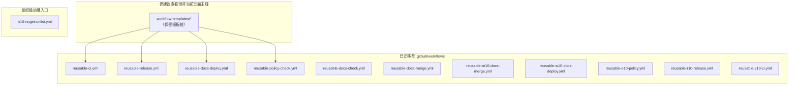
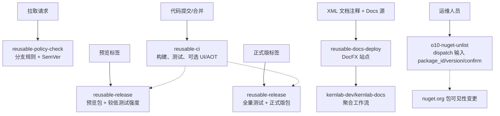
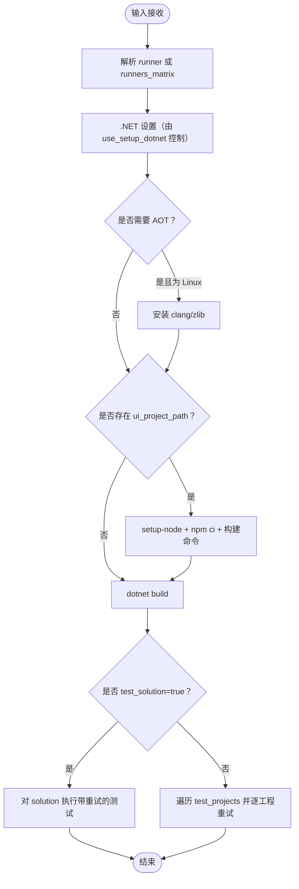
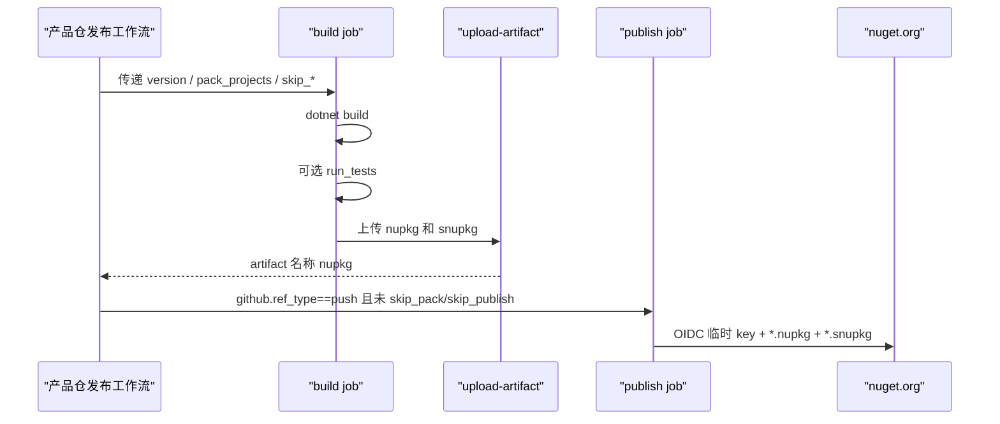
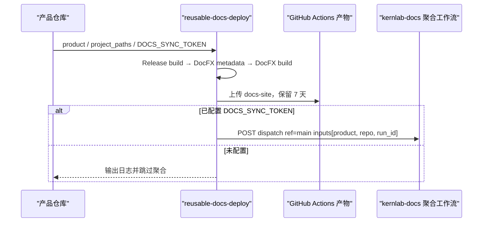
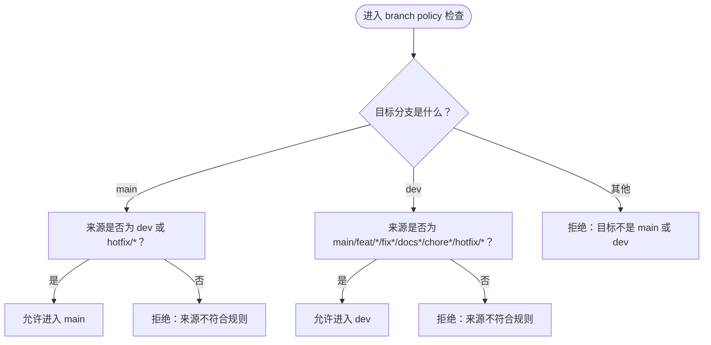
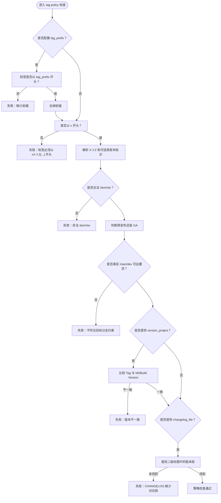
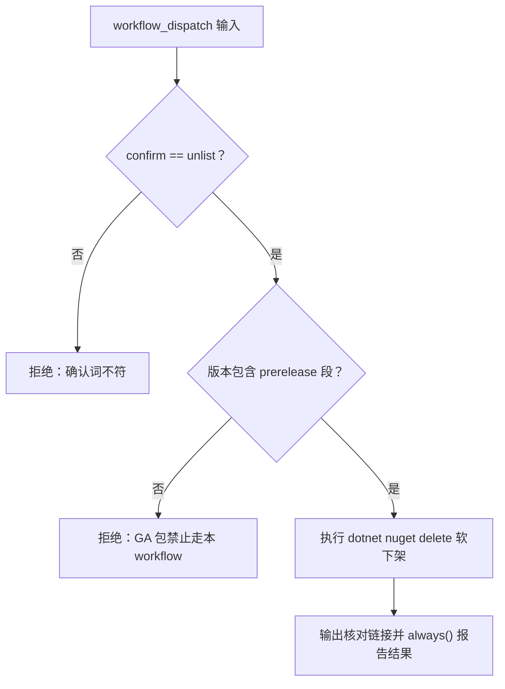
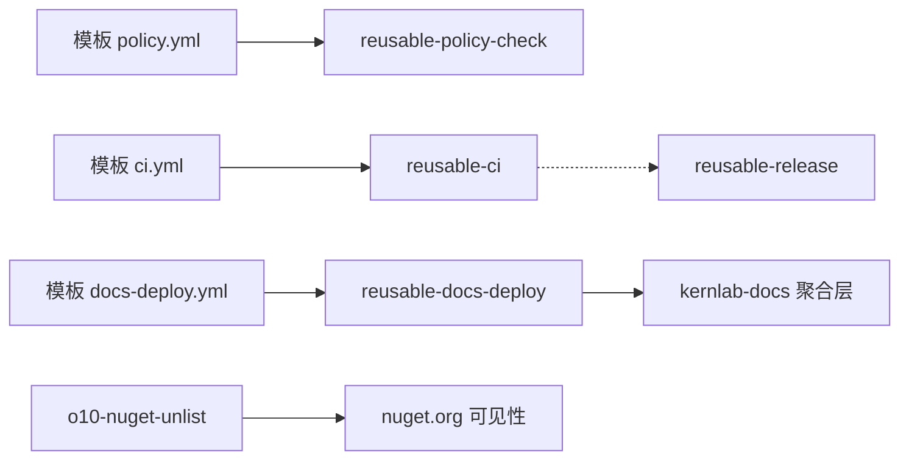

# 可复用工作流参考与输入参数

<cite>

**本文引用的文件**  
- [README.md](file://README.md)
- [VERSIONING.md](file://VERSIONING.md)
- [.github/workflows/reusable-ci.yml](file://.github/workflows/reusable-ci.yml)
- [.github/workflows/reusable-release.yml](file://.github/workflows/reusable-release.yml)
- [.github/workflows/reusable-docs-deploy.yml](file://.github/workflows/reusable-docs-deploy.yml)
- [.github/workflows/reusable-policy-check.yml](file://.github/workflows/reusable-policy-check.yml)
- [.github/workflows/o10-nuget-unlist.yml](file://.github/workflows/o10-nuget-unlist.yml)
- [workflow-templates/ci.yml](file://workflow-templates/ci.yml)
- [workflow-templates/docs-deploy.yml](file://workflow-templates/docs-deploy.yml)
- [workflow-templates/policy.yml](file://workflow-templates/policy.yml)

</cite>

## 目录

1. [简介](#简介)
2. [组织级入口规范](#组织级入口规范)
3. [核心组件总览](#核心组件总览)
4. [架构总览与调用关系](#架构总览与调用关系)
5. [详细组件分析](#详细组件分析)
   - [reusable-ci：统一 CI 门禁](#reusableci统一-ci-门禁)
   - [reusable-release：NuGet 发布管线](#reusable-release发布管线)
   - [reusable-docs-deploy：文档站构建与聚合触发](#reusable-docs-deploy文档站构建与聚合触发)
   - [reusable-policy-check：分支、标签与版本策略门](#reusable-policy-check分支标签与版本策略门)
   - [o10-nuget-unlist：组织级包软下架操作型 reusable](#o10-nuget-unlist组织级包软下架操作型-reusable)
6. [依赖与兼容性分析](#依赖与兼容性分析)
7. [性能与可靠性特征](#性能与可靠性特征)
8. [环境变量与密钥约定](#环境变量与密钥约定)
9. [使用示例与反例](#使用示例与反例)
10. [故障排查](#故障排查)
11. [结论](#结论)

## 简介

该仓库是 kernlab 组织的 GitHub 公共门面与家族共享流水线载体。其中 `.github/workflows` 下的四条 `workflow_call` reusable workflow，以及一个组织中央运维入口，收口了所有产品的持续集成、发布、文档部署、发布前策略校验与 NuGet 包软下架逻辑；各产品仓仅保留触发器和最小参数声明，逻辑变更在此处单源维护。

| 组件 | 事件 | 边界 | 职责 |
|---|---:|---|---|
| `reusable-ci` | `workflow_call` | `.github/workflows/reusable-ci.yml` | 默认 runner 或自建 runner matrix 的 .NET 构建、测试、可选 AOT/NativeAOT 工具链和卫星 UI 预构建 |
| `reusable-release` | `workflow_call` | `.github/workflows/reusable-release.yml` | 全量构建与打包、nupkg/snupkg artifact 上传、OIDC 推送到 nuget.org |
| `reusable-docs-deploy` | `workflow_call` | `.github/workflows/reusable-docs-deploy.yml` | DocFX metadata / site 生成，上传 docs-site artifact，并触发 kernlab-dev/kernlab-docs 聚合部署 |
| `reusable-policy-check` | `workflow_call` | `.github/workflows/reusable-policy-check.yml` | PR 分支准入规则，Tag SemVer、Tag↔MSBuild Version、Tag↔CHANGELOG 校验 |
| `o10-nuget-unlist` | `workflow_dispatch` | `.github/workflows/o10-nuget-unlist.yml` | 组织级 NuGet 包软下架（unlist）入口，供各产品仓零代码触发 |

模板仓库还提供新仓可直接选用的 ci、policy、docs-deploy 调用桩。本仓 workflows 不会自动在其它仓库运行，共享方式由各仓显式 `uses:` 引用。

**章节来源**
- [README.md:15-22](file://README.md#L15-L22)

## 组织级入口规范

为体现“统一 API 边界 + 多入口”原则，以下路径与命名模式应作为 KernLab 组织内 reusable 工作流的唯一引用目标：

| 类别 | 目标路径 | 旧名称（不应继续使用） | 说明 |
|---|---|---|---|
| CI 复用 | `.github/workflows/reusable-ci.yml` | `workflow-templates/reusable-cs-ci.yml` | 被产品仓 CI 调用 |
| 发布复用 | `.github/workflows/reusable-release.yml` | `workflow-templates/reusable-cs-release.yml` | 由 tag push 或 dispatch 触发 build/publish |
| 文档复用 | `.github/workflows/reusable-docs-deploy.yml` | `workflow-templates/reusable-docs-deploy.yml` | 构建站点并触发聚合层 |
| 策略复用 | `.github/workflows/reusable-policy-check.yml` | `workflow-templates/reusable-cs-policy.yml` | PR policy 与 tag policy |
| 文档检查复用 | `.github/workflows/reusable-docs-check.yml` | `workflow-templates/reusable-docs-check.yml` | 文档质量检查专用 |
| 文档 merge 复用 | `.github/workflows/reusable-docs-merge.yml` | `workflow-templates/reusable-docs-merge.yml` | 聚合文档合并门 |
| 元信息 merge 复用 | `.github/workflows/reusable-m10-docs-merge.yml` | `workflow-templates/reusable-m10-docs-merge.yml` | 元信息层合并流程 |
| 新文档部署复用 | `.github/workflows/reusable-w10-docs-deploy.yml` | `workflow-templates/reusable-w10-docs-deploy.yml` | 新版文档部署流程 |
| E10 策略复用 | `.github/workflows/reusable-e10-policy.yml` | `workflow-templates/reusable-e10-policy.yml` | 新一代策略门禁 |
| R10 发布复用 | `.github/workflows/reusable-r10-release.yml` | `workflow-templates/reusable-r10-release.yml` | 新版发布管线 |
| V10 CI 复用 | `.github/workflows/reusable-v10-ci.yml` | `workflow-templates/reusable-v10-ci.yml` | 新版 CI 管线 |
| 组织运维入口 | `.github/workflows/o10-nuget-unlist.yml` | 无旧模板文件 | `workflow_dispatch` 直接暴露 dispatch 输入 |

以上迁移不改变任何 reusable input、job、artifact 名称或下游产物形态；变更的是组织内部的工作流位置索引与调用方指向。模板仓库中的旧文件名仍可作为历史引用存在，但新建或重构调用桩时不应再假定这些路径有效。

## 核心组件总览

| reusable | 入口事件 | 主要职责 | 关键输出 |
|---|---|---|---|
| `reusable-policy-check` | 被 PR 工作流和 release 中 policy job 调用 | 分支门、SemVer tag、Tag↔Version、CHANGELOG 匹配 | 无 artifacts；失败阻断后续步骤 |
| `reusable-ci` | 被仓内 CI 调用 | dotnet build/test、runner matrix、UI 预构建、NativeAOT 环境准备 | 当前实现未显式上传制品 |
| `reusable-release` | 被仓内发布工作流调用 | 构建、测试（可选）、打包、上传 nupkg/snupkg、OIDC push | `nupkg` artifact；可选 nuget.org 发布 |
| `reusable-docs-deploy` | 被文档发布流程调用 | docfx metadata/build、上传 `docs-site`、触发聚合 | `docs-site` artifact；触发外部聚合 workflow |
| `o10-nuget-unlist` | 手动 `workflow_dispatch` | 校验 GA/preview 分类并执行 `dotnet nuget unlist` | 无 workflow artifact；修改 nuget.org 可见性 |

## 架构总览与调用关系

四个 `workflow_call` reusable 并非互相嵌套，而是按发布生命周期由产品仓的 workflow 串联：policy-check 最前置，CI 负责构建测试与质量门，release 负责产物与可信发布，docs-deploy 依赖代码产物中的 XML 注释进行文档生成。`o10-nuget-unlist` 独立于主线，是可由任何人触发的运维命令入口，需带确认词并通过 GA/preview 分类守卫。

**图示来源**
- [.github/workflows/reusable-policy-check.yml:17-158](file://.github/workflows/reusable-policy-check.yml#L17-L158)
- [.github/workflows/reusable-ci.yml:1-24](file://.github/workflows/reusable-ci.yml#L1-L24)
- [.github/workflows/reusable-release.yml:1-27](file://.github/workflows/reusable-release.yml#L1-L27)
- [.github/workflows/reusable-docs-deploy.yml:5-23](file://.github/workflows/reusable-docs-deploy.yml#L5-L23)
- [.github/workflows/o10-nuget-unlist.yml:1-22](file://.github/workflows/o10-nuget-unlist.yml#L1-L22)

## 详细组件分析

### reusable-ci：统一 CI 门禁

该工作流暴露一组用于选择 runner、解决方案、测试工程、重试策略和卫星 UI 构建的参数。其顶层 job `ci` 通过 `matrix.os` 同时支持单腿 GitHub runner 和多腿自建 runner。

#### 输入参数表

| 输入名 | 类型 | 必需 | 默认值 | 取值范围 / 行为 |
|---|---|---:|---|---|
| `runner` | string | 否 | `ubuntu-latest` | 单腿 runner 标签；`runners_matrix` 为空时生效 |
| `runners_matrix` | string | 否 | 空字符串 | JSON 数组格式的自定义 runner 列表；空表示回退到 `runner`。必须传给 `fromJSON` 的有效对象映射，因此内部需包裹为对象维度 |
| `dotnet_version` | string | 否 | `8.0.x` | SDK 精确主点版本；带通配符可能滚到未知大版本，建议稳定化 |
| `use_setup_dotnet` | boolean | 否 | `true` | GitHub 托管 runner 保留；自建机若已装 SDK 则设为 `false` |
| `build_config` | string | 否 | `Release` | dotnet build/test 构建配置名 |
| `solution` | string | 否 | 空字符串 | 解决方案路径；空字符串时表示根 sln 自动发现 |
| `test_projects` | string | 否 | `tests/*/*.csproj` | 测试项目 glob；空表示跳过测试 |
| `test_retries` | string | 否 | `0` | 每个测试工程失败后的额外重试次数；`0` 不重试 |
| `test_solution` | boolean | 否 | `false` | `true` 时对整 solution 跑一次 `dotnet test` |
| `test_filter` | string | 否 | 空字符串 | 传入 `--filter`，空即不过滤 |
| `install_aot_toolchain` | boolean | 否 | `false` | Linux runner 上安装 clang/zlib，供 NativeAOT 探针用例 |
| `ui_project_path` | string | 否 | 空字符串 | 卫星 UI 工程相对仓根路径；空即跳过 Node 预构建 |
| `ui_node_version` | string | 否 | `20` | npm/nvm 所用 Node 版本 |
| `ui_build_command` | string | 否 | `run build` | 在 `npm -C <ui_project_path>` 之后执行的命令 |

#### 控制流说明

**图示来源**
- [.github/workflows/reusable-ci.yml:39-64](file://.github/workflows/reusable-ci.yml#L39-L64)
- [.github/workflows/reusable-ci.yml:66-162](file://.github/workflows/reusable-ci.yml#L66-L162)

#### 向后兼容要求

新增输入必须是可选且具有合理默认值。既有调用桩只传自身关心参数，不会因新增 field 而中断——这是组织级 reusable workflow 的设计前提。

**章节来源**
- [.github/workflows/reusable-ci.yml:12-40](file://.github/workflows/reusable-ci.yml#L12-L40)
- [.github/workflows/reusable-ci.yml:39-162](file://.github/workflows/reusable-ci.yml#L39-L162)
- [README.md:18-22](file://README.md#L18-L22)
- [workflow-templates/ci.yml:17-42](file://workflow-templates/ci.yml#L17-L42)

### reusable-release：NuGet 发布管线

该 reusable 把“构建→打包→artifact 上传→可选发布”拆成 `build` 与 `publish` 两个 job。唯一真实发布门位于 `publish` job 的 `if` 条件：只有 `push` 事件触发且未跳出版本时才执行；dispatch 空跑只产出 artifact，不登录 NuGet。

#### 输入参数表

| 输入名 | 类型 | 必需 | 默认值 | 取值范围 / 行为 |
|---|---|---:|---|---|
| `version` | string | 否 | 空字符串 | 显式指定包版本；tag 触发时自动取 `GITHUB_REF_NAME` |
| `run_tests` | boolean | 否 | `false` | 正式发布线开启；执行 solution 构建与全部测试 |
| `solution` | string | 否 | 空字符串 | 全量构建/测试解决方案路径；为空则跳过 sln 级构建/测试 |
| `test_projects` | string | 否 | `tests/*/*.csproj` | 测试项目；若为空且给了 `solution`，就以 solution 本身作为测试入口 |
| `test_retries` | string | 否 | `0` | 每个测试工程失败后等待并重试的次数 |
| `pack_projects` | string | 否 | 空字符串 | 空格分隔的显式 csproj 列表；空时扫描 `pack_root` 下含 `<IsPackable>true</IsPackable>` 的项目 |
| `skip_pack` | boolean | 否 | `false` | 首包前的空跑或尚未立项包工程的发布流程中跳过打包与上传 |
| `skip_publish` | boolean | 否 | `false` | 将发布 step 留在调用仓时使用，避免 reusable 载体仓身份 401 |
| `dotnet_build` | string | 否 | `8.0.422` | 构建和测试侧 SDK |
| `dotnet_publish` | string | 否 | `9.0.x` | 发布侧 SDK；需要满足 nuget OIDC 所需的较新版本 |
| `pack_root` | string | 否 | `src` | 搜索 `IsPackable` 项目的根目录 |

#### 符号包处理语义

打包阶段上传 `artifacts/*.nupkg` 和 `artifacts/*.snupkg`，发布阶段也对两类包分别执行 `dotnet nuget push`。这意味着：如果某 csproj 启用了运行时符号生成并产出 snupkg，它会被同时上传并推送到 nuget.org，从而避免因历史 glob 只匹配 `.nupkg` 导致符号服务找不到内容。

#### 正式线与预览线差异

根据仓库注释，该 reusable 由调用仓决定正式或预览分支。preview 通常对应较低的 `run_tests` 强度，正式分支启用 full solution build 和全量测试。此外，preview 标签在进入 release 时会先去掉常见的 `preview-` 前缀，再剥离首字符 `v` 得到版本号。

**图示来源**
- [.github/workflows/reusable-release.yml:29-106](file://.github/workflows/reusable-release.yml#L29-L106)
- [.github/workflows/reusable-release.yml:108-170](file://.github/workflows/reusable-release.yml#L108-L170)

**章节来源**
- [.github/workflows/reusable-release.yml:1-27](file://.github/workflows/reusable-release.yml#L1-L27)
- [.github/workflows/reusable-release.yml:29-170](file://.github/workflows/reusable-release.yml#L29-L170)
- [README.md:18-22](file://README.md#L18-L22)

### reusable-docs-deploy：文档站构建与聚合触发

该 reusable 不依赖其他 reusable workflow；它从产品代码读取 XML 文档注释，生成 DocFX 元数据和站点，然后把静态站点作为一个 artifact 保存，并通过 REST API 触发聚合文档仓库的部署。

#### 输入参数表

| 输入名 | 类型 | 必需 | 默认值 | 取值范围 / 行为 |
|---|---|---:|---|---|
| `product` | string | 是 | 无 | 聚合仓库 `sites/` 下对应的产品目录名，例如 `tier` |
| `project_paths` | string | 是 | 无 | 空格分隔的发布项目 csproj 路径清单；任一遗漏都会造成其 API 参考在该层缺失 |
| `dotnet_version` | string | 否 | `8.0.x` | 构建和 docfx metadata 使用的 SDK |

#### Secret 用法

| 名称 | 位置 | 用途 | 缺省行为 |
|---|---|---|---|
| `DOCS_SYNC_TOKEN` | reusable 定义 secrets | 对 `kernlab-dev/kernlab-docs` 有 `actions:write` 权限的个人访问令牌 | 未设置时末步打印信息并成功退出，不阻断文档构建 |

#### 聚合流程说明

**图示来源**
- [.github/workflows/reusable-docs-deploy.yml:6-23](file://.github/workflows/reusable-docs-deploy.yml#L6-L23)
- [.github/workflows/reusable-docs-deploy.yml:33-81](file://.github/workflows/reusable-docs-deploy.yml#L33-L81)
- [workflow-templates/docs-deploy.yml:31-36](file://workflow-templates/docs-deploy.yml#L31-L36)

**章节来源**
- [.github/workflows/reusable-docs-deploy.yml:6-81](file://.github/workflows/reusable-docs-deploy.yml#L6-L81)
- [workflow-templates/docs-deploy.yml:1-36](file://workflow-templates/docs-deploy.yml#L1-L36)

### reusable-policy-check：分支、标签与版本策略门

该 reusable 承担两类检查：PR 分支准入规则；Tag 形式的版本一致性检查。

#### 输入参数表

| 输入名 | 类型 | 必需 | 默认值 | 取值范围 / 行为 |
|---|---|---:|---|---|
| `version_project` | string | 否 | 空字符串 | 提供 `.csproj` 路径以校验 MSBuild `Version`；空则跳过 Version 对齐检查 |
| `changelog_file` | string | 否 | `CHANGELOG.md` | CHANGELOG 文件路径；空则跳过分段存在性检查 |
| `tag_prefix` | string | 否 | 空字符串 | 发布标签前缀；空时表示标准 `v*` 格式 |
| `dotnet_version` | string | 否 | `8.0.422` | 读取版本属性时安装的 SDK |
| `require_dev_for_prerelease` | boolean | 否 | `true` | 预发布 tag 必须可达 `origin/dev` |
| `require_main_for_ga` | boolean | 否 | `true` | 正式发布 tag 必须可达 `origin/main` |

#### 分支准入规则

目标分支为 `main` 时，来源分支只能为 `dev` 或 `hotfix/*`；  
目标分支为 `dev` 时，来源分支只能是 `main` 回灌，或 `feat/*`、`fix/*`、`docs/*`、`chore/*`、`hotfix/*`；  
其他目标分支直接失败。

**图示来源**
- [.github/workflows/reusable-policy-check.yml:66-105](file://.github/workflows/reusable-policy-check.yml#L66-L105)

#### 标签 SemVer 校验

流程如下：

1. 如果配置了 `tag_prefix`，先检查标签是否以该前缀开头，并去掉该前缀。
2. 剩余部分必须以 `v` 开头。
3. 去除 `v` 后必须匹配 `X.Y.Z[-alpha.N|-beta.N|-rc.N]` 的正则。
4. 根据是否有 `-` 区分预发布与 GA。
5. GA tag 必须可达 `origin/main`；预发布 tag 可按输入决定是否必须可达 `origin/dev`。
6. 如果提供了 `version_project`，则比较 Git tag 与 MSBuild `Version`。
7. 如果提供了 `changelog_file`，要求文件中存在与版本号匹配的二级标题段落。

**图示来源**
- [.github/workflows/reusable-policy-check.yml:107-158](file://.github/workflows/reusable-policy-check.yml#L107-L158)

#### CHANGELOG 匹配规则

脚本将 Tag 中的数字点号转义为正则点后，尝试匹配形如 `## X.Y.Z` 或 `## [X.Y.Z]` 的二段标题，并要求段落终止于空白或行尾。外层写法采用 Bash 变量替换配合 `grep -E`，对外部使用者而言只需保证存在对应版本号版本的二级标题即可。

**章节来源**
- [.github/workflows/reusable-policy-check.yml:17-158](file://.github/workflows/reusable-policy-check.yml#L17-L158)
- [workflow-templates/policy.yml:15-21](file://workflow-templates/policy.yml#L15-L21)
- [VERSIONING.md:9-42](file://VERSIONING.md#L9-L42)

### o10-nuget-unlist：组织级包软下架操作型 reusable

`o10-nuget-unlist.yml` 不是一个 `workflow_call` reusable，而是一个 `workflow_dispatch` 入口，代表组织中央运维操作的调用范例。它体现 dispatch 输入如何承载敏感包 ID 与版本，以及如何通过确认词与 GA/preview 分类保护减少误操作风险。

#### Dispatch 输入表

| 输入名 | 类型 | 必需 | 默认值 | 行为 |
|---|---|---:|---|---|
| `package_id` | string | 是 | 无 | NuGet 包 ID，例如 `KernLab.Tier.Contracts` |
| `version` | string | 是 | 无 | 要卸载的包版本，例如 `1.0.0-alpha.19` |
| `confirm` | string | 是 | 无 | 确认词，必须为 `unlist` 才继续执行 |

#### 安全限制

1. `confirm != "unlist"`：立即失败。
2. 版本不含 `-`（即 GA 包）：明确拒绝，提示 GA 包走人工评审，不走本 workflow。
3. 版本含 `-`（预发布包）：进入实际 `dotnet nuget delete ... --non-interactive` 操作。
4. 凭据通过 `secrets.NUGET_UNLIST_USER` 注入，而不是通过普通 token。

**图示来源**
- [.github/workflows/o10-nuget-unlist.yml:1-64](file://.github/workflows/o10-nuget-unlist.yml#L1-L64)

#### 使用方式说明

由于该文件本身由 `workflow_dispatch` 直接触发，它的“最小用法”不是 `uses:` 复用，而是在组织内的该仓库发起一次手动 Workflow Run，填写：

- `package_id`：目标包名。
- `version`：待软下架的预览包版本。
- `confirm`：字面量 `unlist`。

反例包括：

- 对 GA 版本执行 soft unlist；当前实现会直接报错。
- 忘记填 `confirm` 或写错确认词；流程会在守护阶段退出。
- 期望通过其它仓库的 reusable 引用该文件并复用其 dispatch 输入；该文件没有 `workflow_call` 接口，不应这样接入。

**章节来源**
- [.github/workflows/o10-nuget-unlist.yml:1-64](file://.github/workflows/o10-nuget-unlist.yml#L1-L64)

## 依赖与兼容性分析

### 组件耦合图

**图示来源**
- [workflow-templates/ci.yml:34-42](file://workflow-templates/ci.yml#L34-L42)
- [workflow-templates/docs-deploy.yml:31-36](file://workflow-templates/docs-deploy.yml#L31-L36)
- [workflow-templates/policy.yml:15-21](file://workflow-templates/policy.yml#L15-L21)
- [.github/workflows/reusable-docs-deploy.yml:62-81](file://.github/workflows/reusable-docs-deploy.yml#L62-L81)
- [.github/workflows/o10-nuget-unlist.yml:49-64](file://.github/workflows/o10-nuget-unlist.yml#L49-L64)

### 向后兼容承诺

1. **新增 input 不得破坏既有调用桩**  
   所有新增 `workflow_call` 输入都应是 `required: false` 并具有稳定默认值，使旧仓库沿用原 commit 调用时可继续执行。
2. **模板优先升级，实现单源维护**  
   README 说明“逻辑单源于此”，各产品仓只留调用桩；业务行为变更应在 reusable 中完成，而非逐个仓库复制修改。
3. **版本模型保持一致**  
   VERSIONING.md 规定 SemVer 2.0 和预发布排序，`reusable-policy-check` 的 Tag 正则是该政策的自动化体现。
4. **产物命名保持稳定**  
   release 使用固定 artifact 名称 `nupkg`，docs-deploy 使用 `docs-site`；下游 action 引用这些名称不应轻易改动。
5. **路径迁移不影响 API**  
   所有 reusable 的文件绝对路径已由 `workflow-templates/reusable-*.yml` 统一迁移至 `.github/workflows/reusable-<节点码>.yml`；input、job、artifact 语义保持不变。
6. **dispatch 入口保持确认机制**  
   `o10-nuget-unlist` 通过 `confirm=unlist` 与 GA 保护名单体现操作型接口的防误触纪律，不应引入无需确认的回滚能力。

**章节来源**
- [README.md:18-22](file://README.md#L18-L22)
- [VERSIONING.md:1-42](file://VERSIONING.md#L1-L42)
- [.github/workflows/reusable-release.yml:124-170](file://.github/workflows/reusable-release.yml#L124-L170)
- [.github/workflows/reusable-docs-deploy.yml:58-81](file://.github/workflows/reusable-docs-deploy.yml#L58-L81)
- [.github/workflows/o10-nuget-unlist.yml:33-49](file://.github/workflows/o10-nuget-unlist.yml#L33-L49)

## 性能与可靠性特征

- **CI 超时限制**  
  `reusable-ci` 的非 main 分支 CI job 设置了 30 分钟硬超时；超过这个时间的验证应拆分或移出 PR，长稳测试放在 main/nightly/manual 通道。
- **构建失败容忍度**  
  `fail-fast: false`，确保一个 runner 失败时其余 runner 仍继续执行，便于一次性收集跨平台结果。
- **测试重试机制**  
  CI 和 release 均用 Shell 包装重试：遇到瞬时失败吸收 runner 噪音，超出 `test_retries` 后转为错误。retry 逻辑在 shell 里自循环，没有使用第三方 retry action。
- **发布幂等性**  
  NuGet push 使用 `--skip-duplicate`，相同版本再次推送不会报错，但不应据此反复覆盖线上包；VERSIONING.md 明确“已发布版本不移动 Tag、不覆盖镜像”。
- **文档站点保留期**  
  `docs-site` artifact 保留 7 天，适合短暂查看和人工回溯，但不替代正式发布记录。
- **运维操作审计**  
  `o10-nuget-unlist` 的输出链接给出包详情页与版本列表页的核查位置，便于人工核对软下架效果。

**章节来源**
- [.github/workflows/reusable-ci.yml:43-54](file://.github/workflows/reusable-ci.yml#L43-L54)
- [.github/workflows/reusable-ci.yml:119-162](file://.github/workflows/reusable-ci.yml#L119-L162)
- [.github/workflows/reusable-release.yml:52-104](file://.github/workflows/reusable-release.yml#L52-L104)
- [.github/workflows/reusable-release.yml:153-170](file://.github/workflows/reusable-release.yml#L153-L170)
- [.github/workflows/reusable-docs-deploy.yml:55-58](file://.github/workflows/reusable-docs-deploy.yml#L55-L58)
- [.github/workflows/o10-nuget-unlist.yml:58-64](file://.github/workflows/o10-nuget-unlist.yml#L58-L64)
- [VERSIONING.md:47-62](file://VERSIONING.md#L47-L62)

## 环境变量与密钥约定

### 工作流内环境变量

| 变量 | 所属 reusable | 含义 |
|---|---|---|
| `BUILD_CONFIG` | reusable-ci | 传递给 test 步骤的构建配置 |
| `TEST_SOLUTION_MODE` | reusable-ci | 是否对整个 solution 进行测试 |
| `TEST_SOLUTION` | reusable-ci | solution 路径（当 TEST_SOLUTION_MODE 为真时必须提供） |
| `TEST_PROJECTS` | reusable-ci | 测试项目 glob 清单 |
| `TEST_FILTER` | reusable-ci | dotnet test filter |
| `RETRIES` | reusable-ci / reusable-release | 测试失败重试次数 |
| `VERSION_INPUT` | reusable-release | 用户传入的显式版本，fallback 到 GITHUB_REF_NAME |
| `GH_TOKEN` | reusable-docs-deploy | 触发聚合工作流的 token |
| `BASE` | reusable-policy-check | PR base_ref |
| `HEAD` | reusable-policy-check | PR head_ref |
| `TAG` | reusable-policy-check | 当前 tag 名称 |
| `VERSION_PROJECT` | reusable-policy-check | 要检查 MSBuild Version 的 csproj |
| `CHANGELOG_FILE` | reusable-policy-check | CHANGELOG 路径 |
| `TAG_PREFIX` | reusable-policy-check | 允许的前缀 |
| `REQUIRE_DEV` | reusable-policy-check | 预发布是否需要可达 dev |
| `REQUIRE_MAIN` | reusable-policy-check | 正式版是否需要可达 main |
| `PACKAGE_ID` | o10-nuget-unlist | dispatch 传入的包 ID |
| `PACKAGE_VERSION` | o10-nuget-unlist | dispatch 传入的包版本 |

### Secret 与权限

| 资源 | 命名约定 | 说明 |
|---|---|---|
| `NUGET_USER` | `secrets.NUGET_USER` | NuGet OIDC login 用户名，绑定 caller 仓和 workflow 路径 |
| `DOCS_SYNC_TOKEN` | `secrets.DOCS_SYNC_TOKEN` | 对 `kernlab-dev/kernlab-docs` 具有 `actions:write` 的 PAT；聚合部署的可选密钥 |
| `NUGET_UNLIST_USER` | `secrets.NUGET_UNLIST_USER` | `o10-nuget-unlist` 使用的 nuget.org API key，由 GitHub 日志自动打码 |
| `id-token: write` | workflow permissions | publish job 需要 OIDC id token，否则登录和 push 失败 |
| `gh_token` 相关 | 模板或调用仓 secret | 模板 docs-deploy.yml 通过 `secrets.DOCS_SYNC_TOKEN` 透传到 reusable |

### Token 注意事项

- `gh workflow run` 走 GraphQL 时会查默认分支，fine-grained PAT 可能被拒；reusable-docs-deploy 改用 `gh api ... dispatches` 并显式 `ref=main`，以避免细粒度 PAT 权限不足。
- 新仓接入前需在 nuget.org 完成 Trusted Publishing 登记，否则会因 caller workflow 身份不符返回 401。
- `NUGET_UNLIST_USER` 属于组织中央运维凭据，应仅在必要场景配置，不可作为通用 CI token 泄露到日志。

**章节来源**
- [.github/workflows/reusable-ci.yml:121-162](file://.github/workflows/reusable-ci.yml#L121-L162)
- [.github/workflows/reusable-release.yml:52-57](file://.github/workflows/reusable-release.yml#L52-L57)
- [.github/workflows/reusable-release.yml:134-170](file://.github/workflows/reusable-release.yml#L134-L170)
- [.github/workflows/reusable-docs-deploy.yml:59-81](file://.github/workflows/reusable-docs-deploy.yml#L59-L81)
- [.github/workflows/o10-nuget-unlist.yml:51-61](file://.github/workflows/o10-nuget-unlist.yml#L51-L61)
- [workflow-templates/docs-deploy.yml:31-36](file://workflow-templates/docs-deploy.yml#L31-L36)

## 使用示例与反例

以下示例基于仓库中已有模板文件和输入定义整理，仅给出必要字段，不含完整 workflow 正文。

### reusable-ci

最小用法示例：

- 使用 GitHub 托管 runner 构建并发布配置下的项目，并对 `tests/*/*.csproj` 执行一次测试。
- 模板 ci.yml 正是这种形态：指定 `runner`、`build_config`、`test_projects`、`test_retries`。

反例：

- 对需要多平台运行的产品，直接给 `runner=ubuntu-latest` 而忘记启用 `runners_matrix`，会导致 Windows 或私有机器上的问题无法暴露。
- 把 `test_solution=true` 传给 reusable-ci，却未设置 `solution`，会在 test step 中因缺少 solution 报错。
- 在已预装 SDK 的自建 runner 上仍保持 `use_setup_dotnet: true`，可能触发中国网络下 runtime 下载卡顿。

正向模板引用位置：[workflow-templates/ci.yml:34-42](file://workflow-templates/ci.yml#L34-L42)  
Input 定义位置：[.github/workflows/reusable-ci.yml:12-40](file://.github/workflows/reusable-ci.yml#L12-L40)

### reusable-release

最小用法示例：

- dispatch 空跑：传 `version`、`dotnet_build`、`pack_projects` 或保留 `pack_root` 自动扫描，先只构建和上传 artifact。
- 正式发布：启用 `run_tests`、显式或从 tag 自动获取 `version`，并通过 tag push 触发 `publish` job。

反例：

- 忘记在 nuget.org 登记 Trusted Publishing，直接使用 default reusable；发布 job 会因 caller 身份不匹配 401。
- 设置 `skip_publish=true` 后仍期望 reusable 内 push nuget.org；此时发布 step 被跳过，发布动作须留在调用仓。
- 没有 csproj 包含 `<IsPackable>true</IsPackable>` 且 `pack_projects` 也为空，打包 step 会主动失败并提示“先立项包工程”。

Input 定义：[.github/workflows/reusable-release.yml:29-66](file://.github/workflows/reusable-release.yml#L29-L66)  
打包与发布逻辑：[.github/workflows/reusable-release.yml:68-170](file://.github/workflows/reusable-release.yml#L68-L170)

### reusable-docs-deploy

最小用法示例：

- 在 main 分支 push 文档相关文件时，使用模板 docs-deploy.yml：提供 `product`、`project_paths` 和 `DOCS_SYNC_TOKEN`。
- 若暂不需要聚合到文档站，可不配置 `DOCS_SYNC_TOKEN`；步骤会打印跳过消息并成功退出。

反例：

- 漏写一个需要生成 API 参考的 csproj，会导致该产品的整个 API 参考层级缺失。
- 只改了 `product` 却忘了调整 `paths` 过滤；触发的构建要么过于频繁，要么根本不被触发。
- 使用 fine-grained PAT 作为 `DOCS_SYNC_TOKEN` 并希望 `gh workflow run` 稳定生效；当前实现已经改用 `gh api ... dispatches`，但仍需提供具备 `actions:write` 权限的 token。

正向模板引用位置：[workflow-templates/docs-deploy.yml:24-36](file://workflow-templates/docs-deploy.yml#L24-L36)  
Reusible 定义：[.github/workflows/reusable-docs-deploy.yml:14-23](file://.github/workflows/reusable-docs-deploy.yml#L14-L23)

### reusable-policy-check

最小用法示例：

- PR 到 main：由模板 policy.yml 触发，不强制额外配置，即可执行分支规则。
- Tag 发布：把 `version_project` 指向继承最终版本的代表性 csproj，并把 `changelog_file` 改为实际 CHANGELOG 路径。

反例：

- 向 main 提交来自 `feature/my-change` 而不是 `dev` 或 `hotfix/*` 的 PR，会被 branch policy 直接拒绝。
- 发布 pre-release 到 `release/1.0` 而不是符合前缀规则的 `prefix-vX.Y.Z[-pre]`；若未设置 `tag_prefix`，也会因不符合 `v*` SemVer 模式失败。
- `tag_prefix` 设为 `runtime-` 却打标签 `runtime-1.0.0-alpha.1`；当前前缀判断是字符串前缀匹配，仍需结合仓库规范防止滥用。
- Tag 是 `1.2.3` 而不是 `v1.2.3`，或使用了未被正则允许的预发布标识。

正向模板引用位置：[workflow-templates/policy.yml:15-21](file://workflow-templates/policy.yml#L15-L21)  
逻辑定义：[.github/workflows/reusable-policy-check.yml:34-158](file://.github/workflows/reusable-policy-check.yml#L34-L158)

### o10-nuget-unlist

最小用法示例：

- 通过仓库 Actions → Workflow Runs → Run workflow 手动触发该工作流，填入：
  - `package_id`：例如 `KernLab.Tier.Contracts`
  - `version`：例如 `1.0.0-alpha.19`
  - `confirm`：字面量 `unlist`

反例：

- 对 GA 版本执行 unlist：当前 workflow 会拒绝，要求走人工评审。
- 省略 `confirm` 或填入 `unlist!`：守护阶段立即失败。
- 将该文件当作 reusable workflow 由其它仓库 `uses:` 复用：它是 `workflow_dispatch` 入口，不是 `workflow_call`。

调用入口定义：[.github/workflows/o10-nuget-unlist.yml:1-22](file://.github/workflows/o10-nuget-unlist.yml#L1-L22)  
操作逻辑：[.github/workflows/o10-nuget-unlist.yml:33-64](file://.github/workflows/o10-nuget-unlist.yml#L33-L64)

## 故障排查

| 现象 | 可能原因 | 定位依据 |
|---|---|---|
| PR 被策略检查拒绝 | 来源分支不在 `dev`/`hotfix/*`（目标为 main），或不符合 dev 准入分支集 | reusable-policy-check 分支 case 语句 |
| Tag 被报告不是合法 SemVer | Tag 不以 `v` 开头，或后缀不是 `alpha.N`/`beta.N`/`rc.N`，或 Major/Minor/Patch 位格式非法 | reusable-policy-check 正则校验 |
| Tag 版本与工程版本不一致 | `version_project` 中 MSBuild `Version` 与 Tag 剥离前缀、剥离 `v` 后不同 | 同一 tag policy step |
| CHANGELOG 检查失败 | 不存在对应二级标题段落，或文件名不为配置的 `changelog_file` | grep 模式检查 |
| NuGet push 报 401 | 未在 nuget.org 登记 Trusted Publishing，或调用 workflow 身份不符合 OIDC 声明 | reusable-release 注释 |
| 文档聚合未触发但未报错 | 未配置 `DOCS_SYNC_TOKEN`，或 token 权限不足 | reusable-docs-deploy 末步条件 |
| Preview 包上传了但找不到符号包 | 未上传 snupkg，或 csproj 未正确生成符号包 | reusable-release 上传与 push glob |
| 自定义 runner 构建极慢 | 在中国网络下 setup-dotnet 下载基线 runtime 卡死 | reusable-ci 注释说明 |
| 调用 reusable 找不到文件 | 调用桩仍引用旧路径 `workflow-templates/reusable-*.yml` | 组织路径已统一迁移至 `.github/workflows/reusable-<节点码>.yml` |
| 软下架 GA 包失败 | `o10-nuget-unlist` 只允许含 prerelease 段版本；GA 包需人工评审 | o10-nuget-unlist GA 保护规则 |
| dispatch 未提示确认词错误 | 未填写 `confirm` 或未填字面量 `unlist` | o10-nuget-unlist 守护步骤 |

### 常见恢复操作

- 修正 PR 分支：将功能分支合入 `dev`，再通过 `dev → main`；或从 `hotfix/*` 发起 PR。
- 修正标签：删除错误标签后按仓库规范重新打标，确保前缀、`v` 和 SemVer 一致。
- 修正版本号：同步 `.csproj` 中 MSBuild `Version`、Tag 和 CHANGELOG 条目。
- 增加可信发布登记：在 nuget.org 登记 owner、repository、workflow 路径后再触发 release。
- 补上 `DOCS_SYNC_TOKEN`：在产品仓 Secrets 中添加对 `kernlab-docs` 可写的 PAT；当前 reusable 使用 REST dispatch 加显式 ref。
- 修复 reusable 路径：将调用桩中的 `workflow-templates/reusable-*.yml` 更新为 `.github/workflows/reusable-<节点码>.yml`，保持 input 不变。
- 纠正 NuGet 软下架意图：GA 包不可使用 `o10-nuget-unlist`；预览孤包可通过 dispatch 输入触发。
- 减少 flaky 测试噪声：适当提升 `test_retries`，并在产品侧修复时序敏感测试，而不是无限放大重试次数。

**章节来源**
- [.github/workflows/reusable-policy-check.yml:66-158](file://.github/workflows/reusable-policy-check.yml#L66-L158)
- [.github/workflows/reusable-release.yml:9-12](file://.github/workflows/reusable-release.yml#L9-L12)
- [.github/workflows/reusable-release.yml:138-156](file://.github/workflows/reusable-release.yml#L138-L156)
- [.github/workflows/reusable-docs-deploy.yml:59-81](file://.github/workflows/reusable-docs-deploy.yml#L59-L81)
- [.github/workflows/reusable-ci.yml:4-10](file://.github/workflows/reusable-ci.yml#L4-L10)
- [.github/workflows/o10-nuget-unlist.yml:33-61](file://.github/workflows/o10-nuget-unlist.yml#L33-L61)

## 结论

这组 reusable workflow 构成了 KernLab 组织的统一开发闸门：policy-check 守住分支与发布纪律，CI 保障跨 runner 构建与测试质量，release 提供标准化 NuGet 产物与语义化版本约束，docs-deploy 把所有发布项目的 API 参考汇成一个站点，而 `o10-nuget-unlist` 提供可控的组织级 NuGet 包软下架入口。

对所有使用者来说，最重要的原则有三条：

1. 不要把逻辑复制到产品仓，仅在模板基础上填写调用桩参数，并确保调用路径指向 `.github/workflows/reusable-<节点码>.yml`。
2. 所有新增 reusable input 必须可选且有默认值，保持现有调用桩可用；`o10-nuget-unlist` 作为 dispatch 入口同样需依赖确认词和保护规则保证操作纪律。
3. 版本、标签、CHANGELOG 和包元数据必须彼此一致；策略检查失败时应视为发布门阻止信号，不能绕过。

**章节来源**
- [README.md:15-22](file://README.md#L15-L22)
- [VERSIONING.md:9-42](file://VERSIONING.md#L9-L42)