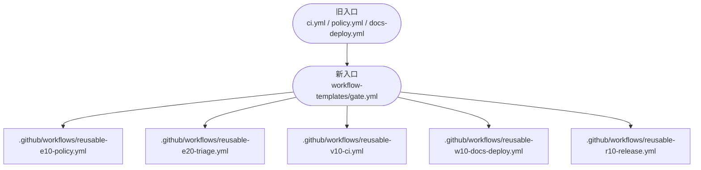
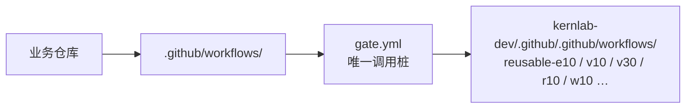
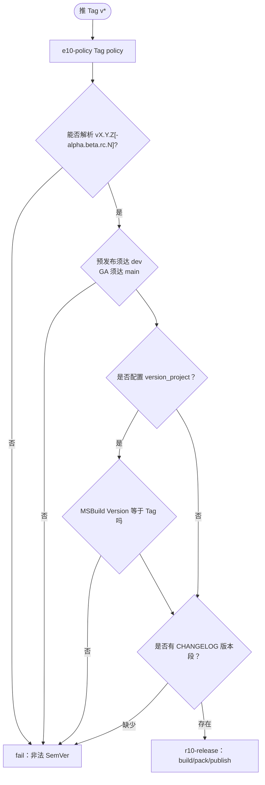
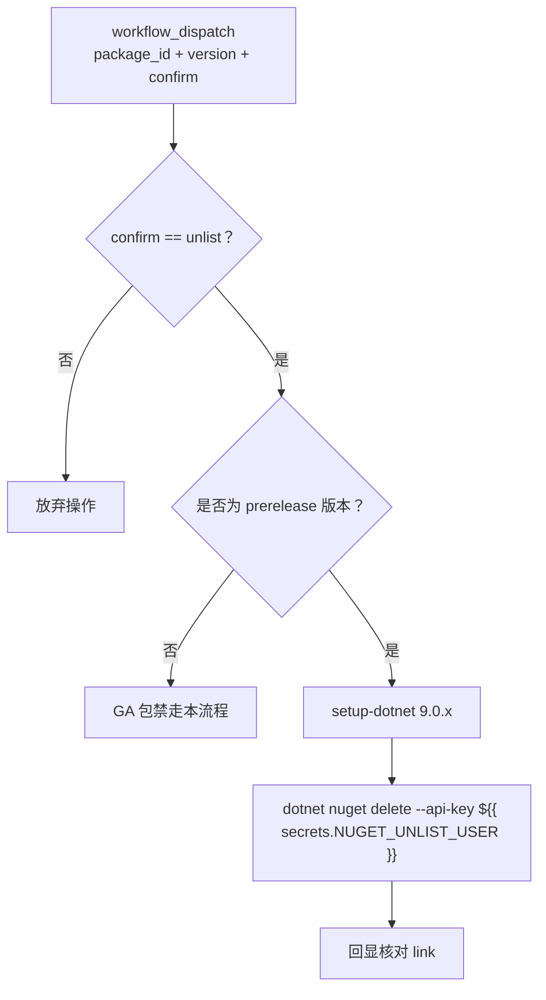

# 快速开始：为新仓库添加标准化 CI/CD

<cite>
**本文引用的文件**   
- [workflow-templates/gate.yml](file://workflow-templates/gate.yml)
- [workflow-templates/gate.properties.json](file://workflow-templates/gate.properties.json)
- [.github/workflows/o10-nuget-unlist.yml](file://.github/workflows/o10-nuget-unlist.yml)
- [.github/workflows/README.md](file://.github/workflows/README.md)
- [CI-GATE.md](file://CI-GATE.md)
- [VERSIONING.md](file://VERSIONING.md)
- [.github/workflows/reusable-e10-policy.yml](file://.github/workflows/reusable-e10-policy.yml)
- [.github/workflows/reusable-v10-ci.yml](file://.github/workflows/reusable-v10-ci.yml)
</cite>

## 目录
1. [简介](#简介)
2. [迁移概览：从三套模板到单一 Gate](#迁移概览从三套模板到单一-gate)
3. [仓库结构与工作流入口](#仓库结构与工作流入口)
4. [标准执行拓扑](#标准执行拓扑)
5. [从零创建新仓的 Gate 入口](#从零创建新仓的-gate-入口)
6. [可选组件与按需启用](#可选组件与按需启用)
7. [关键字输入对照表](#关键字输入对照表)
8. [首次 PR 预期输出](#首次-pr-预期输出)
9. [打 Tag、发布 NuGet 与回滚](#打-tag发布-nuget-与回滚)
10. [文档站构建与聚合部署](#文档站构建与聚合部署)
11. [常见故障排查](#常见故障排查)
12. [结论](#结论)

## 简介
KernLab 家族对代码仓提供“本地 Gate 调用桩 + 组织共享 reusable 实现”的流水线模型。每个业务仓库只需要一个 `.github/workflows/gate.yml`，由它分流强校验、分诊、完整 CI、docs 质量门、自动合并、发布和文档站。实际的 .NET 构建、测试、分支策略、SemVer Tag 校验、DocFX 站点生成和 NuGet 可信发布都集中在 `kernlab-dev/.github/.github/workflows/reusable-<节点码>.yml`。

新建仓库时：
1. 在 GitHub Actions 页面选择 “Standard CI (Gate)” 模板；或从本仓 `workflow-templates/gate.yml` 复制。
2. 将 `uses:` 路径保留为 `kernlab-dev/.github/.github/workflows/reusable-*.yml@main`（你的组织若有副本，再替换成真实仓库/分支）。
3. 仅补充你真正需要的 with 参数；遵循“零参数零槽位即运行”的简单仓约定。
4. 如果需要 publish、docfx 聚合、self-hosted runner 或自定义 test filter，才按表格增配。
5. 首次 PR 触发 e10 + e20 → v10 / v30；主分支 push 触发 w10-docs-deploy；Tag push 触发 r10-release。

**章节来源**
- [CI-GATE.md:1-20](file://CI-GATE.md#L1-L20)
- [CI-GATE.md:233-308](file://CI-GATE.md#L233-L308)

## 迁移概览：从三套模板到单一 Gate
旧指南参考的三套模板已退役：
- `workflow-templates/ci.yml`
- `workflow-templates/docs-deploy.yml`
- `workflow-templates/policy.yml`

当前单源入口是 `workflow-templates/gate.yml`，配套注册元数据为 `workflow-templates/gate.properties.json`。Gate 把过去分散的职责统一进以下节点层：

| 层 | 节点 | 是否默认启用 | 说明 |
|---|---|---:|---|
| 入口层 | `e10-policy` | 是 | PR 分支策略、Tag SemVer、Version/CHANGELOG/分支可达性 |
| 入口层 | `e20-triage` | 是 | 产生 `docs_only` 路由信号 |
| 验证层 | `v10-ci` | 是 | 完整 build + test 门禁 |
| 验证层 | `v30-docs` | 条件 | docs/* → dev 且纯文档变更时的快速通道 |
| 汇合层 | `m10-docs-merge` | 条件 | 快速通道成功后的 squash + 删分支 |
| 发布层 | `r10-release` | 条件 | 仅 `push refs/tags/v*` 时激活 |
| 文档站层 | `w10-docs-deploy` | 条件 | 仅 `push main` 时激活，内部有 paths 守卫防空转 |

老 reusable 文件名仍保留兼容映射，但新项目应直接使用 `reusable-<节点码>` 系列：

| 旧名 | 新名 |
|---|---|
| `reusable-policy-check.yml` | `reusable-e10-policy.yml` |
| `reusable-ci.yml` | `reusable-v10-ci.yml` |
| `reusable-docs-check.yml` | `reusable-v30-docs.yml` |
| `reusable-docs-merge.yml` | `reusable-m10-docs-merge.yml` |
| `reusable-release.yml` | `reusable-r10-release.yml` |
| `reusable-docs-deploy.yml` | `reusable-w10-docs-deploy.yml` |



**图示来源**
- [workflow-templates/gate.yml:1-89](file://workflow-templates/gate.yml#L1-L89)
- [.github/workflows/README.md:8-35](file://.github/workflows/README.md#L8-L35)

**章节来源**
- [workflow-templates/gate.yml:1-12](file://workflow-templates/gate.yml#L1-L12)
- [workflow-templates/gate.properties.json:1-6](file://workflow-templates/gate.properties.json#L1-L6)
- [.github/workflows/README.md:8-35](file://.github/workflows/README.md#L8-L35)

## 仓库结构与工作流入口
新仓库 `.github/workflows/` 中通常只有一个核心文件：



`gate.yml` 只声明：
- 触发事件：push main/tag、pull_request main/dev、workflow_dispatch，以及可选 schedule。
- concurrency：同一 ref 去重。
- permissions：contents read；建议加上 id-token write，避免发布阶段 startup_failure。
- 各 job 如何 uses 对应 reusable 工作流。
- 仅偏离组织缺省时的 with 参数。

**章节来源**
- [workflow-templates/gate.yml:1-89](file://workflow-templates/gate.yml#L1-L89)

## 标准执行拓扑
Gate 的标准路由如下：

```mermaid
sequenceDiagram
    participant Dev as "开发者"
    participant GH as "GitHub"
    participant Gate as "gate.yml"
    participant Policy as "e10-policy"
    participant Triage as "e20-triage"
    participant CI as "v10-ci"
    participant DocsQ as "v30-docs"
    participant Merge as "m10-docs-merge"
    participant Release as "r10-release"
    participant WebDocs as "w10-docs-deploy"

    Dev->>GH: "推送 PR/main/tag/schedule/dispatch"
    GH->>Gate: "实例化 Gate"
    Gate->>Policy: "恒跑强校验"
    Gate->>Triage: "恒跑分诊"

    alt "PR 到 main/dev"
      Policy-->>Gate: "green/red"
      alt "非法输入"
        Gate-->>Dev: "全链短路失败"
      else "合法 PR"
        Gate->>CI: "完整门禁"
        Gate->>DocsQ: "仅 docs/*→dev 且纯文档"
        DocsQ-->>Merge: "成功后 squash+删分支"
      end
    else "push main"
      Gate->>WebDocs: "paths 守卫决定是否空转"
    else "tag push refs/tags/v*"
      Gate->>Release: "发布管线"
    else "schedule/dispatch"
      Gate->>V["其他按需节点"]
    end
```

**图示来源**
- [workflow-templates/gate.yml:9-89](file://workflow-templates/gate.yml#L9-L89)
- [CI-GATE.md:83-150](file://CI-GATE.md#L83-L150)

## 从零创建新仓的 Gate 入口

### 第一步：选择模板
在 GitHub 仓库 Actions 页左侧模板列表中，使用名为 **Standard CI (Gate)** 的模板；其项目注册信息定义在：

| 字段 | 值 | 含义 |
|---|---|---|
| name | Gate | 工作流显示名称 |
| description | 单入口门禁——强校验+分诊+docs快速通道+完整CI | Actions 模板描述 |
| iconName | octicon-gear | Actions 图标 |
| categories | continuous-integration | Actions 分类 |

**章节来源**
- [workflow-templates/gate.properties.json:1-6](file://workflow-templates/gate.properties.json#L1-L6)

### 第二步：确认 uses 引用路径
Gate 示例已经引用组织共享 reusable：

```yaml
uses: kernlab-dev/.github/.github/workflows/reusable-e10-policy.yml@main
uses: kernlab-dev/.github/.github/workflows/reusable-v10-ci.yml@main
uses: kernlab-dev/.github/.github/workflows/reusable-r10-release.yml@main
```

如果你的组织用自有 fork：
- 改为 `your-org/.github/.github/workflows/reusable-<node>@your-branch`；
- 同时确保版本控制（main、release-* 或固定 SHA），不要在 prod gate 里用不稳定分支。

### 第三步：填写分支触发矩阵
默认 Gate 已覆盖主要场景：

| 场景 | on 条件 | 期望触发的节点 |
|---|---|---|
| main 推送 | `push.branches: [main]` | e10, e20, w10-docs-deploy（可能有 v40-heavy） |
| Tag 推送 | `push.tags: ['v*']` | e10 + r10-release |
| PR | `pull_request.branches: [main, dev]` | e10 + e20 + v10-ci（可能 v30-docs/m10） |
| 手动触发 | `workflow_dispatch:` | e10 + e20 + dispatch 配置的具体节点 |
| 定时任务 | `schedule:`（未启用） | e10 + e20 + v40-heavy（需取消注释） |

如果你需要 nightly 或更宽分支（例如支持 release/*），应在 gate.yml 的 `on.push.branches` 和 `on.pull_request.branches` 中增加，而不是绕过 e10-policy。

### 第四步：补充最小必要参数
对于大多数 .NET 简单仓，**零 with 参数就是可运行的**。如果你要偏离：

- 已有解决方案而非根自动发现：
  ```yaml
  with:
    solution: 'src/Tier.sln'
  ```
- 指定测试 glob：
  ```yaml
  with:
    test_projects: 'tests/*/*.csproj'
  ```
- 整个解决方案跑一次 dotnet test：
  ```yaml
  with:
    test_solution: true
  ```
- 指定筛选类别：
  ```yaml
  with:
    test_filter: 'Category=Integration'
  ```
- 指定 runner（GitHub 托管或自建标签）：
  ```yaml
  with:
    runner: ubuntu-latest
  ```
- 多 runner 矩阵（如 win、Linux PVE 等）：
  ```yaml
  with:
    runners_matrix: '["win-runner","pve-runner"]'
    use_setup_dotnet: false
  ```

注意 `runners_matrix` 必须是 JSON 字符串；fromJSON 会把数组展开成对象维度，所以不能直接传裸数组。

### 第五步：Secret/Variable 准备
按组件逐步配置，不要一开始全部打开：

1. 仅做构建测试：不需要 Secret。
2. 文档站聚合部署：在仓库 Settings → Secrets → actions 添加 `DOCS_SYNC_TOKEN`。
3. NuGet 可信发布：在 nuget.org 登记 Trusted Publisher，并在仓库配置发布所需凭证。
4. 软下架工具：组织中央运维工具 `o10-nuget-unlist` 复用组织级 `NUGET_UNLIST_USER` Secret，产品仓无需额外 secret。

**章节来源**
- [workflow-templates/gate.yml:13-89](file://workflow-templates/gate.yml#L13-L89)
- [CI-GATE.md:134-170](file://CI-GATE.md#L134-L170)

## 可选组件与按需启用
Gate 的设计原则是“入口恒跑 + 下游按需”，典型状态如下：

| 节点 | Gate 默认状态 | 何时开启 | 必须配置 |
|---|---|---|---|
| e10-policy | 已启用 | 始终 | `version_project`、`changelog_file`（可选） |
| e20-triage | 已启用 | 始终 | 无 |
| v10-ci | 已启用 | 始终 | 仅偏离时用 with |
| v30-docs | 已启用 | docs/* → dev 且纯文档 PR | 无额外配置，依赖 triage 信号 |
| m10-docs-merge | 已启用 | 快速通道成功后且非 draft PR | `secrets.DOCS_MERGE_PAT` |
| r10-release | 已启用 | tag `refs/tags/v*` push | NuGet 发布凭据或 OIDC Trusted Publisher |
| w10-docs-deploy | 已启用 | push main | `product`、`project_paths`、`DOCS_SYNC_TOKEN`（可选） |

如果仓库不带 NuGet 包，不要强行启用发布逻辑，避免凭据缺失造成误报。只需让 e10 + v10 通过即可先上线 CI。

**章节来源**
- [workflow-templates/gate.yml:36-89](file://workflow-templates/gate.yml#L36-L89)
- [CI-GATE.md:55-75](file://CI-GATE.md#L55-L75)

## 关键字输入对照表

### Gate 层
| 参数 | 类型 | 默认值 | 作用 | 建议 |
|---|---|---|---|---|
| event triggers | YAML 事件 | push main/tag、PR main/dev、workflow_dispatch | 决定 Gate 何时被 GitHub 调度 | 按需加 schedule、分支 |
| concurrency.group | string | `gate-${{ github.workflow }}-${{ github.ref }}` | 同一 workflow 和 ref 的去重组 | 保持默认避免同 ref 并行风暴 |
| permissions.id-token | boolean/write | write（模板已写） | 为 r10-release OIDC publish 提供顶层授权 | 缺少会导致整个 workflow startup_failure |

**章节来源**
- [workflow-templates/gate.yml:9-26](file://workflow-templates/gate.yml#L9-L26)

### e10-policy 输入
| 参数 | 类型 | 默认值 | 作用 | 建议填写方式 |
|---|---|---|---|---|
| `version_project` | string | 空 | 读取 MSBuild Version 做 Tag↔Version 校验 | 填继承 `Directory.Build.props` 的代表性 csproj |
| `changelog_file` | string | `CHANGELOG.md` | 检查 CHANGELOG 是否存在对应版本号段落 | 通常保留默认 |
| `tag_prefix` | string | 空 | 允许非 v* 前缀（如 `runtime-`） | 标准 SemVer 前缀留空 |
| `dotnet_version` | string | `8.0.422` | 读 Version 所用的 SDK | 与团队约定一致 |
| `require_dev_for_prerelease` | boolean | true | 预发布 Tag 必须可达 dev | 默认启用 |
| `require_main_for_ga` | boolean | true | GA Tag 必须可达 main | 默认启用 |

**章节来源**
- [.github/workflows/reusable-e10-policy.yml:22-44](file://.github/workflows/reusable-e10-policy.yml#L22-L44)

### v10-ci 输入
| 参数 | 类型 | 默认值 | 作用 | 建议 |
|---|---|---|---|---|
| `runner` | string | `ubuntu-latest` | 单 runner 标签 | GitHub 托管默认值 |
| `runners_matrix` | string | 空 | 多 runner JSON 数组字符串 | 自建机场景使用 |
| `use_setup_dotnet` | boolean | true | 是否在 runner 上安装 .NET | 自建预装 SDK 设为 false |
| `dotnet_version` | string | `8.0.x` | SDK 版本 | 精确优于 latestMajor |
| `build_config` | string | `Release` | 构建配置 | 一般 Release |
| `solution` | string | 空 | 解决方案路径；空则自动发现 | 大型仓显式 sln |
| `test_projects` | string | `tests/*/*.csproj` | 测试工程 glob | 指向测试项目集合 |
| `test_retries` | string | `0` | 每个测试目标失败重试次数 | 抖动套件用 1–2 |
| `test_solution` | boolean | false | 对整个 solution 跑一次测试 | 大仓减少 vstest 多次启动 |
| `test_filter` | string | 空 | dotnet test 过滤表达式 | 按 Category/Severity 筛选 |
| `install_aot_toolchain` | boolean | false | Linux 安装 NativeAOT clang/zlib | 仅 AOT 探针测试开启 |
| `ui_project_path` | string | 空 | 卫星 UI 工程相对路径 | 如 `src/ui` |
| `ui_node_version` | string | `20` | UI Node 版本 | 与 package.json engines 一致 |
| `ui_build_command` | string | `run build` | npm -C <ui> 后执行的命令 | 家族 Vue 默认 `run build` |

**章节来源**
- [.github/workflows/reusable-v10-ci.yml:17-70](file://.github/workflows/reusable-v10-ci.yml#L17-L70)

### r10-release 与 w10-docs-deploy 常见输入
| 参数 | 所属组件 | 说明 |
|---|---|---|
| `skip_pack` | r10-release | 首包空跑或暂不打包时使用 |
| `skip_publish` | r10-release | 自行发布或避免 reused 载体身份 401 时使用 |
| `pack_projects` | r10-release | 不用 IsPackable 扫描时显式列出 csproj |
| `pack_root` | r10-release | IsPackable=true 扫描根目录 |
| `product` | w10-docs-deploy | kernlab-docs sites/ 下的产品目录名 |
| `project_paths` | w10-docs-deploy | 所有要生成 API 文档的 csproj |
| `DOCS_SYNC_TOKEN` | w10-docs-deploy | kernlab-docs 聚合部署 PAT；未配置仅生成 artifact |

**章节来源**
- [workflow-templates/gate.yml:75-89](file://workflow-templates/gate.yml#L75-L89)
- [CI-GATE.md:172-200](file://CI-GATE.md#L172-L200)

## 首次 PR 预期输出
第一次 PR（例如 feat/x → dev）应依次看到：

1. **e10-policy**：打印 PR 来源和目标分支，若无问题显示分支策略通过。
2. **e20-triage**：分析 diff 并返回 `docs_only` 信号。
3. **v10-ci**：checkout → setup-dotnet → build → test；日志中出现 Setup .NET、Build、Test，以及每个 test project 的结果。
4. 若为 docs/* → dev 且纯文档：可能额外出现 **v30-docs**（docs 质量门）和 **m10-docs-merge**（squash 合并、删除临时分支）。
5. Tags、schedule 或非受控分支不会跑 v10-ci。

通过时 GitHub Actions UI 显示绿色 ✅；失败时应优先查看红色行附近的 `::error::` 输出和具体 job log，不要只看总进度条。

**章节来源**
- [workflow-templates/gate.yml:29-71](file://workflow-templates/gate.yml#L29-L71)
- [.github/workflows/reusable-v10-ci.yml:85-164](file://.github/workflows/reusable-v10-ci.yml#L85-L164)
- [.github/workflows/reusable-e10-policy.yml:66-95](file://.github/workflows/reusable-e10-policy.yml#L66-L95)

## 打 Tag、发布 NuGet 与回滚

### Tag 流程
对发布仓，推荐语义：
- GA 版本：`vX.Y.Z`，提交图可达 origin/main。
- 预发布版本：`vX.Y.Z-alpha.N`、`vX.Y.Z-beta.N` 或 `vX.Y.Z-rc.N`，默认要求提交图可达 origin/dev。
- 如有自定义前缀（如 `runtime-X.Y.Z`），应设置 `tag_prefix`，但不要和 VERSIONING.md 的 v* 实践混用。



**图示来源**
- [.github/workflows/reusable-e10-policy.yml:111-160](file://.github/workflows/reusable-e10-policy.yml#L111-L160)
- [workflow-templates/gate.yml:63-73](file://workflow-templates/gate.yml#L63-L73)

**章节来源**
- [workflow-templates/gate.yml:63-73](file://workflow-templates/gate.yml#L63-L73)
- [CI-GATE.md:134-150](file://CI-GATE.md#L134-L150)
- [VERSIONING.md:8-47](file://VERSIONING.md#L8-L47)

### r10-release 预期产物
- Artifacts 包含 `nupkg` 和 snupkg（取决于 pack 配置）。
- publish job 申请 OIDC token 并向 nuget.org 推送包。
- 成功后可在 https://www.nuget.org/packages/<包名>/versions 看到新版本。

若未启用发布能力，不要打开 r10-release；否则凭据缺失会被设计为“fail-loud”的安全信号，而不是静默跳过。

**章节来源**
- [workflow-templates/gate.yml:63-73](file://workflow-templates/gate.yml#L63-L73)
- [CI-GATE.md:134-170](file://CI-GATE.md#L134-L170)

### o10-nuget-unlist：组织中央软下架工具
`o10-nuget-unlist.yml` 不是每个仓库自带的，而是组织 Central Ops 工具。它面向已发布的 KernLab.* 包：

- **用途**：软下架 pre-release 包，隐藏版本而不影响已缓存消费者。
- **入口**：仅 workflow_dispatch。
- **必需输入**：
  - `package_id`：例如 `KernLab.Tier.Contracts`。
  - `version`：例如 `1.0.0-alpha.19`。
  - `confirm`：必须填入 `unlist`。
- **保护规则**：只允许含 prerelease 段的版本；正式版/GA 包被拒绝，走人工评审流程。
- **凭据**：组织级 Secret `NUGET_UNLIST_USER`；因本仓公开，组织 Secret 可直接投递到 Public 计划。
- **操作命令**：本质是 `dotnet nuget delete <Id> <Version> --source https://api.nuget.org/v3/index.json --non-interactive`。
- **结果核验**：包详情页应返回 404；包版本列表不再展示该版本。



**图示来源**
- [.github/workflows/o10-nuget-unlist.yml:1-64](file://.github/workflows/o10-nuget-unlist.yml#L1-L64)

**章节来源**
- [.github/workflows/o10-nuget-unlist.yml:1-64](file://.github/workflows/o10-nuget-unlist.yml#L1-L64)

## 文档站构建与聚合部署
文档站入口是 Gate 的 `w10-docs-deploy`：

- 触发：push main。
- 行为：先执行 docfx metadata 与 site 构建；如果未启用文档站路径或未带文档，内建守卫使其恒成功空转。
- 可选聚合：若配置 `DOCS_SYNC_TOKEN`，会触发 kernlab-dev/kernlab-docs 聚合，最终站点通常在 docs.kernlab.dev/<product>/ 可见。

Gate 默认没有暴露 product/project_paths，因为很多仓不部署独立文档站；如需启用，请在 `w10-docs-deploy` 的 with 中添加：

```yaml
with:
  product: 'tier'
  project_paths: 'src/Tier.Core/Tier.Core.csproj src/Tier.API/Tier.API.csproj'
```

**章节来源**
- [workflow-templates/gate.yml:75-89](file://workflow-templates/gate.yml#L75-L89)

## 常见故障排查

| 场景 | 现象 | 根因定位 | 解决步骤 |
|---|---|---|---|
| PR 直接被 Gate 阻断，只有 e10 失败 | e10-policy 输出红色，后续全链短路 | PR 头尾分支不符合分支策略 | 确认 base_ref 是 main 或 dev；main 只接受 dev/hotfix/*；dev 只接受 feat/*、fix/*、docs/*、chore/*、hotfix/* 或 main 回灌。 |
| gate.yml 一推就整个 workflow startup_failure | 连 job log 都没进去 | 顶层 `id-token: write` 未被正确授予 | 确保 gate.yml 顶层有 `permissions.id-token: write`；不要只在 r10-release job 中写，GitHub 规范要求 caller 拥有 ≥ reusable 所需权限。 |
| Tag 报不是合法 SemVer | e10-policy Tag policy 失败 | Tag 不符合 vX.Y.Z[-alpha.N/-beta.N/-rc.N] | 参照 VERSIONING.md，删除旧 Tag 后以正确格式重新打。 |
| 预发布 Tag 不可达 dev 或 GA 不可达 main | Tag policy 报告不可达 | 提交图不在目标分支上 | 确认 Tag 基于正确的分支历史；pre-release 在 dev，GA 在 main。 |
| Tag 版本与 MSBuild Version 不一致 | Tag 不等于 version_project 的 Version | 只改了一处而没有同步 | 同步 NuGet 包期望版本与 Source 工程的 Version，然后重新打 Tag。 |
| CHANGELOG 缺少版本段 | Tag policy 报没有指定版本段 | CHANGELOG.md 中没有与 Tag 对应标题段落 | 添加与 Tag 完全一致的版本段落后再打 Tag。 |
| .NET install/setup 在中国网络下卡死 | Runner 长时间停在 SDK/runtime 下载 | setup-dotnet 拉取基础运行时不稳定 | 改用预装 SDK 的 runner，并把 `use_setup_dotnet` 改为 false。 |
| 单元测试偶尔偶发失败 | job 红但重试后可过 | runner 噪音或并发测试不稳定 | 合理调整 `test_retries`；长稳端到点测试不要放进 PR 常规 job。 |
| v10-ci 没有跑任何测试 | 只看到 build | test_projects 为空或 solution 模式未配置 | 设置 `test_projects: 'tests/*/*.csproj'`，或启用 `test_solution: true`。 |
| docs 快速通道没有自动合并 | v30 绿但 m10 没出现 | triage 判断有代码变更，不是纯文档 PR，或 PR 是 draft | 区分 docs/* 纯文档修改和夹带代码的 PR；draft PR 不会触发自动合并。 |
| 文档站没有聚合部署 | 文档构建成功但站不可见 | 未配置 DOCS_SYNC_TOKEN | 在仓库 Settings → Secrets → actions 添加 `DOCS_SYNC_TOKEN`，并确保其对 kernlab-docs 有 actions:write。 |
| r10-release 直接 startup_failure 或报 OIDC 未授权 | 发布 job 无法登录 nuget.org | OIDC Token 未获授权 | 先在 nuget.org 登记 Trusted Publisher；绑定 owner、repository 和 reusable-r10-release.yml 路径；再在仓库配置所需凭据。 |
| 想下架 GA 包但 o10-nuget-unlist 拒绝 | 报错为非 prerelease 版本 | 正式包不走该 workflow | 走人工评审流程；该工具专用于清理预发布孤包。 |
| 新建仓库看不到模板 | 仓库还没初始化 Actions 模板 | 尚未在 GitHub Actions 中实例化 gate | 使用 Actions 页面中的 Standard CI (Gate) 模板，或复制 `workflow-templates/gate.yml` 并提交到 `.github/workflows/`。 |

**章节来源**
- [.github/workflows/reusable-e10-policy.yml:66-160](file://.github/workflows/reusable-e10-policy.yml#L66-L160)
- [.github/workflows/reusable-v10-ci.yml:71-164](file://.github/workflows/reusable-v10-ci.yml#L71-L164)
- [.github/workflows/o10-nuget-unlist.yml:1-64](file://.github/workflows/o10-nuget-unlist.yml#L1-L64)
- [CI-GATE.md:134-200](file://CI-GATE.md#L134-L200)

## 结论
对新仓库而言，最稳妥的路径是：**复制 `workflow-templates/gate.yml`，只改事件/路径/必要的 with，把构建、测试、策略、文档和发布逻辑留给 `kernlab-dev/.github/.github/workflows/reusable-*`**。Gate 让初学者的第一条 PR 进入标准化门禁，也让有经验开发者能迅速对照 CI-GATE 规范和各 reusable 文件落地复杂分支矩阵、自托管 runner、DocFX 站点和 NuGet Trusted Publishing。首次上线建议顺序：e10 + v10 → docs 快速通道 → w10-docs-deploy → r10-release + o10-nuget-unlist 回滚流程；每加一个组件只改最小必要配置，以便失败时精确定位。