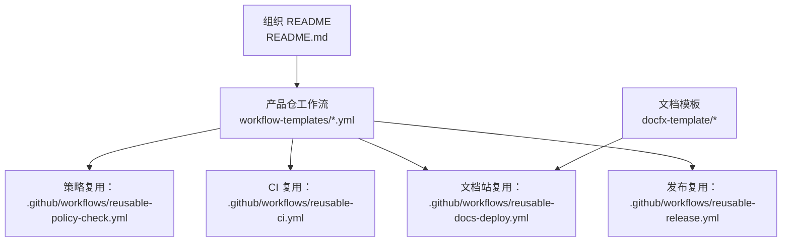
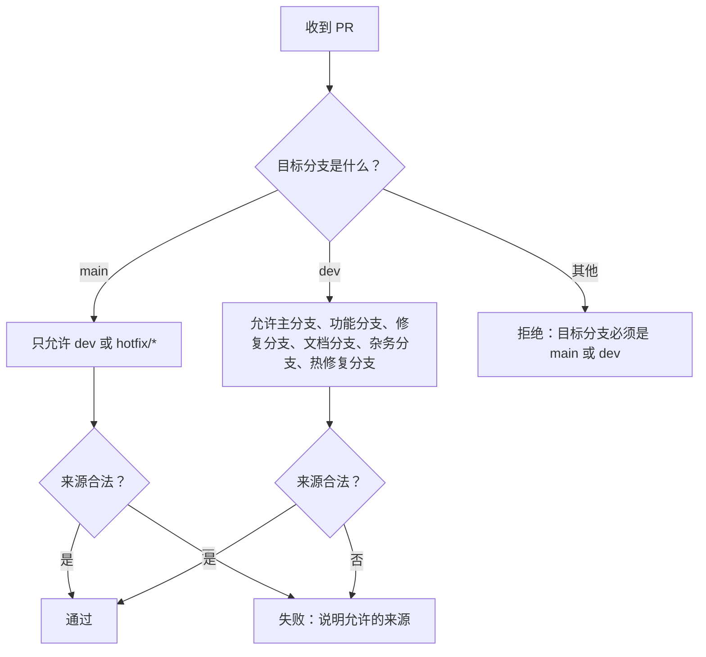
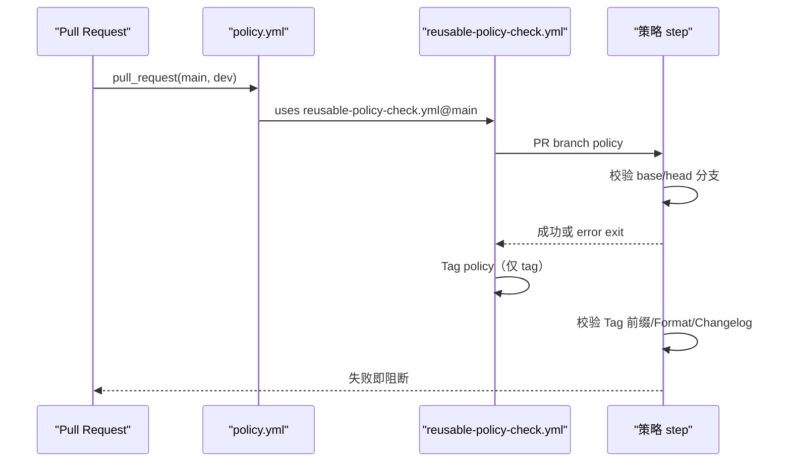
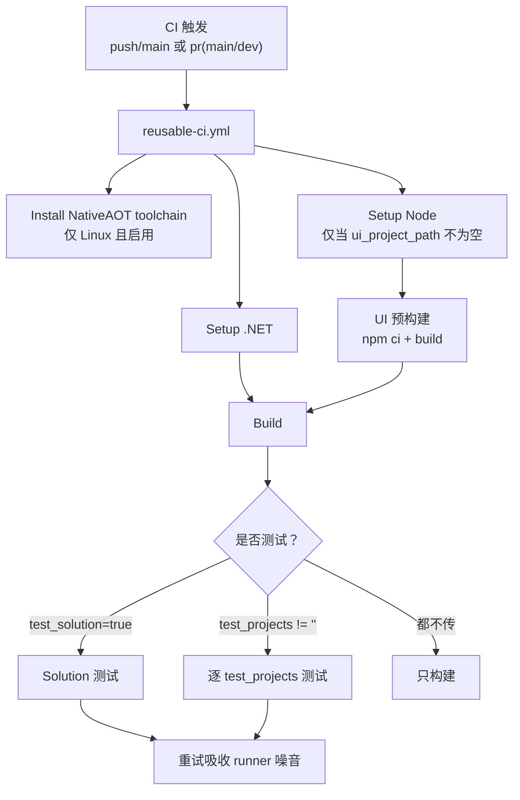
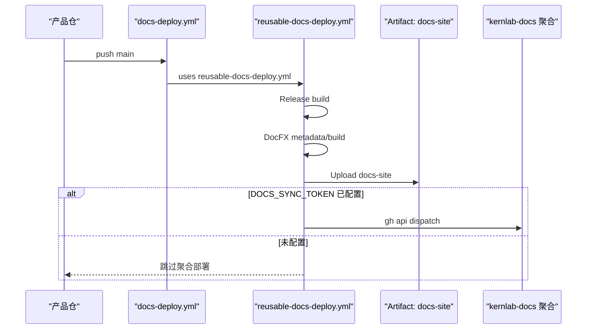
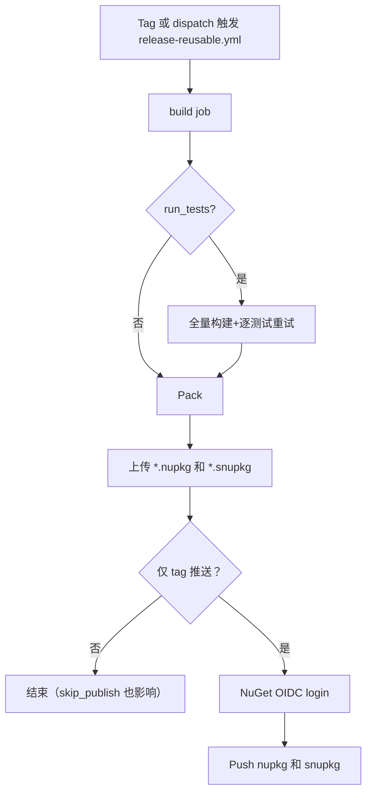

# 故障排除手册

<cite>
**本文引用的文件**   
- [reusable-policy-check.yml](file://.github/workflows/reusable-policy-check.yml)
- [reusable-ci.yml](file://.github/workflows/reusable-ci.yml)
- [reusable-docs-deploy.yml](file://.github/workflows/reusable-docs-deploy.yml)
- [reusable-release.yml](file://.github/workflows/reusable-release.yml)
- [policy.yml](file://workflow-templates/policy.yml)
- [ci.yml](file://workflow-templates/ci.yml)
- [docs-deploy.yml](file://workflow-templates/docs-deploy.yml)
- [docfx.json](file://docfx-template/docfx.json)
- [toc.yml](file://docfx-template/toc.yml)
- [README.md](file://README.md)
</cite>

## 目录

1. [引言](#引言)
2. [项目结构总览](#项目结构总览)
3. [通用排查清单](#通用排查清单)
4. [策略检查失败排查](#策略检查失败排查)
5. [CI 构建与测试失败排查](#ci-构建与测试失败排查)
6. [文档构建失败排查](#文档构建失败排查)
7. [发布失败排查](#发布失败排查)
8. [关键组件流程图](#关键组件流程图)
9. [结论](#结论)

## 引言

本仓库提供 KernLab 组织的“单源复用”流水线：

- `.github/workflows/` 下四条 `workflow_call` reusable workflow，承载实际逻辑；
- `workflow-templates/` 是各产品仓可从 Actions 模板选用的调用桩；
- `docfx-template/` 是文档站模板骨架（DocFX 配置、导航、首页、样式）；
- `README.md` 说明本仓是组织级特殊仓库，负责公共门面、默认社区文件、工程文档模板和家族共享流水线。

这意味着：**大多数故障不能只看产品仓自己的 workflow file，必须对照 reusable 实现中 step name、环境变量和输入参数**。本文按问题类别整理现象、可能原因、定位步骤和修复方案，并给出最小可复现的 YAML 引用位置。

## 项目结构总览



**图表来源**
- [README.md:10-27](file://README.md#L10-L27)
- [reusable-policy-check.yml:1-20](file://.github/workflows/reusable-policy-check.yml#L1-L20)
- [reusable-ci.yml:1-45](file://.github/workflows/reusable-ci.yml#L1-L45)
- [reusable-docs-deploy.yml:1-20](file://.github/workflows/reusable-docs-deploy.yml#L1-L20)
- [reusable-release.yml:1-20](file://.github/workflows/reusable-release.yml#L1-L20)
- [docfx-template/docfx.json:1-10](file://docfx-template/docfx.json#L1-L10)

**章节来源**
- [README.md:1-28](file://README.md#L1-L28)

## 通用排查清单

### 1. 打开 verbose 日志

在 Actions UI 中：

1. 进入失败 run 详情页；
2. 点击左侧对应 job；
3. 找到对应 step；
4. 展开 step 后右上角选择 **View raw logs** 或查看 shell 输出面板；
5. 若输出被截断，优先把该 step 从 reusable 中独立出来，确认是 .NET/Node/DocFX 哪一层失败。

对于本地验证：

| 层次 | 推荐命令 | 作用 |
|---|---|---|
| .NET 构建 | `dotnet build -c Release -v q` | 先排除编译错误是否与 GitHub runner 网络相关 |
| .NET 测试 | `dotnet test -c Release --no-build` | 验证本地已构建产物是否可执行 |
| NuGet pack | `dotnet pack -c Release -o artifacts -p:Version=1.2.3-preview.1` | 验证包清单和版本号 |
| DocFX metadata | `docfx metadata docfx.json` | 验证 DLL + XML 注释是否可读 |
| DocFX 站点 | `docfx build docfx.json` | 验证模板、toc、index 及资源路径 |
| Node 预构建 | `npm ci --prefix src/ui && npm run build` | 隔离卫星 UI 环境异常 |

提示：如果本地通而 GitHub 不通过，优先怀疑 runner 网络、SDK 版本切换、缓存或权限；如果本地也不通，优先固定 SDK 和依赖版本。

### 2. 确认 workflow 引用的是期望分支

GitHub Actions 使用 tag/commit ref 决定引用版本。产品仓应重点检查：

```text
uses: kernlab-dev/.github/.github/workflows/<name>.yml@<ref>
```

常见陷阱：

- 仍指向旧 tag，没有随组织流水线升级；
- PR 未更新调用方 `uses:`；
- 分支模式为 `main`/`dev`，但产品仓引用了 `master` 或其他自定义分支；
- 自建 runner 场景误保留了 `setup-dotnet`，导致 double setup 或下载卡死。

定位方法：

1. 在 Actions UI 中点击蓝色 `uses:` URL，跳转到底层 reusable 当前 commit；
2. 对比模板中预期 ref；
3. 对 PR 触发，查看 job 启动时的 event summary，确认 `head_ref`/`base_ref`。

### 3. 如何缩小问题范围

建议遵循以下顺序：

1. **只看一次失败的 job 和 step**：不要同时对比多个 run。
2. **先在本地用相同命令跑一遍**：区分 runner 环境与代码逻辑问题。
3. **将复杂 bash 逻辑抽到临时 step**：只留下必要 echo，确认传入变量是否正确。
4. **固定精确版本**：避免 `latestMajor` 或 `x` 滚动到未知组合。
5. **逐项关闭可选能力**：如先去掉 `run_tests`、`ui_project_path`、`install_aot_toolchain`、DOC_SYNC_TOKEN。

**章节来源**
- [README.md:10-27](file://README.md#L10-L27)

## 策略检查失败排查

### A. 分支名不是 main 或 dev

**现象**

PR 校验 job 报 PR 目标分支非法，例如指出 base 不是 `main` 或 `dev`。

**可能原因**

- PR 的目标分支写成了 `master`、`release`、`develop` 等；
- 团队分支模型要求 PR 只能提交到 `main` 或 `dev`；
- 产品仓在 `policy.yml` 中将策略扩展到了其他分支，但没有更新 reusable 分支规则。

**定位步骤**

1. 在 Actions UI 中打开对应的 policy job；
2. 查找 step name 为 **PR branch policy** 的输出；
3. 查看日志中的 `BASE` 和 `HEAD` 值；
4. 确认 PR 页面的 Base branch 是否确实是 `main` 或 `dev`。

**修复方案**

- 修改 PR 目标分支为 `main` 或 `dev`；
- 若需要支持其他分支，应更新策略规则而不是绕过检查；
- 如果使用自定义分支模型，应在仓库内部流程中明确约定。

最小可复现参考：

- 策略实现在 `reusable-policy-check.yml` 的 `policy` job。
- 模板调用在 `policy.yml`。

**章节来源**
- [reusable-policy-check.yml:37-74](file://.github/workflows/reusable-policy-check.yml#L37-L74)
- [policy.yml:1-21](file://workflow-templates/policy.yml#L1-L21)

### B. PR 合并规则违反

**现象**

- 向 `main` 提 PR 报错，提示只允许来自 `dev` 或 `hotfix/*`；
- 向 `dev` 提 PR 报错，提示来源不符合 `feat/*`、`fix/*`、`docs/*`、`chore/*`、`hotfix/*` 或 `main`。

**可能原因**

- 功能分支命名不规范；
- 历史分支直接提交到保护分支；
- `hotfix/*` 与 `feat/*` 等类别混淆。

**定位步骤**

1. 查看 **PR branch policy** step 的错误输出；
2. 检查 `head_ref`：这是 PR 来源分支；
3. 检查 `base_ref`：这是 PR 目标分支；
4. 根据以下规则判断：

| 目标分支 | 允许的 PR 来源 |
|---|---|
| `main` | `dev`、`hotfix/*` |
| `dev` | `main`、`feat/*`、`fix/*`、`docs/*`、`chore/*`、`hotfix/*` |

**修复方案**

- 创建符合命名的新分支重新提交 PR；
- 若是 hotfix，应使用 `hotfix/xxx`；
- 如果是团队临时需求，请在分支命名上保持一致性。



**章节来源**
- [reusable-policy-check.yml:37-74](file://.github/workflows/reusable-policy-check.yml#L37-L74)

### C. Tag 不符合 `vMAJOR.MINOR.PATCH[-prerelease]` 格式

**现象**

Tag push 触发 policy 失败，错误中出现 SemVer 格式说明，或直接指出缺少版本前缀。

**可能原因**

- Tag 写成 `1.0.0` 而非 `v1.0.0`；
- Tag 包含非法字符，如大写字母段、空格、日期型后缀；
- 使用了 `tag_prefix` 但未匹配登记前缀；
- 预发布类型不是支持的 `alpha.N`、`beta.N`、`rc.N`；
- 预发布 Tag 未可达 `dev`，或 GA Tag 未可达 `main`。

**定位步骤**

1. 在 Actions UI 打开 policy job；
2. 查看 **Tag policy** step 日志中的 `tag version=` 和实际 Tag；
3. 关注以下错误片段之一：

   - 缺登记前缀；
   - Tag 必须是 vX.Y.Z 格式；
   - 不是合法 SemVer；
   - 预发布 Tag 必须指向 dev 可达提交；
   - GA Tag 必须指向 main 可达提交。

4. 本地验证 tag 是否符合正则语义：

   - 必须以 `v` 开头；
   - 主版本、次版本、修订号都是十进制数字；
   - 预发布只能是 `-alpha.N`、`-beta.N`、`-rc.N`。

**修复方案**

- 删除无效 Tag：`git tag -d <tag>`，然后在远程再删一次；
- 重新创建合法 Tag，例如：`v1.2.3-alpha.1`；
- 如果是预发布版本，确保提交可从 `dev` 检出；
- 如果是正式版本，确保提交可从 `main` 检出；
- 如果有 `tag_prefix`，确保 Tag 以该前缀开头。

最小可复现参考：

- 规则处理逻辑在 `reusable-policy-check.yml` 的 **Tag policy** step。

**章节来源**
- [reusable-policy-check.yml:76-159](file://.github/workflows/reusable-policy-check.yml#L76-L159)

### D. CHANGELOG 缺少必填段落

**现象**

Policy 报 `CHANGELOG.md` 没有指定版本的版本段；或者指出缺少该文件。

**可能原因**

- 新增了 Tag 但没有新增对应 `## [vX.Y.Z]` 段落；
- CHANGELOG 使用了不同的分段语法；
- 输入参数 `changelog_file` 指向了错误的文件名；
- 本地 CHANGELOG 与远端不一致。

**定位步骤**

1. 在 policy job 中找到 **Tag policy** 的变更输出；
2. 确认 `changelog_file` 参数是否为 `CHANGELOG.md` 或其他自定义路径；
3. 检查对应 csproj 的 MSBuild Version 与 Tag 是否一致；
4. 搜索 CHANGELOG 中是否真的存在该版本段；
5. 注意该检查会按版本号转义点号，因此版本号必须精确。

**修复方案**

- 在对应文件顶部或指定分段中添加缺失版本段；
- 确保版本号与 `Directory.Build.props` / csproj 的 `Version` 属性一致；
- 若使用非标准文件路径，请同步更新 `version_project`、`changelog_file`、`dotnet_version`。

最小可复现参考：

- 模板调用示例在 `policy.yml`。
- Tag/CHANGELOG 校验在 `reusable-policy-check.yml`。

**章节来源**
- [policy.yml:9-21](file://workflow-templates/policy.yml#L9-L21)
- [reusable-policy-check.yml:120-158](file://.github/workflows/reusable-policy-check.yml#L120-L158)

### E. `policy.yml` 未正确 uses 对应 reusable workflow

**现象**

- PR 不触发策略检查；
- 使用的 reusable 版本过旧；
- 新建仓直接从模板选用后忘记修改 `version_project`。

**定位步骤**

1. 打开产品仓根部的 `policy.yml`；
2. 检查 `on.pull_request` 的 branches；
3. 检查 `jobs.policy.uses` 是否指向 `kernlab-dev/.github/.github/workflows/reusable-policy-check.yml@main`；
4. 检查是否保留了对应输入：`version_project`、`changelog_file`、`dotnet_version`。

**修复方案**

- 确保 `uses` 地址正确；
- 确保 `version_project` 指向继承 `Directory.Build.props` 的代表性 csproj；
- 确保 `changelog_file` 确实存在于仓库；
- 如果不需要版本对齐，可将 `version_project` 置空（由 reusable 输入默认行为决定）。

最小可复现参考：

- 模板参考：[policy.yml:9-21](file://workflow-templates/policy.yml#L9-L21)。

**章节来源**
- [policy.yml:1-21](file://workflow-templates/policy.yml#L1-L21)

## CI 构建与测试失败排查

### A. .NET SDK 版本不匹配

**现象**

- 构建阶段报 SDK 不可用；
- 本地能通过，GitHub 失败；
- 上游 SDK 升级后突然失败；
- reusable-release 里发布面与构建面 SDK 行为不一致。

**可能原因**

- CI reusable 的 `dotnet_version` 使用的是通配形式；
- 产品仓的 `global.json` 强制了另一个版本；
- 自建 runner 预装 SDK 版本与托管 runner 不同；
- release 阶段显式移除 `global.json` 后改用独立 SDK 版本。

**定位步骤**

1. 打开 CI job 中 **Setup .NET** step 的日志；
2. 检查实际安装的 `dotnet-version` 是否等于预期；
3. 若使用自定义模板，检查 `workflow-templates/ci.yml` 的 `runner`、`runners_matrix`、`use_setup_dotnet`；
4. 如果发布失败，再检查 `reusable-release.yml` 的 `dotnet_build` 与 `dotnet_publish`。

**修复方案**

- 在 CI reusable 中指定精确版本；
- 自建 runner 设置 `use_setup_dotnet: false`；
- release 阶段如需 OIDC Trusted Publishing，确保 publish SDK 满足 `NuGet/login` 要求；
- 不要混用 `latestMajor` 与精确 SDK。

最小可复现参考：

- CI reusable SDK 安装行。
- release reusable 构建面与发布面 SDK。

**章节来源**
- [reusable-ci.yml:54-63](file://.github/workflows/reusable-ci.yml#L54-L63)
- [reusable-release.yml:99-126](file://.github/workflows/reusable-release.yml#L99-L126)

### B. NativeAOT 编译错误

**现象**

- Linux runner 出现 `clang`、`zlib` 相关找不到；
- 本地可通过，GitHub 失败；
- 仅在启用特定测试或 AOT 工具链时失败。

**可能原因**

- 启用了 `install_aot_toolchain`，但 runner 未安装 `clang` 和 `zlib1g-dev`；
- 只安装了 clang 未安装 zlib 开发头；
- Windows runner 上不应启用 Linux 专属工具链安装逻辑。

**定位步骤**

1. 在 CI job 中查找 **Install NativeAOT toolchain (Linux clang)** step；
2. 确认 `inputs.install_aot_toolchain` 与 `runner.os == 'Linux'` 条件；
3. 查看 apt 安装日志是否有包缺失或网络失败；
4. 本地若模拟 Linux，需在 WSL 或容器中使用相同系统包。

**修复方案**

- 只在确实需要 AOT 探针测试的腿开启 `install_aot_toolchain`；
- 确保 Linux runner 能访问 apt 源；
- 若仅需普通 .NET 构建，关闭该选项；
- 将此类长尾步骤放入专门的 nightly 或 manual pipeline。

最小可复现参考：

- 条件化安装步骤。

**章节来源**
- [reusable-ci.yml:65-74](file://.github/workflows/reusable-ci.yml#L65-L74)

### C. 测试被 `runners_matrix` 或 `test_projects` 排除后漏测

**现象**

- 某测试从未执行；
- CI 仅显示 build 成功，看不到测试报告；
- 改用 `test_solution: true` 或改 glob 后测试才出现。

**可能原因**

- `runners_matrix` 没有覆盖所需 OS/runner；
- `test_projects` 的 glob 匹配不到目录下的 csproj；
- 使用 `for proj in $TEST_PROJECTS` 遍历后遇到不存在路径会跳过；
- `test_solution=true` 和 `test_projects` 同时配置时逻辑走 solution 模式；
- CI 超时时间只有 30 分钟，长测试可能中途结束。

**定位步骤**

1. 查看 **Test（solution 一次成型 / 逐工程…）** step 输出；
2. 打印 `TEST_PROJECTS` 实际展开结果；
3. 检查是否在目标 runner 上执行：

```text
runners_matrix: '[\"win-ci\",\"pve-ci\"]'
```

4. 在本地运行同样的 glob 和命令，验证路径是否真实存在；
5. 若使用 solution 模式，确认 `test_solution` 和 `solution` 都传入了；
6. 如果测试本身很长，不要把耗时逻辑放进 PR CI，应移到主分支单独管线。

**修复方案**

- 修正 `test_projects` glob 使其至少匹配一个测试 csproj；
- 为多 runner 矩阵补充对应 runner 标签；
- 对时序敏感用例增加 `test_retries`；
- 超大测试集合优先用 `test_solution: true`；
- 30 分钟超时内无法完成的测试应移出常规 PR CI。

最小可复现参考：

- CI reusable matrix 定义与 steps。
- 模板调用中的测试入口。

**章节来源**
- [reusable-ci.yml:88-164](file://.github/workflows/reusable-ci.yml#L88-L164)
- [ci.yml:23-42](file://workflow-templates/ci.yml#L23-L42)

### D. Action runner 网络超时

**现象**

- `actions/checkout` 慢但不一定失败；
- `setup-dotnet` 拉取 runtime 卡住；
- 依赖下载失败、curl 超时；
- 偶尔重试后恢复。

**可能原因**

- China 网络的托管 runner 随机连接失败；
- CDN 限流或代理不可达；
- 自建 runner 尚未预装 SDK；
- 缓存失效或 lock 文件过期。

**定位步骤**

1. 查看具体失败 step 的原始日志；
2. 确认是否是第一次下载 large runtime；
3. 在 `reusable-ci.yml` 中检查 `use_setup_dotnet`：
   - 托管机保持 `true`；
   - 自建机设为 `false`；
4. 本地使用相同 SDK 版本重复执行。

**修复方案**

- 托管环境：固定 SDK 版本，等待网络恢复；
- 自建环境：预装 SDK，并把 `use_setup_dotnet` 设为 `false`；
- 不要为了绕过网络问题盲目加全局重试，应先识别是哪一步卡住；
- 长期优化应由 runner 运维解决，不应在每个 action 里堆 retry。

最小可复现参考：

- CI reusable 的 setup-dotnet 条件和文档注释。

**章节来源**
- [reusable-ci.yml:4-30](file://.github/workflows/reusable-ci.yml#L4-L30)

### E. Node / vite / vue-tsc 卫星 UI 预构建环境异常

**现象**

- dotnet build 之前 UI 构建失败；
- npm 找不到 `vue-tsc`；
- `npm ci` 因 lock 文件与运行时不一致失败；
- 本地 `npm install` 成功，GitHub 失败。

**可能原因**

- `ui_project_path` 为空或未启用；
- `ui_node_version` 与项目依赖不匹配；
- `package-lock.json` 不在缓存路径；
- `ui_build_command` 不是项目实际的 npm script；
- Node 版本未在 `actions/setup-node` 中安装。

**定位步骤**

1. 在 CI job 中查找 **Setup Node（卫星 UI 预构建）** step；
2. 查看 **UI 预构建（npm ci + 构建……）** step 的退出码；
3. 检查 `ui_project_path`、`ui_node_version`、`ui_build_command`；
4. 本地使用相同 node 版本复现：

```text
npm ci --prefix <ui_project_path>
npm run build --prefix <ui_project_path>
```

**修复方案**

- 确保 `package-lock.json` 与源码一起提交；
- 固定 Node 版本到项目实际需要的 LTS；
- 如果卫星 UI 暂不需预构建，先把 `ui_project_path` 留空；
- 若需启用，按模板示例传递参数；
- 将 UI 依赖锁定和 Node 版本约束在项目自身工程中维护。

最小可复现参考：

- Reusable CI 中 Node 与 npm steps。
- CI 模板中对 UI 输入参数的注释。

**章节来源**
- [reusable-ci.yml:76-97](file://.github/workflows/reusable-ci.yml#L76-L97)
- [ci.yml:33-42](file://workflow-templates/ci.yml#L33-L42)

## 文档构建失败排查

### A. DocFX 模板 `toc.yml` 循环引用

**现象**

- `docfx build` 报 toc 警告或链接无效；
- 站点部分导航缺失；
- index 或 API reference 页面打不开；
- 构建没立刻失败，但在部署后发现 404。

**可能原因**

- `toc.yml` 引用了不会生成的页面；
- 使用了绝对路径而不是相对路径；
- coordination 短名映射与实际文档路径不一致；
- docfx.json 中 content 映射未生成目标目录；
- 复制模板后漏改 `<层目录>`、`<项目>`、`<产品名>` 占位符。

**定位步骤**

1. 打开 `docfx-template/toc.yml` 中每条 `href`；
2. 对照 `docfx-template/docfx.json` 的 `build.content`；
3. 确认所有 `.html` 最终会在 `_site` 中生成；
4. 特别检查：

   - `api/index.html`；
   - `docs/<层>/<入口页>.html`；
   - `docs/coordination/<短名>`；
   - 根 `index.html`。

5. 运行本地 `docfx build docfx.json` 并检查 `_site`。

**修复方案**

- `toc.yml` 只引用确实存在的页面；
- 所有站内链接使用相对路径；
- 对 coordination 内容使用短名而不是深层镜像路径；
- 复制模板后替换全部占位符；
- 每次新增导航项都要同步 docfx.json 的 content mapping。

最小可复现参考：

- toc.yml 骨架；
- docfx.json 元数据与 content/resource/globalMetadata 三段。

**章节来源**
- [docfx-template/toc.yml:1-14](file://docfx-template/toc.yml#L1-L14)
- [docfx-template/docfx.json:1-63](file://docfx-template/docfx.json#L1-L63)

### B. `index.md` 无法加载

**现象**

- DocFX 构建报无法解析 `index.md`；
- 站点首页 404；
- 本地无错，GitHub 有错。

**可能原因**

- 产品仓没有把 `index.md` 复制到 `docs-site/`；
- docfx.json 中 root content 的 files 不包含 `index.md`；
- 文件名大小写不同；
- `working-directory` 设置为 `docs-site`，但 index 文件位于父目录未被声明。

**定位步骤**

1. 查看文档构建 step：`working-directory: docs-site`；
2. 检查调用桩 `docs-deploy.yml` 中 product 和 project_paths；
3. 检查 `docfx.json` 的 build.content 中是否声明了根级 `files: ["index.md"]`；
4. 本地切换到 `docs-site` 目录运行 docfx；
5. 确认 `index.md` 相对于 `docfx.json` 的路径有效。

**修复方案**

- 确保仓库把 `docfx-template/index.md` 复制到 `docs-site/index.md`；
- 保持 docfx.json 与模板一致；
- 若首页放在别处，需要同步修改 content mapping；
- 不要把 home page 放在未纳入 content 的深层子目录中。

最小可复现参考：

- 文档 reuse 中 `working-directory: docs-site`。
- docfx-template docfx.json 根 content mapping。

**章节来源**
- [reusable-docs-deploy.yml:40-60](file://.github/workflows/reusable-docs-deploy.yml#L40-L60)
- [docfx-template/docfx.json:19-51](file://docfx-template/docfx.json#L19-L51)

### C. metadata 上传失败

**现象**

- Metadata 阶段缺失某个项目的 API 参考；
- 但整个构建没有直接报错；
- 上线后某一模块文档空白。

**可能原因**

- docfx.json 的 `metadata.files` 没有列出对应 DLL；
- reusable-docs-deploy 的 `project_paths` 漏了一个 csproj；
- XML documentation 未生成，因为构建未启用注释输出；
- DLL 和同名 XML 不在同一目录，或路径映射错误。

**定位步骤**

1. 查看 **Release build（XML doc metadata）** 构建了哪些 csproj；
2. 确认该 csproj 生成了 `.xml` 注释；
3. 核对 docfx.json 的 `src[].files` 是否包含该 dll；
4. 本地运行：

```text
docfx metadata docfx.json
```

并检查 `docs-site/api` 下是否产出 yml。

**修复方案**

- 同步更新两个地方：

  1. reusable-docs-deploy 的 `project_paths`；
  2. docfx-template 的 `metadata.files`。

- 确保每个发布项目的 dll 都会产生同名 xml；
- 不要因为构建通过就认为 API 参考完整。

最小可复现参考：

- reusable-docs-deploy 构建循环。
- docfx-template metadata.src 与 comments。

**章节来源**
- [reusable-docs-deploy.yml:33-54](file://.github/workflows/reusable-docs-deploy.yml#L33-L54)
- [docfx-template/docfx.json:4-17](file://docfx-template/docfx.json#L4-L17)

### D. `DOCS_SYNC_TOKEN` 权限不足

**现象**

- 站点构建成功，artifact 也已上传；
- 但最后一步 **Trigger kernlab-docs 聚合部署** 失败；
- 错误信息涉及 fine-grained PAT、resource not accessible、dispatch 不被接受；
- 也有情况是直接跳过，输出 `DOCS_SYNC_TOKEN 未配置，跳过聚合部署`。

**可能原因**

- 仓库 Settings → Secrets 没有配置 `DOCS_SYNC_TOKEN`；
- PAT 缺少 `kernlab-dev/kernlab-docs` 的 `actions:write` 权限；
- 使用了 fine-grained PAT，但该 token 不支持 GraphQL 风格的 `gh workflow run`；
- 可复现脚本改用 REST dispatch + 显式 ref。

**定位步骤**

1. 在 Actions UI 中查看最后一个 step；
2. 如果输出为 `DOCS_SYNC_TOKEN 未配置…`，只是跳过而不是失败；
3. 如果出现 resource not accessible 或 dispatch 失败，检查 PAT 权限；
4. 确认 token 是否具备 `kernlab-dev/kernlab-docs` 的 actions 写入权限；
5. 确认调用桩 `docs-deploy.yml` 是否将 `secrets.DOCS_SYNC_TOKEN` 传给 reusable。

**修复方案**

- 在调用方仓库中配置 `DOCS_SYNC_TOKEN`；
- 为 token 添加对聚合仓库的 actions 权限；
- 不要用会被拒绝的 fine-grained token；
- 如果只需要构建 artifact，不需要聚合部署，可继续保留跳过行为。

最小可复现参考：

- reusable-docs-deploy 末尾的 gh api dispatch；
- 调用桩 secrets 映射。

**章节来源**
- [reusable-docs-deploy.yml:56-83](file://.github/workflows/reusable-docs-deploy.yml#L56-L83)
- [docs-deploy.yml:1-36](file://workflow-templates/docs-deploy.yml#L1-L36)

## 发布失败排查

### A. OIDC Trusted Publishing 认证失败

**现象**

- `NuGet/login` 报 401；
- OIDC token 认证成功但 push 返回认证失败；
- 新接入仓库一直无法发布；
- 旧仓库升级后突然不再发布。

**可能原因**

- nuget.org 上没有为该 caller 仓登记 Trusted Publisher；
- issuer、subject、namespace 绑定不正确；
- reusable-release 的 `skip_publish` 仍为默认值，或调用仓自行发布的 OIDC 绑定与 reusable 不一致；
- publish 阶段 SDK 不满足 OIDC 要求。

**定位步骤**

1. 在 publish job 中找到 **NuGet login (OIDC to temp API key)** 和 **Push to nuget.org**；
2. 确认 `if: github.event_name == 'push'`；
3. 检查 `global.json` 是否被 remove；
4. 检查 `dotnet-publish` SDK 是否为 `9.0.x`；
5. 登录 nuget.org 确认 Trusted Publishing 登记中的 owner、repository、workflow path；
6. 如果用 dispatch 空跑，应确认它不会触发正式发布。

**修复方案**

- 在 nuget.org 上新增/更正该仓库的 OIDC 登记；
- 确保绑定的是真实调用仓 workflow；
- 不要把 reusable-release 当作组织唯一发布入口，组织纪律要求发布面的 OIDC 绑定 caller workflow；
- 如果发布逻辑留在产品仓，则设置 `skip_publish: true`。

最小可复现参考：

- publish job 条件、permissions、global.json 处理和 push。

**章节来源**
- [reusable-release.yml:1-25](file://.github/workflows/reusable-release.yml#L1-L25)
- [reusable-release.yml:127-172](file://.github/workflows/reusable-release.yml#L127-L172)

### B. scope 不正确

**现象**

- OIDC 成功但 push 被拒；
- nuget.org 反馈 package 不能被推送到该 namespace；
- 同一个 account 在不同仓库表现不一致。

**可能原因**

- nuget.org 登记的 Trusted Publisher scope/namespace 和目标包不一致；
- 包的 nuspec 或 Directory.Build.props 中定义的 namespace 与登记不符；
- 跨组织发布时 caller warehouse 身份与 expected namespace 不匹配；
- 调用仓自己的发布 workflow 与 reusable 的 OIDC 角色混合。

**定位步骤**

1. 在 nuget.org 的 Trusted Publishing settings 中查看 issuer 和 subject；
2. 比较包项目中 `PackageId`/`Namespace` 等字段；
3. 确认发布的是哪个 csproj；
4. 如果 skip_publish=true，发布逻辑是否真的在产品仓 own workflow 中完成；
5. 检查是否有人手动改过 `id-token: write` 权限。

**修复方案**

- 统一包的 package id 与 trusted publisher 的 namespace；
- 不要在组织 reusable 里硬编码产品 namespace；
- 明确 ownership：谁负责 register Trusted Publisher，谁负责配置包元数据；
- 如果重用库只打包不发布，保持 `skip_publish: true`。

**章节来源**
- [reusable-release.yml:127-172](file://.github/workflows/reusable-release.yml#L127-L172)

### C. NuGet 包版本已被占用

**现象**

- 构建和 packing 成功；
- push 时报 version already exists；
- 有时带 `--skip-duplicate` 但 snupkg 再次出现相同版本。

**可能原因**

- 多次重复打同一个 tag；
- preview/v 前缀处理与 csproj Version 不一致；
- 预发线和 GA 线共用同一 version 字段；
- snupkg 和 nupkg 的版本判定不同；
- 包版本号与 Directory.Build.props 不同步。

**定位步骤**

1. 在 build job 中查看实际使用的 VERSION；
2. 检查 input `version` 是否带 `preview-v` 或 `v`；
3. 检查 csproj 的 Version；
4. 检查 `*.nupkg` 和 `*.snupkg` 是否都使用了同一版本；
5. 在本地运行 `dotnet pack`，观察输出版本号。

**修复方案**

- 删除本地和远端错误 tag 后重新发布；
- 不要为同一包重复推送同名版本；
- 严格区分 preview 和 GA 版本号；
- 如果确实要重建包，请先在 nuget.org 确认该版本是否已被别人占用；
- 对 symbol/snupkg 也使用相同版本策略。

最小可复现参考：

- version 解析、pack loop、upload、push。

**章节来源**
- [reusable-release.yml:148-172](file://.github/workflows/reusable-release.yml#L148-L172)

### D. Symbol 包未正确签名或上传失败

**现象**

- nuget 服务查不到符号文件；
- IntelliSense/PDB 调试不可用；
- 构建成功但调试时找不到 source；
- 只找到 `.nupkg`，没找到 `.snupkg`。

**可能原因**

- 原 glob 只包含 `artifacts/*.nupkg`，漏掉 `artifacts/*.snupkg`；
- 包工程未启用 IncludeSymbols；
- Pack 阶段没有传递 `Version`；
- symbol 服务器要求包必须先签好并发布；
- 符号源配置有问题。

**定位步骤**

1. 检查 **Upload packages** 的 artifact glob；
2. 检查 **Push to nuget.org** 是否分别 push nupkg 和 snupkg；
3. 检查 csproj 是否启用符号生成；
4. 本地确认 `artifacts/` 下是否存在同版本 snupkg；
5. 在 nuget 服务端查看该版本是否真正附带 symbol artifact。

**修复方案**

- 确保 upload 和 push 都包含 `artifacts/*.snupkg`；
- 包工程启用符号生成；
- pack 时使用正确版本；
- 发布前先本地验证 snupkg 是否存在且版本与 nupkg 一致。

最小可复现参考：

- Upload packages glob 和 push 双命令。

**章节来源**
- [reusable-release.yml:160-172](file://.github/workflows/reusable-release.yml#L160-L172)

## 关键组件流程图

### 策略检查流程



**图表来源**
- [policy.yml:9-21](file://workflow-templates/policy.yml#L9-L21)
- [reusable-policy-check.yml:37-159](file://.github/workflows/reusable-policy-check.yml#L37-L159)

### CI 构建与测试流程



**图表来源**
- [ci.yml:16-42](file://workflow-templates/ci.yml#L16-L42)
- [reusable-ci.yml:47-164](file://.github/workflows/reusable-ci.yml#L47-L164)

### 文档构建与聚合流程



**图表来源**
- [docs-deploy.yml:18-36](file://workflow-templates/docs-deploy.yml#L18-L36)
- [reusable-docs-deploy.yml:31-83](file://.github/workflows/reusable-docs-deploy.yml#L31-L83)

### 发布流程



**图表来源**
- [reusable-release.yml:66-172](file://.github/workflows/reusable-release.yml#L66-L172)

## 结论

排查 KernLab 组织 reusable CI/CD 和 DocFX 模板问题时，最重要的原则是：

1. **先读 reusable 实现，再看产品仓调用桩**；
2. **用 step name 定位日志**，而不是只凭 job name；
3. **先本地复现，再怀疑 GitHub runner 环境**；
4. **固定 SDK、Node、DocFX、依赖版本**；
5. **不要把策略检查当成黑名单**——失败通常是版本控制纪律问题；
6. **文档 API 参考缺失不等于构建失败**，必须同步检查 `project_paths` 和 docfx metadata；
7. **symbol 包必须与主包版本一致**，并且要显式上传 snupkg；
8. **Trusted Publishing 的身份是 caller workflow**，新仓接入前必须在 nuget.org 完成登记。

如果仍然无法定位，请按本手册的“通用排查清单”打开 verbose logging，记录当前 `github.ref_type`、`input.*`、`dotnet --info`、`docfx --version`、`node -v`、`npm -v`，再结合本仓库各 reusable workflow 中对应的 step output 进行比对。

**章节来源**
- [README.md:10-27](file://README.md#L10-L27)