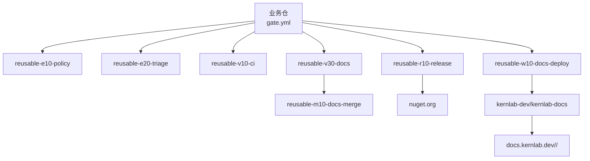
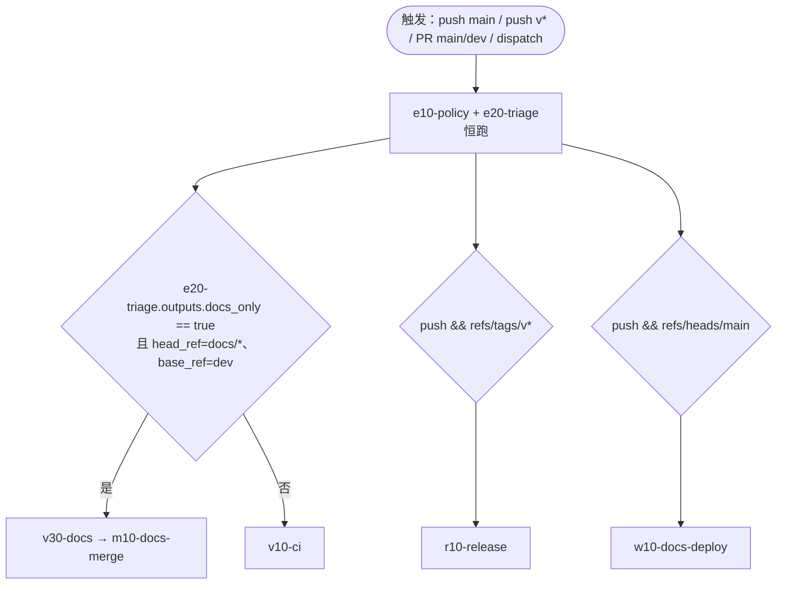
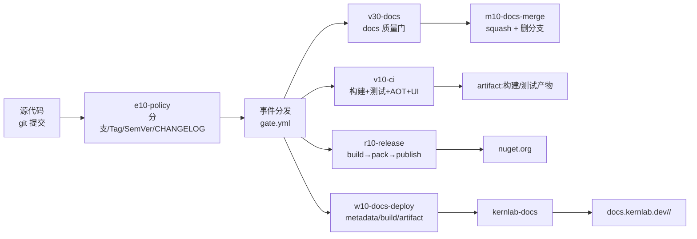
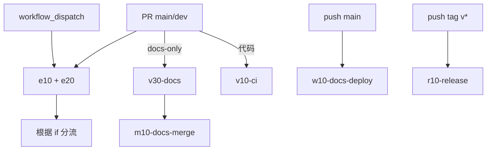
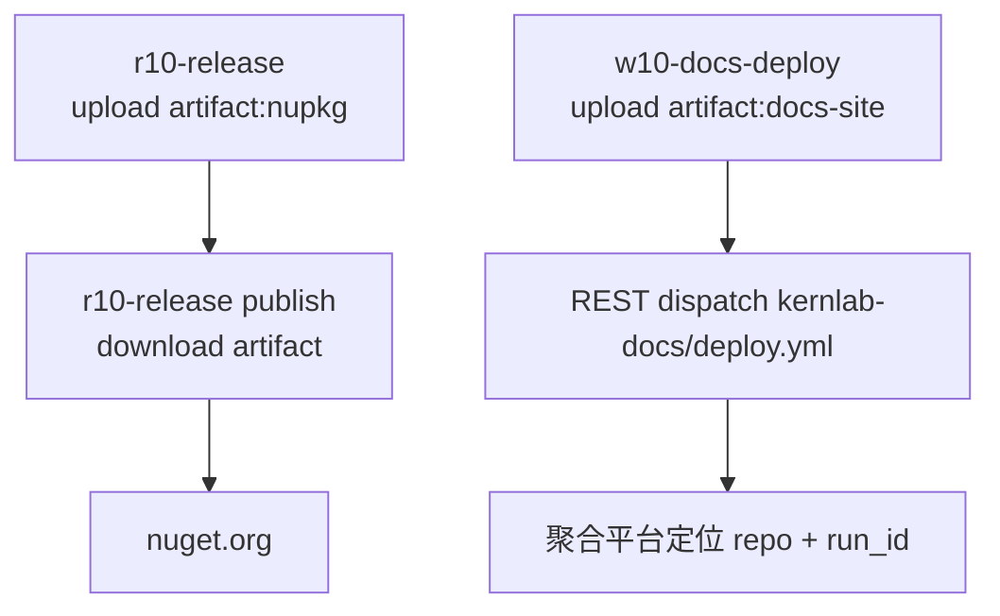

# 流水线架构与执行模型

<cite>
**本文引用的文件**
- [CI-GATE.md](file://CI-GATE.md)
- [README.md](file://README.md)
- [VERSIONING.md](file://VERSIONING.md)
- [SECURITY.md](file://SECURITY.md)
- [.github/workflows/reusable-v10-ci.yml](file://.github/workflows/reusable-v10-ci.yml)
- [.github/workflows/reusable-r10-release.yml](file://.github/workflows/reusable-r10-release.yml)
- [.github/workflows/reusable-w10-docs-deploy.yml](file://.github/workflows/reusable-w10-docs-deploy.yml)
- [.github/workflows/reusable-docs-merge.yml](file://.github/workflows/reusable-docs-merge.yml)
- [workflow-templates/gate.yml](file://workflow-templates/gate.yml)
</cite>

## 目录
1. [简介](#简介)
2. [仓库结构与调用桩](#仓库结构与调用桩)
3. Gate 入口与分流树](#gate-入口与分流树)
4. [四类可复用流程的职责边界](#四类可复用流程的职责边界)
5. [核心流程图](#核心流程图)
6. [Runner 组合、条件开关与超时](#runner-组合条件开关与超时)
7. [事件驱动链路](#事件驱动链路)
8. [制品生命周期与跨 workflow 传递](#制品生命周期与跨-workflow-传递)
9. [安全性设计](#安全性设计)
10. [性能、可扩展性与扩展点](#性能可扩展性与扩展点)
11. [故障排查指南](#故障排查指南)
12. [结论](#结论)

## 简介
本仓库承载 KernLab 家族的公共文档模板、组织门面文件、分支/发布/安全约定，以及用于指导各业务仓实例化的工作流模板。实际流水线的逻辑单源位于组织提供的 `reusable-*` workflow；每个业务仓只保留一个极薄的 `gate.yml` 入口，通过 `uses: kernlab-dev/.github/.github/workflows/reusable-<节点>@main` 完成路由，不再直接复制实现逻辑。

顶层 gate 把 PR/Push Tag、快速文档通道、nightly/dispatch 重线和 tag 发布统一收敛为“恒跑入口 + 分诊 → 验证/合并 → 交付”的四层形态：

| 层 | 代表节点 | 职责 | 何时运行 |
|---|---|---|---|
| 入口层（e） | `e10-policy`、`e20-triage` | 来源/Tag/版本策略强校验，产出 `docs_only` 路由信号 | 所有触发恒跑 |
| 验证层（v） | `v10-ci`、`v30-docs`、`v20-extension`、`v40-heavy` | 构建测试、docs 质量门、扩展或重型验证 | 依赖入口绿，按事件/分诊过滤 |
| 汇合层（m） | `m10-docs-merge` | docs-only PR 的 squash 自动合并与删分支 | docs-only 全绿且非 draft |
| 交付层（r/w） | `r10-release`、`w10-docs-deploy` | tag 发布到 NuGet，或 push main 后构建文档站并聚合 | tag push / push main |

章节来源
- [CI-GATE.md:200-308](file://CI-GATE.md#L200-L308)
- [workflow-templates/gate.yml:1-89](file://workflow-templates/gate.yml#L1-L89)

## 仓库结构与调用桩
当前仓库不直接拥有 `reusable-e10-policy`、`reusable-e20-triage`、`reusable-v10-ci`、`reusable-v30-docs` 等组织级 reusable；它们托管在 `kernlab-dev/.github`，由本仓库的模板与 CI-GATE 规范引用。本仓库本地真正参与执行的 reusable 集中在 `.github/workflows/`，对应以下四个长期存在的主题：

- `reusable-v10-ci.yml`：v10 构建与测试管线，提供 runner 矩阵、AOT、UI 预构建和重试语义。
- `reusable-r10-release.yml`：r10 发布管线，负责 build/test → pack → upload-artifact，并在满足 push+tag 条件时走 OIDC/API key 双模 NuGet 推送。
- `reusable-w10-docs-deploy.yml`：w10 文档站管线，将 Release XML 注释转为 DocFX metadata/_site，并通过 REST dispatch kernlab-docs。
- `reusable-docs-merge.yml`：m10 docs 合并管线，使用每仓独立的 `DOCS_MERGE_PAT` 做竞态复核与 squash 合并。

`workflow-templates/gate.yml` 是该仓库面向新仓库提供的模板入口；其注释和 CI-GATE §8 说明它继承上述组织 reusable，并把原本分散的 policy/ci/release/docs-deploy 抽象为单一 `Gate` 工作流。

图表来源
- [CI-GATE.md:200-308](file://CI-GATE.md#L200-L308)
- [workflow-templates/gate.yml:19-89](file://workflow-templates/gate.yml#L19-L89)

### 为什么各仓只保留薄桩？
CI-GATE 原则第 1、5 条明确：一个仓一个工作流文件，但执行逻辑全部在 dotgithub reusable；`gate.yml` 只剩触发块、`needs`、`if` 分流和业务参数。这样做的原因是：

1. **单源维护**：branching rule、semver、CHANGELOG、build matrix、AOT 探测、OIDC publish、DocFX metadata/build 都集中到一组可审计 reusable，避免每个业务仓出现细微差异。
2. **调用桩稳定**：只要 reusable 输入名不变，业务仓只需改 with/secrets，不必改动 job 拓扑或权限声明。
3. **分层风险面**：gate.yml 语法错误会波及全事件，因此 CI-GATE 强调必须用 `workflow_dispatch` 冒烟；真正的构建失败则由下游 reusable 暴露详细 step。
4. **扩展不污染桩**：需要整方案替换、自定义 runner、串行链条或额外验证时，可在调用侧引入仓专属 `v20/v40`，而不是扩写 gate 本身。

章节来源
- [CI-GATE.md:14-19](file://CI-GATE.md#L14-L19)
- [workflow-templates/gate.yml:1-17](file://workflow-templates/gate.yml#L1-L17)

## Gate 入口与分流树
`workflow-templates/gate.yml` 是内核：它声明 `on.push`（main、`v*`）、`on.pull_request`（main、dev）、`on.workflow_dispatch`，并为每条路径配置 `concurrency.group=gate-${{ github.workflow }}-${{ github.ref }}`，取消正在进行中的同分支任务，减少 rerun 造成的重复计算。

图表来源
- [workflow-templates/gate.yml:9-89](file://workflow-templates/gate.yml#L9-L89)
- [CI-GATE.md:200-308](file://CI-GATE.md#L200-L308)

### 决策规则逐条解释
- `e10-policy`：唯一合法的红来源。任何非法 PR（例如 feat→main 或不匹配的 branch 前缀）都会在这里失败，下游全部短路，不烧构建资源。
- `e20-triage`：分诊输出 `docs_only`；非 PR 上下文内部返回成功，避免下游 `success()` 求值歧义。
- `v10-ci`：当 policy 绿、非 schedule、非 tag、且**不是 docs-only 快速通道**时运行完整门禁；这是默认代码路径。
- `v30-docs`：仅对 `docs/*` → `dev` 的纯文档 PR 运行轻量 docs 质量门。
- `m10-docs-merge`：当 e10 绿、docs_only=true、PR 来自 docs/*→dev、v30-docs 成功且非 draft 时，尝试 squash 合并并删除临时分支；缺少 `DOCS_MERGE_PAT` 则显式跳过。
- `r10-release`：仅在 `push` + `refs/tags/v*` 时激活，配合 e10 的 tag 前置策略防止非法版本被发布。
- `w10-docs-deploy`：仅在 `push` + `refs/heads/main` 时激活；后续还受 w10 内部的 product/project_paths + paths 守卫保护，未启用文档站的仓零成本空转。

[本节以模板 gate.yml 与 CI-GATE 为准，未假设本仓库目录中存在 e10/e20 本地文件]

## 四类可复用流程的职责边界
尽管模板引用的是组织级 `reusable-e*/v*/m*/r*/w*`，本仓库仍对四个已实现的 reusable 承担直接证据责任。

| 组件 | 调用方 | 主要职责 | 关键输入 | 输出/副作用 |
|---|---|---|---|---|
| `reusable-v10-ci.yml` | `v10-ci` | 多 runner 构建、NativeAOT 安装、可选 UI 预构建、按 solution/proj 运行测试并重试 | runner/runners_matrix/solution/test_projects/test_solution/test_filter/install_aot_toolchain/ui_project_path 等 | 构建日志、测试结果；可能阻断 PR |
| `reusable-r10-release.yml` | `r10-release` | 可选全量 test → pack（nupkg/snupkg）→ upload-artifact，push tag 时走 API key 或 OIDC 推 nuget | version/run_tests/solution/pack_projects/skip_pack/skip_publish/dotnet_build/dotnet_publish | artifacts nupkg；必要时 nuget.org 包 |
| `reusable-w10-docs-deploy.yml` | `w10-docs-deploy` | Release 构建 → DocFX metadata/build → artifact docs-site → dispatch kernlab-docs | product/project_paths/dotnet_version/DOCS_SYNC_TOKEN | docs-site artifact、聚合平台调度 |
| `reusable-docs-merge.yml` | `m10-docs-merge` | 竞态复核 squash 合并、删除临时分支 | DOCS_MERGE_PAT | 无制品，只有 PR 合并结果 |

### v10-ci：构建、AOT、UI 与重试
- runner 形态由 `runner`（默认 `ubuntu-latest`）和 JSON 数组 `runners_matrix` 决定；未传时使用 `{os: [runner]}` 的单腿矩阵。
- `use_setup_dotnet=false` 表示自建 runner 已自管 SDK，绕过 `setup-dotnet`，避免网络下载导致的随机卡顿。
- Linux 上可选安装 clang+zlib1g-dev，作为 NativeAOT 发布探针的前置。
- `ui_project_path` 非空时安装 Node/npm、缓存 package-lock.json，然后运行 `npm ci` 和自定义 `ui_build_command`；构建产物（通常 `dist`）随后参与 .NET 构建。
- 测试既可按整 solution，也可按 `tests/*/*.csproj` 逐项运行，均支持 `--filter` 和 `test_retries`；shell 里用递增计数器实现最多 RETRIES+1 次重试。
- 单 job 限制 `timeout-minutes: 30`，对应组织 branching 约束：PR 非 main 分支的单个 job 不应超过 30 分钟，长 AOT/稳态测试应拆分至 main 或 nightly。

### r10-release：预览空跑与正式 push 发版
- 接收可选 `version`；dispatch 空跑时为传入值，tag 触发时用 `GITHUB_REF_NAME` 剥离 `preview-v` 前缀和首段 `v`，生成合法 NuGet package version。
- `run_tests=true` 时对 solution 构建一次并按项目或整 solution 重试测试。
- `skip_pack=true` 表示尚未立项包工程的过渡形态；pack 阶段要求至少找到一个 csproj（显式清单或递归扫描 `<IsPackable>true</IsPackable>`）。
- 打包产物写入 `artifacts/*.nupkg` 和 `artifacts/*.snupkg`；上传时 glob 明确包含 snupkg，修复过去遗漏符号包导致 nuget.org 符号服务 404 的问题。
- publish job 仅在 `event_name==push`、`skip_pack!=true`、`skip_publish!=true` 时运行；它移除全局 `global.json`，再用 `dotnet_publish`（默认 9.0.x）获取 OIDC 所需的较新 SDK。
- 发布采用双模：优先读取仓库 secret `NUGET_API_KEY`，否则走 `NuGet/login` OIDC；两者都以 `--skip-duplicate` 保证幂等。
- `skip_publish=true` 是为发布逻辑留在调用仓而留的后门；因 Trusted Publishing 绑定 caller workflow，在本 reusable 所在仓直接推会出现身份不一致问题。

### w10-docs-deploy：文档站元数据与聚合
- 若 `product` 或 `project_paths` 为空，第一步显式 `exit 0`，让未启用文档站的仓恒成功。
- paths 守卫检查 `BEFORE` 提交，diff 包含 `docs-site/`、`src/*/docs/`、`COORDINATION.md`、`toc.yml`、普通 `.md` 或 `docs/` 目录时才继续；这样 push main 的非文档变更不会浪费 DocFX。
- 步骤链：setup .NET → install docfx → 逐项目 Release 构建生成 DLL 旁 XML → `docfx metadata` → `docfx build` → 上传 `docs-site/_site`（保留 7 天）→ REST dispatch kernlab-docs。
- dispatch 端点使用 `/actions/workflows/deploy.yml/dispatches`，显式传 `ref=main`，兼容 fine-grained PAT 不支持 GraphQL 客户端的情况。

### m10-docs-merge：竞态安全的 squash 合并
- 使用每仓库独立配置的 `DOCS_MERGE_PAT`（fine-grained PAT：Contents RW + Pull requests RW），不能用 org secret 替代——GitHub Free 组织 secret 只对公开仓生效。
- 刻意不用 `GITHUB_TOKEN`：它触发的下游 workflow 不带真实 push 事件，也不具备可审计的 bot actor 语义。
- 合并前先取 PR 当前 `headRefOid`，与本次判定快照比对；如果有人在新 commit 推进了 PR，立即退出 1，把决策权交给新 run，杜绝竞态合入未验内容。

章节来源
- [.github/workflows/reusable-v10-ci.yml:1-164](file://.github/workflows/reusable-v10-ci.yml#L1-L164)
- [.github/workflows/reusable-r10-release.yml:1-196](file://.github/workflows/reusable-r10-release.yml#L1-L196)
- [.github/workflows/reusable-w10-docs-deploy.yml:1-116](file://.github/workflows/reusable-w10-docs-deploy.yml#L1-L116)
- [.github/workflows/reusable-docs-merge.yml:1-55](file://.github/workflows/reusable-docs-merge.yml#L1-L55)
- [CI-GATE.md:14-19](file://CI-GATE.md#L14-L19)

## 核心流程图
KernLab 家族流水线可从源码走向制品简化为一条主链，再附加文档聚合支线。

图表来源
- [workflow-templates/gate.yml:19-89](file://workflow-templates/gate.yml#L19-L89)
- [.github/workflows/reusable-r10-release.yml:115-196](file://.github/workflows/reusable-r10-release.yml#L115-L196)
- [.github/workflows/reusable-w10-docs-deploy.yml:78-116](file://.github/workflows/reusable-w10-docs-deploy.yml#L78-L116)
- [CI-GATE.md:34-50](file://CI-GATE.md#L34-L50)

## Runner 组合、条件开关与超时
### Runner 组合决策
v10-ci 支持两类 runner 模式：

1. GitHub 托管 runner：使用 `defaults.runner`，默认 `ubuntu-latest`。
2. 自建独立 CI：传入 `runners_matrix`，JSON 字符串数组形式，例如 `["win-ci","pve-ci"]`，每项映射为矩阵 os 值；此时应配 `use_setup_dotnet=false`，因为 SDK 由机器自身管理，无需每次重新下载。

这种设计把“基础设施选择”从 reusable 逻辑中解耦：简单仓可以用单一 ubuntu runner，重型仓可叠加 Windows/私有池矩阵。

### 能力开关
| 开关 | 作用 | 适用场景 |
|---|---|---|
| `install_aot_toolchain` | Linux runner 上 `apt install clang zlib1g-dev` | 带 NativeAOT 发布探针的项目 |
| `ui_project_path` + `ui_node_version` + `ui_build_command` | 安装 Node、缓存 npm、运行 npm ci 和自定义构建命令 | 含卫星 UI/NPM 前端的项目 |
| `test_solution=true` | 对整个 solution 跑一次 `dotnet test` | 大解决方案希望一次性 vstest |
| `test_projects` + `test_filter` | 按 glob 逐项测试，并可过滤用例 | 隔离失败工程、定位子集回归 |
| `test_retries` | shell 内实现“失败重试 N 次” | 吸收 runner 瞬时错误 |
| `use_setup_dotnet=false` | 跳过 setup-dotnet | 自建 runner 自带 SDK |

### 超时与稳定性
- `strategy.fail-fast=false`：单 runner 失败不提前终止其他系统腿结果，方便横向比较 Windows/Linux、托管/自建 runner。
- 单 job `timeout-minutes: 30`：非 main 分支 PR 的上限，超过的验证应拆出主门禁或放到 main/nightly。
- `concurrency.group=gate-${{ github.workflow }}-${{ github.ref }}` + `cancel-in-progress: true`：rerun 同一 ref 时取消旧 run，避免同一 PR/分支堆叠大量 runner。

章节来源
- [.github/workflows/reusable-v10-ci.yml:12-38](file://.github/workflows/reusable-v10-ci.yml#L12-L38)
- [.github/workflows/reusable-v10-ci.yml:39-164](file://.github/workflows/reusable-v10-ci.yml#L39-L164)
- [workflow-templates/gate.yml:9-18](file://workflow-templates/gate.yml#L9-L18)

## 事件驱动链路
gate.yml 同时处理四类触发：

| 触发 | 激活节点 | 行为 |
|---|---|---|
| PR → main/dev | e10-policy、e20-triage、v10-ci、可能的 v30-docs/m10-docs-merge | 开发门禁 + docs-only 快速通道 |
| push main | e10-policy、w10-docs-deploy | 文档站构建 + paths 守卫 |
| push tag v* | e10-policy、r10-release | 发布管线（先策略，后打包/发布） |
| workflow_dispatch | e10-policy、e20-triage 及模板注释中定义的扩展 | 人工冒烟、调试或按需扩展节点 |

需要注意：模板注释还保留 `schedule` 槽位，用于 nightly heavy check（CI-GATE 矩阵描述 `v40-heavy` 由 schedule 触发）；但本仓模板示例没有展开该 section。

图表来源
- [workflow-templates/gate.yml:9-89](file://workflow-templates/gate.yml#L9-L89)

## 制品生命周期与跨 workflow 传递
### 本地工件
- `r10-release` 将 `artifacts/*.nupkg` 和 `artifacts/*.snupkg` 通过 `actions/upload-artifact@v4` 保存，工件名称固定为 `nupkg`；publish job 再通过 `download-artifact name=nupkg` 恢复。
- `w10-docs-deploy` 上传 `docs-site/_site` 作为 `docs-site` 工件，保留 7 天，供 Actions 界面验证站点构建结果。

### 跨 workflow 工件
GitHub Actions 中不同 workflow run 不能直接共享同名 artifact；文档聚合通过 dispatch 间接携带上下文：

- w10 向 `repos/kernlab-dev/kernlab-docs/actions/workflows/deploy.yml/dispatches` 发起 REST POST，传入 `product`、`repo`（调用仓 repository）和 `run_id`。
- 聚合平台据此定位上游构建上下文，而不是依赖 artifact 名称匹配。
- 对于 m10-docs-merge，产物不是文件而是 PR 状态：squash 合并后留下 dev 上的单亲提交，事件审计身份是 DOCS_MERGE_PAT 对应的 bot actor。

图表来源
- [.github/workflows/reusable-r10-release.yml:89-145](file://.github/workflows/reusable-r10-release.yml#L89-L145)
- [.github/workflows/reusable-w10-docs-deploy.yml:78-116](file://.github/workflows/reusable-w10-docs-deploy.yml#L78-L116)

章节来源
- [.github/workflows/reusable-r10-release.yml:89-145](file://.github/workflows/reusable-r10-release.yml#L89-L145)
- [.github/workflows/reusable-w10-docs-deploy.yml:78-116](file://.github/workflows/reusable-w10-docs-deploy.yml#L78-L116)

## 安全性设计
### 最小凭据暴露面
- v10-ci、r10-release、w10-docs-deploy 默认只声明 `contents: read`。
- r10-publish job 只在真正执行 `dotnet nuget push` 的步骤开启 `permissions.id-token: write`。
- `DOCS_SYNC_TOKEN` 只在 w10 聚合部署中使用，未配置时显式跳过而不是伪造成功。
- DOCS_MERGE_PAT 由 m10-docs-merge 单独消费，具有 Contents + Pull requests RW 的最小能力；未配置时只打 warning 并不假绿。

### OIDC Trusted Publishing
- r10 的 NuGet publish 优先读取 `secrets.NUGET_API_KEY`；缺席时回退 `NuGet/login` OIDC。
- Trusted Publishing 的签名绑定 owner、repository 与 workflow path，因此新接入仓需要在 nuget.org 登记可信发布者，否则推送会出现 no-matching/401。
- 为避免 reusable 载体仓的身份与调用仓不一致，模板允许设置 `skip_publish=true`，把发布动作放回调用仓自己的 release 管线。
- 顶层 gate 模板也明确 `permissions.id-token: write`：因为 r10 的 OIDC publish 要求顶层授权，缺失会导致整个 workflow `startup_failure`。

### 供应链关注点
SECURITY.md 明确关注包完整性、供应链、凭据处理、隔离边界和解析面的 fail-loud 路径；VERSIONING 要求包版本、Git Tag、容器镜像保持一致，并禁止移动已有 Tag。这些外部政策与 pipeline 的“合法红”“Tag 前缀 SemVer”“跳过覆盖”共同降低供应链攻击面。

章节来源
- [.github/workflows/reusable-r10-release.yml:146-196](file://.github/workflows/reusable-r10-release.yml#L146-L196)
- [.github/workflows/reusable-w10-docs-deploy.yml:10-16](file://.github/workflows/reusable-w10-docs-deploy.yml#L10-L16)
- [workflow-templates/gate.yml:19-28](file://workflow-templates/gate.yml#L19-L28)
- [CI-GATE.md:105-112](file://CI-GATE.md#L105-L112)
- [SECURITY.md:1-28](file://SECURITY.md#L1-L28)
- [VERSIONING.md:66-85](file://VERSIONING.md#L66-L85)

## 性能、可扩展性与扩展点
### Runner 矩阵与并行
- `strategy.fail-fast=false` 让所有 runner 都执行完，便于横向定位特定 OS 的问题。
- `runners_matrix` 适合 Windows/私有池组合矩阵，使 PR 同时看到多系统表现。
- v10-ci 的 test 阶段既可整 solution 一次成型，也可按 `tests/*/*.csproj` 逐个运行，兼顾 vstest 启动开销与隔离性。

### 缓存建议
- UI 管线已经通过 `actions/setup-node` 的 npm cache + `cache-dependency-path` 缓存 package-lock.json。
- 对于大型 .NET 仓库，建议在调用桩处补充：
  - `~/.nuget/packages` 的 `dotnet-packages-*` 缓存键。
  - `~/.local/share/NuGet/GlobalPackages` 或 apikey 沙箱缓存，避免因 secret 变化污染包缓存。
  - `docfx` CLI 的全局工具缓存，避免每次 w10 都重建 DocFX。
- CI-GATE §8 明确指出简单仓可使用零参数 zero-stub；偏离组织默认才添加 with 参数。

### 避免重复构建
- e10/e20 恒跑但只做轻量策略判断；红后立即短路下游，不会白烧 runner。
- r10 将构建/测试 SDK `dotnet_build`（默认 8.0.422）与 OIDC 发布 SDK `dotnet_publish`（默认 9.0.x）分离，避免发布面能力拖慢构建，同时发布阶段删除 global.json 以确保 OIDC SDK 生效。
- w10-docs-deploy 的 paths 守卫能在检测到文档文件之前尽早退出，避免非文档 push main 触发完整 DocFX。

### 扩展点
根据 CI-GATE 与模板注释，可扩展的方向包括：

| 扩展点 | 推荐方式 | 影响范围 |
|---|---|---|
| 新增自定义验证链 | 增加 `v20-extension`、`v40-heavy` | 仅验证层，不改变入口 |
| 切换整体 ci 行为 | 在调用仓用本地 `v10-ci.yml` 替换 `uses:` | 隔离复杂矩阵/串行测试 |
| 新增 SDK/toolchain 能力 | 扩展现有 reusable 的 input，不改 call site 输入名 | 向后兼容现有 gate |
| 新增 nightly schedule | 在 gate.yml 加入 schedule cron + v40-heavy | 独立于 PR/tag |
| 调整 docs-only 规则 | 修改 e20-triage reusable 或 gate `if` 分支 | 影响快速通道分支策略 |

[本节为结合 v10/r10/w10 实现的通用扩展分析，不虚构具体行号]

## 故障排查指南

### 在 Actions UI 中定位问题
1. 打开失败 workflow run，先看是否失败在入口层：
   - e10-policy 失败通常是分支来源、Tag 前缀、SemVer、CHANGELOG 或分支可达性不满足。
   - e20-triage 通常不红，异常时检查是否误加了 `if` 阻止它执行。
2. 再看验证层：
   - v10-ci 失败查看 runner 矩阵哪条腿红，确认是否是某 OS/runner 特有环境。
   - v30-docs 失败重点看 DocFX metadata/build 步骤。
3. 最后看交付层：
   - r10-release 失败要区分 pack（找不到 IsPackable 项目、版本号不合法）与 publish（OIDC 未登记、API key 缺失、global.json 冲突）。
   - w10-docs-deploy 失败先看“参数守卫/paths 守卫”是否 early exit，而非直接进入构建。
4. 进入失败 job 的 steps，点击红色 step，查看原始 runner console。shell 中 `::error::` / `::warning::` 会被 GitHub 渲染为标记行，便于快速阅读。

### 典型问题对照
- “PR 直接被拒绝，未跑到构建”：e10-policy 是唯一的合法红；检查 base/head 分支是否符合 gate 与 strategy 预期，常见是 feat/fix 推到了 main。
- “Tag 无法通过”：确认 tag 以 `v` 开头，符合 `X.Y.Z[-alpha.N|-beta.N|-rc.N]`；如需前缀（如 `runtime-`），应在 e10 输入中配置。
- “csproj <Version> 与 Tag 不一致”：用与 e10/tag 一致的 SDK 读取 MSBuild Version，修正 project 文件或 tag。
- “CHANGELOG 没有版本段”：添加对应 `x.y.z` 段落；版本号中的点需被转义。
- “v10 某个子系统在 Linux 通过，Windows 失败”：检查 `runners_matrix` 是否覆盖了预期 runner；查看 Windows runner 的 log，特别是 UI 或原生依赖。
- “NativeAOT 探针失败”：确认 Linux runner 启用了 `install_aot_toolchain`，并已安装 clang/zlib1g-dev。
- “UI 预构建缓存失效或很慢”：检查 `ui_project_path/package-lock.json` 是否存在；如 UI 迁移，更新依赖路径或清理 Actions cache。
- “v10 job 超 30 分钟被强制结束”：这是组织硬性上限；拆分为多个小步、移到 main/nightly，或改用 test_filter 缩小范围。
- “r10 能 pack 但 push 报 401/no-matching”：核对 nuget.org 可信发布者登记是否绑定正确 owner/repository/workflow，并确保已激活；也可以暂时用 `NUGET_API_KEY` 走 API key 模式验证通路。
- “r10 publish 未运行”：确认触发方式是 tag push；如果是 dispatch 空跑，会跳过 publish，只留 artifact。
- “w10 文档站没更新，却显示成功”：确认 product/project_paths 和 secrets.DOCS_SYNC_TOKEN 都已配置；缺任一都会早退出而不算失败。
- “kernlab-docs 没有收到 dispatch”：确保使用 REST 接口并传 `ref=main`；fine-grained PAT 可能不支持 `gh workflow run` 的 GraphQL 路径。
- “docs PR 未自动合并”：检查 DOCS_MERGE_PAT 是否为 fine-grained PAT（Contents + Pull requests RW），且按仓独立配置，而不是依赖 org secret；还要确认 PR 当前 HEAD 未发生竞态推进。

章节来源
- [CI-GATE.md:51-112](file://CI-GATE.md#L51-L112)
- [workflow-templates/gate.yml:31-89](file://workflow-templates/gate.yml#L31-L89)
- [.github/workflows/reusable-v10-ci.yml:39-164](file://.github/workflows/reusable-v10-ci.yml#L39-L164)
- [.github/workflows/reusable-r10-release.yml:40-196](file://.github/workflows/reusable-r10-release.yml#L40-L196)
- [.github/workflows/reusable-w10-docs-deploy.yml:34-116](file://.github/workflows/reusable-w10-docs-deploy.yml#L34-L116)
- [.github/workflows/reusable-docs-merge.yml:17-55](file://.github/workflows/reusable-docs-merge.yml#L17-L55)

## 结论
KernLab 家族流水线当前采用两层分工：**gate.yml 单入口分流**与**dotgithub reusable 逻辑单源**。Gate 负责最少的运行时决策——谁能跑、什么事件触发、哪个下游激活；Reusable 负责真正执行的构建、测试、AOT、UI、Pack、NuGet OIDC、DocFX 和聚合。

核心优势是：
- 所有仓库通过模板化 gate 获得一致入口，PR 门禁、docs 快速通道、release、docs deploy 不再散落。
- 扩展集中在 reusable 与调用参数的范围内，无需复制 workflow 骨架。
- 安全性和凭据暴露面收敛到明确的顶层 `id-token: write` 和 per-job `id-token: write`，并用 trusted publisher 或显式 API key 二选一。
- Runner 矩阵、条件开关、超时上限、retry 和 paths/参数守卫共同构成可观测、可回滚、可诊断的执行模型。

对外一致性由 VERSIONING 与 SECURITY 约束；对内可观测性来自 gate 的 `needs`/`if`、reusable 的 step output 和 Actions console。只要保持“调用桩简短、reusable 明确、gate 只做分流”，新增 runner、新 toolchain、新的 AOT/UI 能力或新的 nightly 重线都可以在不破坏调用方的前提下演进。