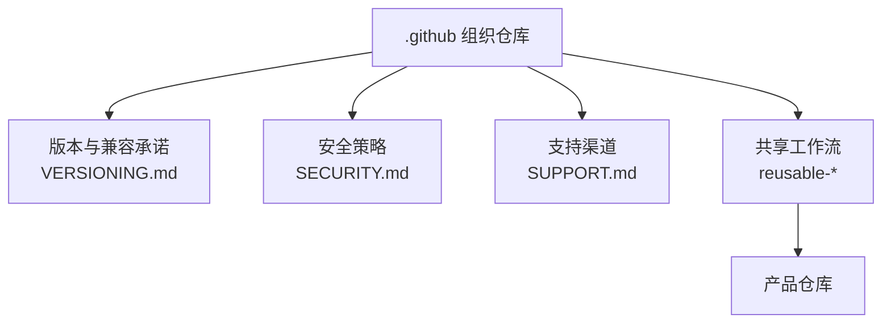
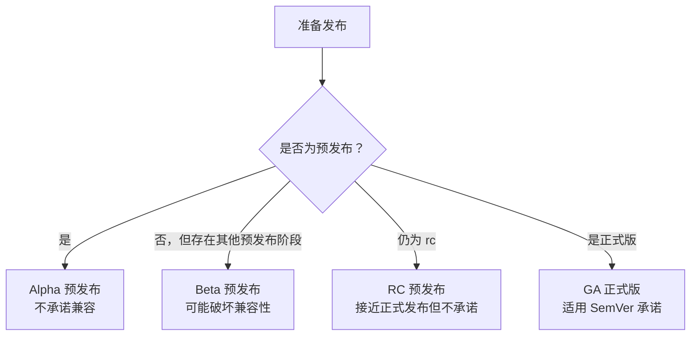
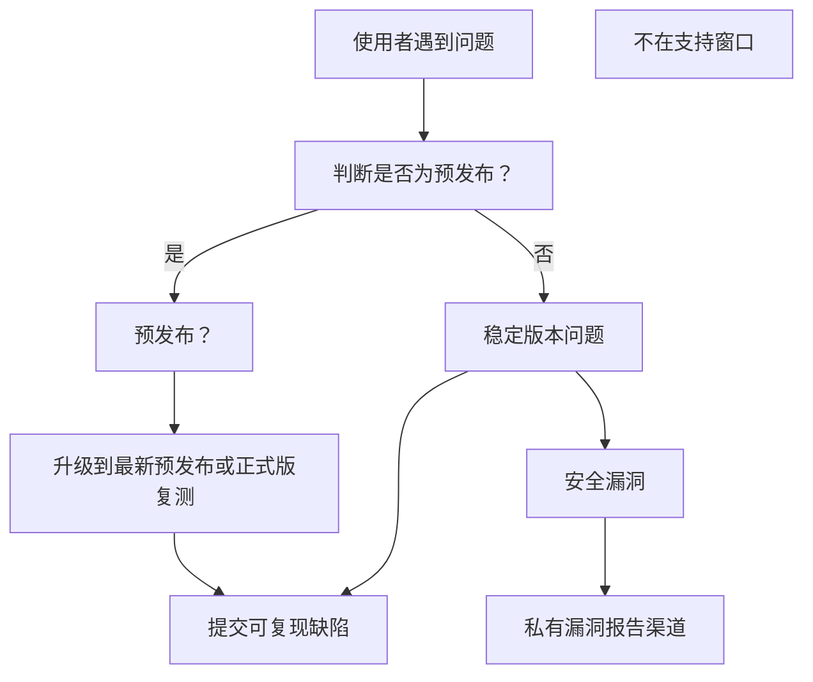
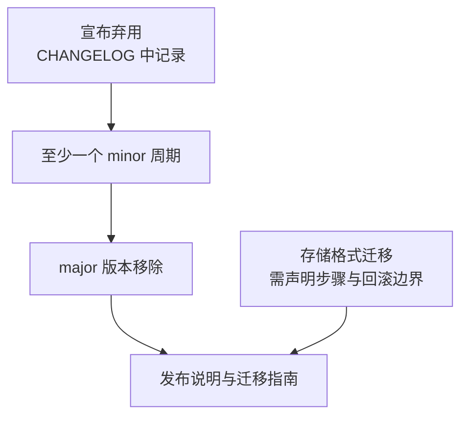
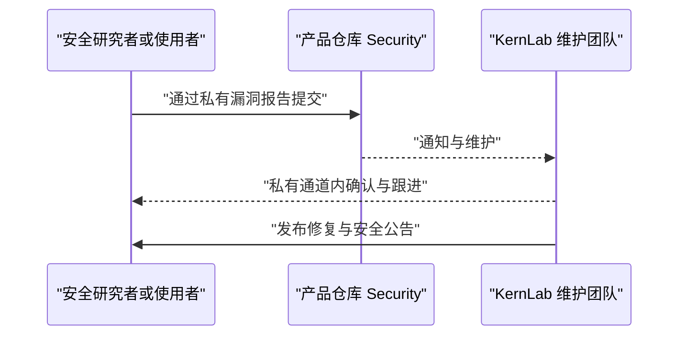
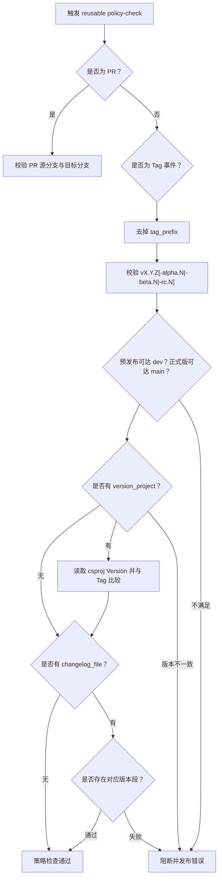
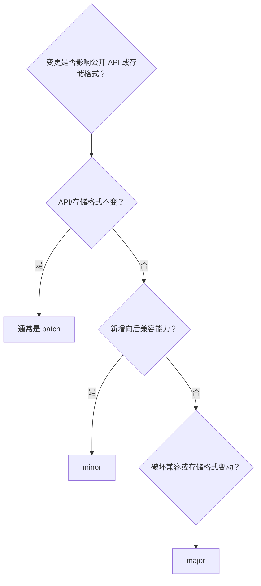

# 版本管理与工程治理

<cite>
**本文引用的文件**   
- [README.md](file://README.md)
- [VERSIONING.md](file://VERSIONING.md)
- [SECURITY.md](file://SECURITY.md)
- [SUPPORT.md](file://SUPPORT.md)
- [.github/workflows/reusable-policy-check.yml](file://.github/workflows/reusable-policy-check.yml)
</cite>

## 目录

1. [引言](#引言)
2. [项目结构与作用](#项目结构与作用)
3. [SemVer 与版本格式](#semver-与版本格式)
4. [兼容性承诺表](#兼容性承诺表)
5. [存储引擎与重大变更规则](#存储引擎与重大变更规则)
6. [支持策略与生命周期](#支持策略与生命周期)
7. [包、Tag 与镜像约束](#包tag-与镜像约束)
8. [弃用、移除与迁移边界](#弃用移除与迁移边界)
9. [安全报告与供应链关注面](#安全报告与供应链关注面)
10. [Workflow 级策略校验](#workflow-级策略校验)
11. [版本升级对照速查](#版本升级对照速查)
12. [外部集成与反馈指南](#外部集成与反馈指南)
13. [结论](#结论)

## 引言

本文面向 NuGet 包消费者、容器镜像用户以及将 KernLab 组件集成到自身流水线的外部团队，汇总 KernLab 组织对外版本的版本管理策略与工程治理要点。内容基于仓库中的公开政策文档与统一工作流程定义，重点解释：

- 版本编号如何构造和排序；
- patch、minor、major 分别允许什么变更；
- 存储引擎磁盘格式相关字段为何一律按 major 处理；
- 发布、Tag、镜像和支持窗口如何对齐；
- 安全问题如何上报；
- reusable policy check 会在什么时候阻断不可接受的版本与变更流程。

## 项目结构与作用

kernlab-dev/.github 是 GitHub 约定的组织级特殊仓库，主要承担四层职责：

| 层次 | 说明 |
|---|---|
| 组织公开门面 | `profile/README.md` 渲染在组织概览页。 |
| 组织级默认社区健康文件 | 根目录的 `SECURITY.md`、`SUPPORT.md` 等会作为没有自建同名文件的仓库回退继承。这些文件不会出现在常规克隆与下载中。 |
| 家族公共工程文档 | 包括跨仓公开的 VERSIONING.md、ENGINEERING.md、RULES.md 和 docfx-template。 |
| 共享工作流逻辑单源 | `.github/workflows/` 提供 reusable CI、release、文档部署与策略校验模板；各产品仓库只调用不复制实现。 |

**图示来源**
- [README.md:3-26](file://README.md#L3-L26)

**章节来源**
- [README.md:3-26](file://README.md#L3-L26)

## SemVer 与版本格式

KernLab 遵循 Semantic Versioning 2.0，并明确要求如下形式：

| 类别 | 版本号示例 | 含义 |
|---|---|---|
| 正式版 | `v1.2.3` | 稳定发布的正式版本。 |
| alpha 预发布 | `v1.2.3-alpha.1` | 内部开发或测试用途，功能和接口都可能继续变化。 |
| beta 预发布 | `v1.2.3-beta.2` | 功能冻结后的外部测试阶段。 |
| rc 预发布 | `v1.2.3-rc.1` | 发布候选，仅修复阻断缺陷。 |

### 预发布排序规则

预发布按照以下顺序递增：

`alpha.N < beta.N < rc.N < 正式版`

这意味着同一主版本下，不同阶段的预发布可以独立累积；只有进入“正式版”才进入 SemVer 兼容性承诺区段。

### Tag、包与镜像的一致性要求

- NuGet 包版本号；
- git Tag；
- 容器镜像 Tag；

应当使用同一个版本号。若发现不一致，应以发布说明和 CHANGELOG 为准，并向维护者反馈。

**图示来源**
- [VERSIONING.md:8-30](file://VERSIONING.md#L8-L30)

**章节来源**
- [VERSIONING.md:8-30](file://VERSIONING.md#L8-L30)

## 兼容性承诺表

| 版本位 | 允许的内容 | 兼容性承诺 |
|---|---|---|
| `patch` | 向后兼容的缺陷修复 | 旧代码和旧数据应继续可用。 |
| `minor` | 向后兼容的新增能力 | 旧代码和旧数据应继续可用。 |
| `major` | 不兼容的 API 或存储格式变更 | 需要按发布说明执行迁移。 |

需要注意：该表格描述的是“对外兼容性影响”，并不表示 minor 补丁永远不需要阅读发布说明。尤其对存储引擎产品，磁盘日志格式和元数据结构同样重要。

**章节来源**
- [VERSIONING.md:22-49](file://VERSIONING.md#L22-L49)

## 存储引擎与重大变更规则

KernLab 明确把存储引擎产品的持久化一致性放在和 API 同等位置。以下变更一律视为 **major**：

| 变更类型 | 原因 |
|---|---|
| 磁盘或日志格式发生变化 | 旧版本写入的数据可能在新版本无法直接读取。 |
| segment 布局发生变化 | 底层数据分布改变会影响解析与恢复路径。 |
| checksum 规则变化 | 旧数据的完整性校验方式不再适用。 |
| 魔数变化 | 运行时识别当前格式版本的入口发生变化。 |
| 字段偏移、大小端或对齐变化 | 二进制结构语义变化，旧数据不能简单复用。 |

同时：

- “旧版本写入的数据新版本不可读” → 必须是 major，除非发布说明显式写出迁移路径。
- “新增可选能力且旧数据仍可被旧版本或新版本读取” → 可以是 minor。
- “纯缺陷修复且不改变读写语义” → 可以是 patch。

### 为什么这些字段必须升级 major

这类字段直接影响二进制层面能否正确解析和恢复数据。将它们归入 major，目的是让使用者看到版本号时就知道：**不要直接把生产数据挂到新大版本上**，必须先确认是否已有受支持的迁移路径或回滚方案。

**章节来源**
- [VERSIONING.md:31-49](file://VERSIONING.md#L31-L49)

## 支持策略与生命周期

### 默认支持窗口

- 默认支持 **最新正式版所在版本线**。
- 旧版本线进入维护期后，通常只处理安全漏洞和阻断性缺陷。
- 当前家族处于预览阶段（`1.0.0-alpha.*`），暂只对每个包的**最新预览版**提供安全修复。
- 正式版本的生命周期与支持窗口将在正式发布后另行明确。

### 预发布版本不支持

预发布版本不参与正常支持窗口。如果遇到预发布问题，应：

1. 升级到最新预发布或正式版复测；
2. 如果能在正式版本复现，则按缺陷流程反馈；
3. 如果是安全相关问题，走私有渠道上报。

### 支持政策摘要

| 类别 | 处理方式 |
|---|---|
| 正常问题 | 对应仓库的 GitHub Issues / Discussions。 |
| 预发布版本的问题 | 优先升级到更高预发布或正式版复测。 |
| 安全性问题 | 使用 `SECURITY.md` 指定的私有报告渠道，不要在公开 Issue 或 Discussions 中披露。 |
| 已停止支持版本的严重问题 | 参考对应仓库的安全策略；必要时通过私有渠道咨询。 |

**图示来源**
- [VERSIONING.md:38-55](file://VERSIONING.md#L38-L55)
- [SECURITY.md:3-27](file://SECURITY.md#L3-L27)

**章节来源**
- [VERSIONING.md:38-55](file://VERSIONING.md#L38-L55)
- [SECURITY.md:3-27](file://SECURITY.md#L3-L27)

## 包、Tag 与镜像约束

### 三个 Tag 必须对齐

| 名称 | 版本要求 |
|---|---|
| NuGet 包版本 | 使用完整 SemVer 版本号。 |
| git Tag | 与包版本相同。 |
| 容器镜像 Tag | 与包版本相同。 |

### `latest` 标签限制

- `latest` 只指向正式发布。
- 预发布包不会获得 `latest` 镜像 Tag。

### 已发布版本不可移动或覆盖

| 操作 | 规则 |
|---|---|
| 移动已发布 Tag | 不允许。 |
| 覆盖已发布容器镜像 | 不允许。 |
| 发现错误发布 | 通过新 patch 修复；对旧 NuGet 版本执行软下架（unlist）。 |

这一原则保障了依赖锁定环境的可重现性与可审计性：第三方消费方可以在未来回溯某个确切包。

**章节来源**
- [VERSIONING.md:56-73](file://VERSIONING.md#L56-L73)

## 弃用、移除与迁移边界

### 公开 API 的弃用

- 弃用会先在 CHANGELOG 的 `Deprecated` 段公告。
- 弃用到移除应尽量保留至少一个 minor 周期。
- 这样做的目的是给使用者留出升级时间，而不是立刻破坏现有编译期行为。

### 移除只能发生在 major

- 公开 API 的移除发生在 major 版本。
- 预发布内部的 API 不承诺固定弃用周期，因此外部集成方仍应避免依赖未对外承诺的稳定内部契约。

### 存储格式的迁移必须写清步骤

存储格式相关的移除或迁移必须在 major 版本说明中包含：

- 迁移步骤；
- 目标格式要求；
- 回滚边界；
- 风险与建议的回滚策略。

这使得使用者能够判断“我能否直接升级”“是否需要离线迁移工具”“是否能快速回滚”。

**图示来源**
- [VERSIONING.md:51-68](file://VERSIONING.md#L51-L68)

**章节来源**
- [VERSIONING.md:51-68](file://VERSIONING.md#L51-L68)

## 安全报告与供应链关注面

### 当前支持状态

家族目前处于预览阶段，只对每个包的最新版预览版本提供安全修复。稳定版本的生命周期与支持范围将在正式发布后另行明确。

### 上报渠道

唯一公开的官方上报入口是 GitHub 的**私有漏洞报告**：

1. 进入对应仓库；
2. 打开 Security 页面；
3. 选择 Report a vulnerability；
4. 也可在 Security 标签页查看已公开的安全公告。

**严禁**在公开 Issue、Discussion、评论或 PoC 中披露尚未修复的安全问题。

### 供应链与安全关注面

| 关注面 | 示例 |
|---|---|
| 包完整性与供应链 | OIDC Trusted Publishing、签名与哈希对账、依赖来源。 |
| 凭据与密钥处理 | 密钥落盘权限、密文信封、凭据随包或日志外泄。 |
| 隔离与信任边界 | 多租户进程边界、沙箱、插件程序集白名单、能力声明制授权。 |
| 解析与输入处理 | 协议帧解析、路由匹配、配置与清单校验、拒绝路径。 |
| 网络与 TLS | 监听端口、出站 TLS、mTLS、UDS 或命名管道权限。 |

### SLA 现状

当前属于个人项目性质的预览阶段，安全报告**尽力处理但不承诺 SLA**。收到报告后会在私有通道内确认和跟进，修复发布后会发布公告，并在必要时申请 CVE。

**图示来源**
- [SECURITY.md:3-27](file://SECURITY.md#L3-L27)

**章节来源**
- [SECURITY.md:3-27](file://SECURITY.md#L3-L27)

## Workflow 级策略校验

`.github/workflows/reusable-policy-check.yml` 是组织统一的策略检查 reusable workflow，用于在 Pull Request 和 Tag 事件上阻断不符合要求的分支、Tag、版本与变更内容。

### 输入参数

| 参数 | 说明 |
|---|---|
| `version_project` | 用于读取 MSBuild Version 的 csproj 路径；留空则跳过版本对齐检查。 |
| `changelog_file` | 包含版本段的 CHANGELOG 路径；留空则跳过段落检查。 |
| `tag_prefix` | 发布前缀；留空时使用标准 `v*` Tag。 |
| `dotnet_version` | setup-dotnet 使用的 SDK 版本。 |
| `require_dev_for_prerelease` | 预发布 Tag 必须可达 `dev`。 |
| `require_main_for_ga` | GA 正式版 Tag 必须可达 `main`。 |

### PR 分支策略

| 目标分支 | 允许的源分支 |
|---|---|
| `main` | `dev`、`hotfix/*` |
| `dev` | `main`、`feat/*`、`fix/*`、`docs/*`、`chore/*`、`hotfix/*` |
| 其它目标 | 拒绝 |

如果违反分支规则，job 会输出错误并退出，导致 PR 门禁失败。

### Tag 策略

#### SemVer 格式校验

Tag 必须满足：

- 带 `v` 前缀；
- 符合 `vX.Y.Z[-alpha.N|-beta.N|-rc.N]`；
- major/minor/patch 为非负整数；
- 预发布部分只能是 alpha、beta、rc 加数字序号。

#### 分支可达性

| Tag 类型 | 要求 |
|---|---|
| 预发布 Tag | 必须指向可达 `dev` 的提交。 |
| GA 正式版 Tag | 必须指向可达 `main` 的提交。 |

#### 版本对齐

当传入 `version_project` 时，pipeline 会通过 `dotnet msbuild` 获取 csproj 的 `Version` 属性，并与 Tag 版本号比较。如果不一致，则报错并阻断。

#### CHANGELOG 段落校验

当传入 `changelog_file` 时，pipeline 会检查该文件是否存在，并以正则匹配形如 `## x.y.z` 的版本段标题。如果缺失对应版本段落，则报错并阻断。

**图示来源**
- [.github/workflows/reusable-policy-check.yml:3-160](file://.github/workflows/reusable-policy-check.yml#L3-L160)

### 常见失败与处理方法

| 现象 | 原因 | 处理建议 |
|---|---|---|
| 提示 Tag 不是合法 SemVer | Tag 缺少 `v`、号段格式错误、或出现非法预发布后缀。 | 改用 `v<major>.<minor>.<patch>` 或带有效预发布后缀的形式重新打 Tag。 |
| 预发布 Tag 必须指向 dev 可达的提交 | 该 Tag 没有被包含进 `dev`。 | 把相关提交合并进 `dev`，再重试。 |
| 正式版 Tag 必须指向 main 可达的提交 | 该 Tag 没有被包含进 `main`。 | 先完成正式发布所需的合并流程。 |
| 提示 Tag 版本与 csproj 的 Version 不一致 | Tag 和 `VersionProject` 中的 `.NET Project` 版本号不同。 | 修改 csproj 的 `Version` 使其与 Tag 完全一致后再试。 |
| 提示 CHANGELOG 缺少版本段 | 版本发布了 Tag，但 CHANGELOG 没有对应的 `## x.y.z` 段落。 | 在指定 CHANGELOG 文件中添加该版本段落后再发布。 |
| 提示 PR 到 main 只允许来自 dev 或 hotfix | 分支策略被违反。 | 改为从 `dev` 或 `hotfix/*` 创建 PR。 |

**章节来源**
- [.github/workflows/reusable-policy-check.yml:3-160](file://.github/workflows/reusable-policy-check.yml#L3-L160)

## 版本升级对照速查

下表帮助读者判断常见业务或架构变更应落在哪个版本区间。它是对 VERSIONING.md 的策略提炼，不是代替 Release Notes 的权威判断依据。

| 变更场景 | 推荐版本位 | 说明 |
|---|---:|---|
| 修复只影响运行结果但未改变数据结构的行为缺陷 | `patch` | 向后兼容缺陷修复。 |
| 增加不影响现有行为的可选配置或能力 | `minor` | 向后兼容新增能力。 |
| 调整内部诊断码但不改变对外 API 语义 | 视影响定：不影响调用方通常为 `patch`；若影响日志解析或消费者逻辑则可能是 `minor` 或 `major`。 |
| 新增公开 API 且兼容旧调用方 | `minor` | 典型 backward-compatible feature。 |
| 删除公开 API 或改变其语义 | `major` | 破坏向后兼容。 |
| 重命名公开 API 且不提供兼容映射 | `major` | 外部代码可能需要更新。 |
| 改变序列化契约且旧数据不可再读 | `major` | 存储兼容性与 API 同等重要。 |
| 修改 segment layout、checksum、魔数、字段偏移、大小端或对齐 | `major` | 底层二进制结构变化。 |
| 增加可选字段且保持旧数据可读 | `minor` | 旧数据仍可被旧版本或新版本使用。 |
| 仅改进性能但未改变语义或 I/O 可见行为 | `patch` 或 `minor` | 通常按补丁或优化类更新处理；若有新可见行为则考虑 minor。 |
| 公开弃用某个 API | 先在后续 `minor` 记录弃用，再在 `major` 移除 | 弃用到移除应有过渡周期。 |
| 迁移存储格式但没有回滚说明 | 不应直接发布；需要先写出迁移路径和回滚边界 | 否则视为破坏性更新。 |

### 快速决策树

**图示来源**
- [VERSIONING.md:22-49](file://VERSIONING.md#L22-L49)

## 外部集成与反馈指南

### 沟通渠道优先级

根据 README 与 SUPPORT 政策，组织推荐使用以下方式沟通：

| 事项 | 首选渠道 |
|---|---|
| 组织公开门面 | profile 与 README 描述的组织页面。 |
| 使用说明、问答、方案讨论 | `.github/discussions`，这是组织级社区枢纽。 |
| 可复现实用的缺陷 | 先通过 Discussions 提交，由维护者确认后转内部工单跟踪。 |
| 功能请求 | Discussions 提案。 |
| 安全漏洞 | **不公开**，走 SECURITY.md 的私有漏洞报告渠道。 |

### 反馈时应提供的最小信息

- 包名；
- 版本号；
- 目标框架 TFM；
- 平台信息；
- 最小可复现代码或复现步骤。

### 不接受的支持方式

微信、邮箱、私聊等非公开私人渠道不受官方支持；答疑属于自愿行为，不承诺回复时效。入门引导、业务部署、生产适配、定制类问题也可能不被直接承接。

**章节来源**
- [README.md:3-26](file://README.md#L3-L26)
- [SUPPORT.md:3-14](file://SUPPORT.md#L3-L14)

## 结论

KernLab 对外治理的核心原则可以概括为：

1. **版本号即信号**：Patch 保兼容，Minor 扩兼容，Major 才允许破坏兼容。
2. **存储格式等于 API**：磁盘布局、segment、checksum、魔数、偏移和对齐都是重大变更。
3. **发布物必须可追溯**：NuGet 包、git Tag、容器镜像 Tag 保持一致，已发布版本不可移动或覆盖。
4. **预发布不是生产基线**：不承诺兼容，也不进入默认支持窗口。
5. **安全只在私有渠道流动**：避免在公开 Issue 或 Discussion 泄露未修复漏洞。
6. **流程强制优于口头约定**：policy-check workflow 直接阻断非法 Tag、错配版本号或缺少 CHANGELOG 段落的发布尝试。

对于外部集成方而言，最重要的实践是：**每次升级都阅读 CHANGELOG 与发布说明，特别是 major 和存储格式相关变更，并在测试环境验证读写、迁移和回滚边界，再考虑进入生产环境。**