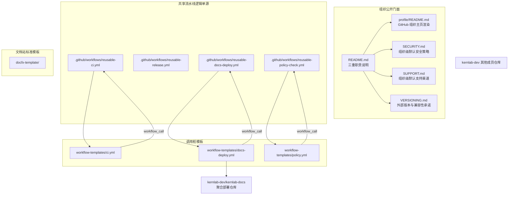
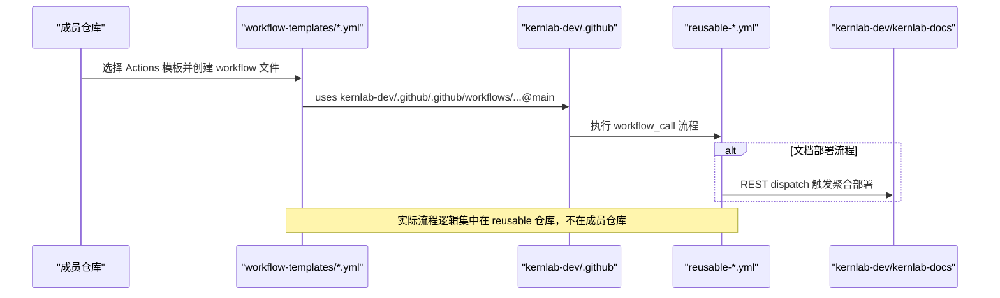
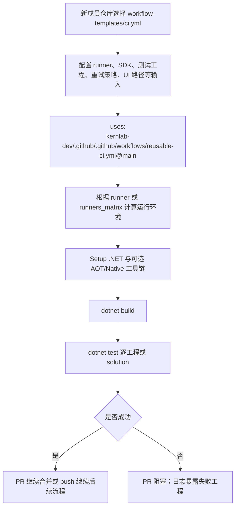
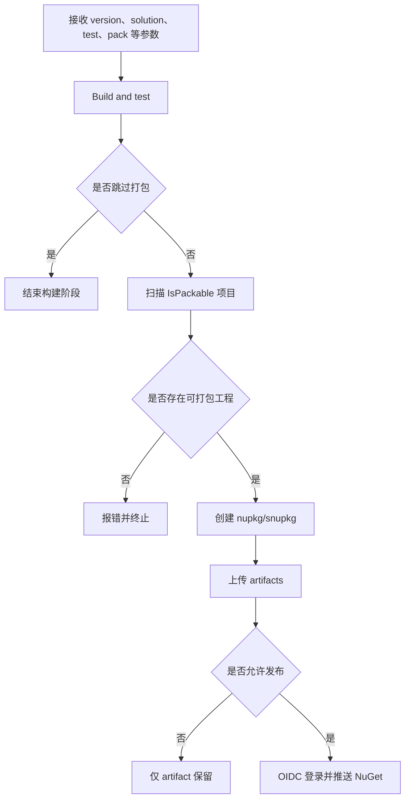
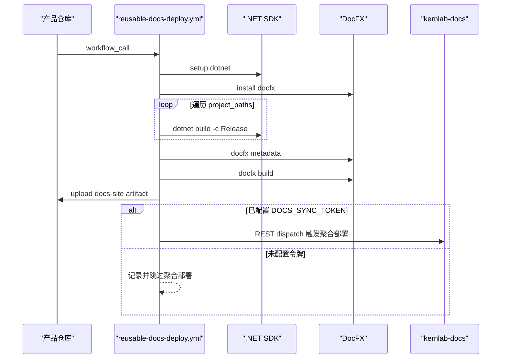
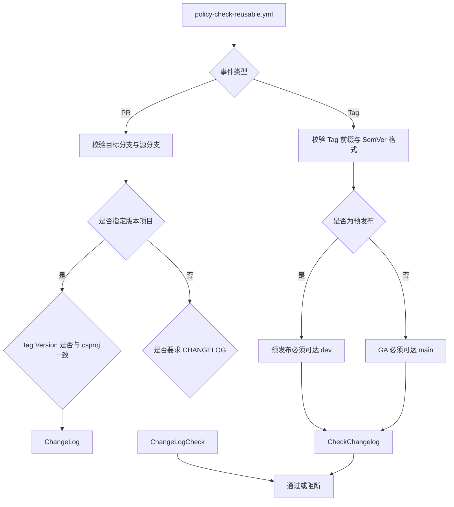
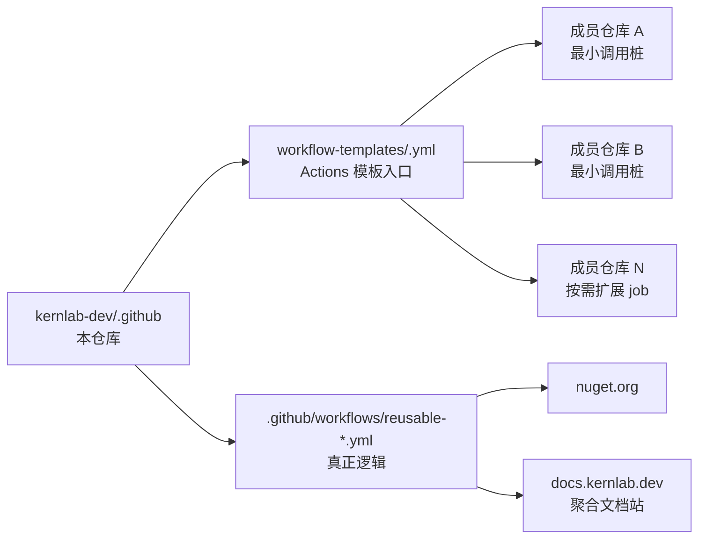

# 项目概述与定位

<cite>
**本文引用的文件**   
- [README.md](file://README.md)
- [SECURITY.md](file://SECURITY.md)
- [SUPPORT.md](file://SUPPORT.md)
- [VERSIONING.md](file://VERSIONING.md)
- [profile/README.md](file://profile/README.md)
- [.github/workflows/reusable-ci.yml](file://.github/workflows/reusable-ci.yml)
- [.github/workflows/reusable-release.yml](file://.github/workflows/reusable-release.yml)
- [.github/workflows/reusable-docs-deploy.yml](file://.github/workflows/reusable-docs-deploy.yml)
- [.github/workflows/reusable-policy-check.yml](file://.github/workflows/reusable-policy-check.yml)
- [workflow-templates/ci.yml](file://workflow-templates/ci.yml)
- [workflow-templates/docs-deploy.yml](file://workflow-templates/docs-deploy.yml)
- [workflow-templates/policy.yml](file://workflow-templates/policy.yml)
</cite>

## 目录

1. [介绍](#介绍)
2. [仓库结构总览](#仓库结构总览)
3. [三大核心职责](#三大核心职责)
4. [家族流水线架构](#家族流水线架构)
5. [可组合 .NET 基础设施家族的产品矩阵](#可组合-net-基础设施家族的产品矩阵)
6. [详细组件分析](#详细组件分析)
7. [与其他成员仓库的关系](#与其他成员仓库的关系)
8. [性能与可靠性设计](#性能与可靠性设计)
9. [常见问题排查](#常见问题排查)
10. [快速导航](#快速导航)
11. [总结](#总结)

## 介绍

本仓库是 GitHub 约定的组织级特殊仓库，承担 kernlab-dev 组织的元基础设施职责：它对外展示 KernLab 产品门户与工程立场，对内提供组织级默认社区健康策略、共享开发纪律以及 `.NET` 生态子项目的流水线逻辑单源。

该仓库本身不是某个业务产品的主代码仓，而是面向所有可组合 `.NET` 底层家族子项目的治理、文档与持续交付基础设施载体。成员仓库通过显式的 `uses:` 调用本仓库的 reusable workflow，从而实现流水线行为、分支策略、发布流程与文档站模板的集中式演进。

对于新加入 kernlab-dev 组织的开发者，本仓库的首要任务是回答三个问题：

- 如何理解 KernLab 作为“可组合 .NET 底层基础设施家族”的定位？
- 如何从现有模板创建新的成员仓库流水线调用桩？
- 文档站、版本承诺、安全报告与获取支持的入口在哪里？

**章节来源**  
- [README.md:1-28](file://README.md#L1-L28)

## 仓库结构总览

**图表来源**  
- [README.md:1-28](file://README.md#L1-L28)
- [profile/README.md:1-40](file://profile/README.md#L1-L40)
- [workflow-templates/ci.yml:1-42](file://workflow-templates/ci.yml#L1-L42)
- [workflow-templates/docs-deploy.yml:1-36](file://workflow-templates/docs-deploy.yml#L1-L36)
- [workflow-templates/policy.yml:1-21](file://workflow-templates/policy.yml#L1-L21)

仓库采用清晰的职责分层：

| 层级 | 路径或目录 | 职责 |
|---|---|---|
| 组织公开门面 | `profile/`、根目录治理文档 | GitHub 组织主页、安全与支持默认值、对外版本承诺 |
| 共享流水线 | `.github/workflows/reusable-*.yml` | 真正的 CI、发布、文档与策略校验实现 |
| 调用桩模板 | `workflow-templates/` | 成员仓库新建时可复制的轻量 `workflow_call` 入口 |
| 文档模板 | `docfx-template/` | 统一样式、导航、构建配置，供 docfx 站点使用 |

这种分离确保了一个原则：**共享流程不可被成员仓库直接覆盖，只能通过 `workflow_call` 输入参数和调用侧 job 补充进行有限扩展。**

**章节来源**  
- [README.md:1-28](file://README.md#L1-L28)
- [workflow-templates/ci.yml:1-42](file://workflow-templates/ci.yml#L1-L42)

## 三大核心职责

### 一、组织公开门面

`profile/README.md` 会渲染到 GitHub 的 `kernlab-dev` 组织 Overview 页面。它承担以下作用：

- 向访问者给出 KernLab 的品牌定位——“可组合的 .NET 底层基础设施家族”。
- 展示产品矩阵中的 Tier、Loom、Cell、Claim、Traffic 等产品与其 NuGet 包入口。
- 明确工程立场：自研内核、编译期优先、零反射、AOT 就绪、零警告红线。
- 把讨论与安全报告引导回 GitHub Discussions 和本仓库的 `SECURITY.md`。

由于 GitHub 要求组织级默认社区健康文件的载体仓库必须是公开（托管型组织可为 internal），本仓库采用 public 可见性。

**章节来源**  
- [README.md:1-28](file://README.md#L1-L28)
- [profile/README.md:1-40](file://profile/README.md#L1-L40)

### 二、组织级默认社区健康文件承载

根目录的 `SECURITY.md` 与 `SUPPORT.md` 充当 org-level default fallback：若某个 kernlab-dev 成员仓库没有自行编写同名文件，这些文件会被组织继承为默认值。

需要注意的重要约束是：这些默认文件通常不会出现在普通文件浏览器、git 历史、克隆与下载结果中；它们是 GitHub 在解析缺失时的回退策略，而不是一个普通业务仓库应该常规展示的源码。

`sUPPORT.md` 还明确了沟通渠道边界：

| 渠道类型 | 处理方式 |
|---|---|
| 使用交流、方案讨论 | GitHub Discussions |
| 已确认缺陷 | 由维护者转入内部工单跟踪 |
| 功能请求 | Discussions 提案 |
| 安全漏洞 | 私有礼道，不得在公开 Issue 披露 |
| 微信、邮箱、私聊 | 不接受 |

这帮助新人明确：这个仓库不承接私人咨询，也不替代各产品的具体支持协议。

**章节来源**  
- [README.md:1-28](file://README.md#L1-L28)
- [SECURITY.md:1-28](file://SECURITY.md#L1-L28)
- [SUPPORT.md:1-15](file://SUPPORT.md#L1-L15)

### 三、家族公共工程文档与共享流水线逻辑单源

本仓库同时承载两件事：

1. **家族公共工程文档**：包括跨仓库公共开发纪律、版本与兼容性承诺、编译器扩展诊断 ID 段位注册表、DocFX 文档站标准模板等。
2. **家族共享流水线**：四条 reusable workflow 分别承担 CI、NuGet 发布、文档站部署、分支与 Tag 策略校验。

成员仓库不需要重新实现这些流程；它们只应在自己的 `.github/workflows` 中保留极薄的调用桩，再通过 `uses: kernlab-dev/.github/.github/workflows/<name>@main` 引用正式实现的分支。

**章节来源**  
- [README.md:1-28](file://README.md#L1-L28)

## 家族流水线架构

KernLab 的 CI/CD 体系围绕 four reusable workflows 展开，并由 workflow-templates 提供新仓初始模板。

**图表来源**  
- [workflow-templates/ci.yml:1-42](file://workflow-templates/ci.yml#L1-L42)
- [.github/workflows/reusable-ci.yml:1-164](file://.github/workflows/reusable-ci.yml#L1-L164)
- [.github/workflows/reusable-docs-deploy.yml:1-83](file://.github/workflows/reusable-docs-deploy.yml#L1-L83)

### 四大 reusable workflow

| 名称 | 触发方式 | 主要责任 | 关键输出 |
|---|---|---|---|
| `reusable-ci` | `workflow_call` | 默认 GitHub 托管 runner 或自建 runner matrix；`.NET` 构建与测试 | 构建结果、可选 AOT toolchain、UI 预构建产物 |
| `reusable-release` | `workflow_call` | NuGet 打包、符号包上传、OIDC Trusted Publishing 发布 | nupkg、snupkg、NuGet.org 包 |
| `reusable-docs-deploy` | `workflow_call` | DocFX metadata/build、docs-site artifact、聚合部署调度 | docs-site、kernlab-docs 部署触发 |
| `reusable-policy-check` | `workflow_call` | PR 分支准入、Tag SemVer、Version 对齐、CHANGELOG 检查 | 阻断失败或不阻断的分支/版本策略判断 |

每个 reusable workflow 都明确声明 `on: workflow_call` 和输入参数；成员仓库只负责提供这些输入，而不需要复制完整流程逻辑。

**章节来源**  
- [README.md:1-28](file://README.md#L1-L28)
- [.github/workflows/reusable-ci.yml:1-164](file://.github/workflows/reusable-ci.yml#L1-L164)
- [.github/workflows/reusable-release.yml:1-172](file://.github/workflows/reusable-release.yml#L1-L172)
- [.github/workflows/reusable-docs-deploy.yml:1-83](file://.github/workflows/reusable-docs-deploy.yml#L1-L83)
- [.github/workflows/reusable-policy-check.yml:1-160](file://.github/workflows/reusable-policy-check.yml#L1-L160)

## 可组合 .NET 基础设施家族的产品矩阵

`profile/README.md` 将 KernLab 定位为“从存储内核到流量平台”的可组合基础设施家族。其核心思想是：底层由自研且零黑盒依赖的内核支撑，上层通过编译期和运行时能力进行组合。

| 产品 | 定位 | 当前状态 | 重要角色 |
|---|---|---|---|
| KernLab.Tier | 字节存储内核；KV / WAL / Blob / Queue / TimeSeries；NativeAOT 就绪 | 预览版包 | 存储层核心 |
| KernLab.Loom | 编译期层；源生成器、规则分析器、构建骨架 | 预览版包 | Tier 为 0 号消费者 |
| KernLab.Cell | 运行时容器；一租户一容器进程隔离与池化 | 预览版包 | OS 级资源边界 |
| KernLab.Claim | 统一认证中心；验证身份、签发身份声明 | 预览版包 | 统一信任源 |
| KernLab.Traffic | 全协议统一流量平台；多协议复用、指令流编排、原生多租户 | 筹备中 | 流量入口与调度面 |
| KernLab.Synod | Raft 强一致分布式 KV | 筹备中 | 分布式一致性层 |
| KernLab.Cohort | 分布式开发框架底座；MiniAPI + CQRS + 源生成端点 + 编译期切面 | 筹备中 | 分布式应用开发层 |

其中，Loom 与 Tier 的关系具有代表性：Loom 负责编译期生成与装配，Tier 消费 Loom 提供的能力，实现零反射、低分配的持久化与数据服务层。这种“编译期生成 → 运行时内核 → 运行时容器 → 认证与流量层”的分层关系，构成了可组合 .NET 底层家族的典型技术方向。

> “筹备中”表示对应产品尚未完成公开包或文档页，不代表 KernLab 基础设施仓库的职责变化。

**章节来源**  
- [profile/README.md:1-40](file://profile/README.md#L1-L40)

## 详细组件分析

### reusable-ci：家族公共 CI 门禁

`reusable-ci.yml` 是家族统一的 CI 逻辑载体，重点能力包括：

- 支持单一 runner（默认 GitHub 托管 `ubuntu-latest`）。
- 支持通过 JSON 数组形式的 `runners_matrix` 传入多个自建 runner 标签。
- 支持 `use_setup_dotnet: false`，用于自建机预装 SDK 场景。
- 对 Linux 条件安装 NativeAOT 工具链。
- 可选卫星 UI 预构建：Node 安装、npm ci、指定构建命令，使前端资产嵌入后端构建态。
- 统一的 dotnet 构建与测试执行，支持逐工程或 solution 一次成型。
- 针对时序敏感测试的重试机制。

调用栈如下：

**图表来源**  
- [workflow-templates/ci.yml:1-42](file://workflow-templates/ci.yml#L1-L42)
- [.github/workflows/reusable-ci.yml:1-164](file://.github/workflows/reusable-ci.yml#L1-L164)

设计要点：

- GitHub 托管 runner 应开启 `use_setup_dotnet: true`，使用通配 SDK 版本。
- 自建 runner 通常关闭 `use_setup_dotnet`，并把网络下载依赖交给 runner 维护。
- 非 `main` 分支上的 CI 作业有 30 分钟硬超时限制；超过阈值的验证应拆分或迁移到 release、nightly、manual 等其他分支触发线。

**章节来源**  
- [workflow-templates/ci.yml:1-42](file://workflow-templates/ci.yml#L1-L42)
- [.github/workflows/reusable-ci.yml:1-164](file://.github/workflows/reusable-ci.yml#L1-L164)

### reusable-release：NuGet 发布管线

`reusable-release.yml` 的核心目标是稳定地构建、打包并上传 NuGet 包，并在适当条件下执行发布。

其关键语义包括：

- 正式线可通过 `run_tests: true` 执行全量构建与全部测试。
- 包工程通过 `IsPackable=true` 自动扫描或 `pack_projects` 显式列表确定。
- 未找到可打包工程时流程报错，避免误发空发布。
- 包与符号包均上传至 artifact。
- 仅 tag push 才进入 `publish` job；dispatch 仅做构建与打包的空跑形态。
- 发布面 SDK 版本可能不同于构建/测试面 SDK；必要时移除 `global.json` 以避免 OIDC 发布的 SDK 不匹配。
- `skip_publish: true` 时，发布职责留给各仓自己的 release 流程；这是为了满足 NuGet Trusted Publishing 按 caller workflow OIDC 绑定的要求。

**图表来源**  
- [.github/workflows/reusable-release.yml:1-172](file://.github/workflows/reusable-release.yml#L1-L172)

**章节来源**  
- [.github/workflows/reusable-release.yml:1-172](file://.github/workflows/reusable-release.yml#L1-L172)

### reusable-docs-deploy：文档站构建与聚合

`reusable-docs-deploy.yml` 负责把产品仓库的 API 参考转换为 docfx 站点并上报聚合仓库。

处理链路：

1. checkout 产品仓库。
2. 安装 DocFX。
3. 对 `project_paths` 中列出的项目逐个构建。
4. 生成 docfx metadata。
5. 构建文档站 artifact。
6. 若配置了 `DOCS_SYNC_TOKEN`，则触发 `kernlab-dev/kernlab-docs` 聚合部署。

注意：文档质量门在本流程中以“构建成功”为主；更细粒度的本地子路径校验清单位于组织内部的 `.github-private DOC-PUBLISH` 相关规则中，不在本公开仓库体现。

**图表来源**  
- [.github/workflows/reusable-docs-deploy.yml:1-83](file://.github/workflows/reusable-docs-deploy.yml#L1-L83)

**章节来源**  
- [.github/workflows/reusable-docs-deploy.yml:1-83](file://.github/workflows/reusable-docs-deploy.yml#L1-L83)

### reusable-policy-check：分支与版本策略校验

`reusable-policy-check.yml` 是发布前最终防线之一，负责两类检查：

#### PR 分支策略

| 目标分支 | 允许的源分支 |
|---|---|
| `main` | `dev`、`hotfix/*` |
| `dev` | `main`、`feat/*`、`fix/*`、`docs/*`、`chore/*`、`hotfix/*` |

如果 PR 不满足分支规则，流程直接报错并阻断。

#### Tag 策略

Tag 检查包含：

- Tag 必须有正确前缀（例如 `v` 或自定义 `tag_prefix`）。
- Tag 必须符合 SemVer 格式：`vX.Y.Z[-alpha.N|-beta.N|-rc.N]`。
- 预发布 Tag 必须可达 `dev`（可通过输入控制）。
- 正式版 Tag 必须可达 `main`（可通过输入控制）。
- 指定 csproj 时，Tag 版本应与 MSBuild `Version` 属性一致。
- 指定 CHANGELOG 时，变更日志中必须存在对应版本的段落。

这意味着，任何绕过 policy check 的行为都会直接阻止发布，除非修改或替换 reusable 本身——而该 reusable 在 org 级共享，改动应受更高优先级流程审查。

**图表来源**  
- [.github/workflows/reusable-policy-check.yml:1-160](file://.github/workflows/reusable-policy-check.yml#L1-L160)

**章节来源**  
- [.github/workflows/reusable-policy-check.yml:1-160](file://.github/workflows/reusable-policy-check.yml#L1-L160)

## 与其他成员仓库的关系

#### 关系模型

#### 调用关系

- **本仓库持有 reusable 逻辑**：CI、release、docs-deploy、policy-check 的真实步骤定义放在 `.github/workflows/reusable-*.yml`。
- **成员仓库持有调用桩**：新建成员仓库从 `workflow-templates` 选取 `ci`、`docs-deploy`、`policy` 模板，再把 runner、SDK、测试工程、包路径、产品名等参数传进去。
- **事件仅在所属仓库触发**：本仓库的 workflow 不会自动在其他仓库里执行；其它仓库必须显式 `uses:` 引用，才会发生 `workflow_call`。
- **组织默认文件具有隐式继承性**：成员仓库如果没有自身 `SECURITY.md`、`SUPPORT.md` 等默认健康文件，则由本仓库文件作为 GitHub 组织的回退实现。

#### 为什么叫“逻辑单源”

因为所有家族子项目的构建行为、测试重试策略、发布 gate、分支策略、文档站构建流程都收敛在这几个 reusable 文件中。成员仓库只需要关注：

- 我应该跑哪些测试？
- 我应该用哪个 runner？
- 我有哪些可打包工程？
- 我的产品文档路径是什么？
- 我该更新哪些调用桩参数？

而不需要重复实现相同的 `.NET` SDK 安装、NuGet 发布、DocFX 构建或分支准入逻辑。

**章节来源**  
- [README.md:1-28](file://README.md#L1-L28)
- [workflow-templates/ci.yml:1-42](file://workflow-templates/ci.yml#L1-L42)
- [workflow-templates/docs-deploy.yml:1-36](file://workflow-templates/docs-deploy.yml#L1-L36)
- [workflow-templates/policy.yml:1-21](file://workflow-templates/policy.yml#L1-L21)

## 性能与可靠性设计

该仓库的流水线设计已经考虑了可运维性和稳定性，主要体现在以下几方面：

### Runner 双形态

- GitHub 托管 runner：零基础设施，适合大多数仓库的默认门。
- 自建 runner：通过 `runners_matrix` 和多标签组合扩展 Windows、Proxmox、PowerShell、长期任务等特殊环境。
- 在自建 runner 场景下应关闭 `setup-dotnet`，避免中国网络环境下基线 runtime 下载随机卡死的问题。

### 测试重试

CI 和 release 流程都内置重试逻辑，目的是吸收 runner 噪音和偶发性时序失败，而不是掩盖真正失败的测试。

### 超时保护

非 `main` 分支 CI 单 job 设置了 30 分钟硬超时，防止长稳验证、AOT 编译、真云端点验证拖垮 PR 评审节奏。

### 发布安全边界

- OIDC Trusted Publishing 依赖 `id-token: write` 权限。
- 发布 gate 只在 tag push 时执行。
- `skip_publish: true` 时发布职责交给调用方仓库，避免 reusable 主体仓身份与 caller 不一致导致的 401。
- `global.json` 可能在发布阶段被移除，从而允许 nuget OIDC 使用所需的更高 SDK 版本。

### 文档构建可靠性

文档构建采用逐项目构建 + 逐 dll metadata 模式；遗漏任一发布项目会导致 API 参考层缺失。因此 `project_paths` 必须准确反映所有应产出 XML 注释的项目。

**章节来源**  
- [.github/workflows/reusable-ci.yml:1-164](file://.github/workflows/reusable-ci.yml#L1-L164)
- [.github/workflows/reusable-release.yml:1-172](file://.github/workflows/reusable-release.yml#L1-L172)
- [.github/workflows/reusable-docs-deploy.yml:1-83](file://.github/workflows/reusable-docs-deploy.yml#L1-L83)

## 常见问题排查

| 现象 | 可能原因 | 处理方式 |
|---|---|---|
| 新仓库 CI 一直等待或卡在网络步骤 | 使用了 GitHub 托管 `setup-dotnet`，但在自建 runner 上仍存在 SDK/runtime 下载问题 | 改用 `runners_matrix` 的自建 runner 标签，并设置 `use_setup_dotnet: false` |
| PR 到 `main` 被策略拒绝 | 源分支不符合 `main` 准入规则 | 使用 `dev` 或 `hotfix/*` 提交 PR |
| PR 到 `dev` 被策略拒绝 | 源分支不是短命名分支或未走预期前缀 | 使用 `feat/*`、`fix/*`、`docs/*`、`chore/*`、`hotfix/*`，或通过 `main` 回灌 |
| Tag 被拒绝 | Tag 格式不是合法 SemVer，或缺少 `v` 前缀 | 改为符合 `vX.Y.Z[-alpha.N|-beta.N|-rc.N]` 的 Tag |
| 预发布 Tag 失败 | Tag 不可达 `dev` | 先将 commit 合入 `dev`，或调整 policy 输入 |
| GA Tag 失败 | Tag 不可达 `main` | 将 tag 指向 `main` 可达提交 |
| 包为空或无法打包 | 没有找到 `IsPackable=true` 的工程 | 先立项可打包 csproj，或提供 `pack_projects` |
| NuGet 推送 401 | 未在 nuget.org 登记 trusted publishing；或者 reusable 的 publisher 身份不是 caller | 核对 org 内 NuGet 登记；必要时让调用仓库自己拥有 `publish` job |
| 文档站缺少某产品 API 参考 | `project_paths` 漏项 | 补全所有需要生成 XML 注释的 csproj |
| 文档聚合未触发 | `DOCS_SYNC_TOKEN` 未配置 | 在调用仓库 Settings → Secrets 中配置 token；或确认该仓库确实需要聚合 |

### 版本与兼容性的基本约定

此外，`VERSIONING.md` 明确了对外承诺：

- 遵循 Semantic Versioning 2.0。
- 预发布版本不建议用于生产。
- patch 修复兼容缺陷，minor 添加向后兼容能力，major 接受破坏性 API 或存储格式变更。
- NuGet 包、git Tag、容器镜像 Tag 保持版本号对齐。
- `latest` 镜像 Tag 只指向正式版。
- 已发布版本不移动 Tag、不覆盖镜像。

这对维护者的含义是：当 Storage Tier、Cell、Loom 这类底层设施发生变化时，必须判断是否影响磁盘格式、序列化布局、API 或兼容性契约，并据此选择 minor 或 major。

**章节来源**  
- [VERSIONING.md:1-85](file://VERSIONING.md#L1-L85)

## 快速导航

以下是面向不同读者角色的入口导航：

| 读者目标 | 阅读顺序 |
|---|---|
| 初次接触的新成员 | [profile/README.md](file://profile/README.md) → [README.md](file://README.md) → [workflow-templates/ci.yml](file://workflow-templates/ci.yml) |
| 需要建立新仓库流水线的维护者 | [workflow-templates/ci.yml](file://workflow-templates/ci.yml) → [workflow-templates/docs-deploy.yml](file://workflow-templates/docs-deploy.yml) → [workflow-templates/policy.yml](file://workflow-templates/policy.yml) |
| 需要理解 CI 行为的维护者 | [.github/workflows/reusable-ci.yml](file://.github/workflows/reusable-ci.yml) |
| 需要理解发布过程的维护者 | [.github/workflows/reusable-release.yml](file://.github/workflows/reusable-release.yml) |
| 需要维护文档站的维护者 | [.github/workflows/reusable-docs-deploy.yml](file://.github/workflows/reusable-docs-deploy.yml)、`docfx-template/` |
| 需要了解版本承诺的外部使用者 | [VERSIONING.md](file://VERSIONING.md) |
| 需要上报安全漏洞的贡献者 | [SECURITY.md](file://SECURITY.md)、[SUPPORT.md](file://SUPPORT.md) |

建议首次使用时先读 `profile/README.md` 了解 KernLab 产品家族，再读 `README.md` 理解本仓库的组织职责，最后根据实际需要打开对应的 template 和 reusable 文件。

**章节来源**  
- [README.md:1-28](file://README.md#L1-L28)
- [profile/README.md:1-40](file://profile/README.md#L1-L40)
- [VERSIONING.md:1-85](file://VERSIONING.md#L1-L85)

## 总结

kernlab-dev/.github 是一个典型的“组织元基础设施仓库”：它不负责某个业务的完整特性实现，却决定了整个家族仓库在质量、版本、安全和持续交付方面的共同基线。

它的价值可以用一句话概括：

> 对外提供组织公开门面、默认社区健康回退与对外版本承诺；对内提供 reusable CI、release、文档站与策略校验，让所有 .NET 生态子项目共用同一套流水线逻辑与协作纪律。

对新老成员而言，最重要的边界意识是：

- 不要复制 reusable workflow。
- 不要忽略 `workflow-templates`。
- 不要把本仓库当作某个产品的主仓库。
- 不要把组织默认的 `SECURITY.md`、`SUPPORT.md` 当成可随 git clone 看到的普通仓库文件。
- 遇到流水线问题，优先查 reusable 定义；遇到版本问题，以 `VERSIONING.md` 为对外权威依据。