# 高级配置与扩展指南

<cite>
**本文引用的文件**   
- [.github/workflows/reusable-ci.yml](file://.github/workflows/reusable-ci.yml)
- [.github/workflows/reusable-release.yml](file://.github/workflows/reusable-release.yml)
- [workflow-templates/gate.yml](file://workflow-templates/gate.yml)
- [.github/workflows/o10-nuget-unlist.yml](file://.github/workflows/o10-nuget-unlist.yml)
- [CI-GATE.md](file://CI-GATE.md)
</cite>

## 目录

1. [目标与阅读对象](#目标与阅读对象)
2. [仓库定位与复用模型](#仓库定位与复用模型)
3. [可复用流水线概览](#可复用流水线概览)
4. [Gate 入口：按需区段、docs 快速通道与按 tag 发布](#gate-入口按需区段docs-快速通道与按-tag-发布)
5. [构建与测试：runners_matrix、test_projects、并发与缓存](#构建与测试runners_matrixtest_projects并发与缓存)
6. [卫星 UI 预构建与 Node.js 工具链依赖](#卫星-ui-预构建与-nodejs-工具链依赖)
7. [NativeAOT 验证入口：install_aot_toolchain 与 Linux runner 组合](#nativeaot-验证入口install_aot_toolchain-与-linux-runner-组合)
8. [NuGet 软下架工具：o10-nuget-unlist 的 dispatch 输入与 GA 包保护名单](#nuget-软下架工具o10-nuget-unlist-的-dispatch-输入与-ga-包保护名单)
9. [发布控制输入项：skip_pack、version 及其影响](#发布控制输入项skip_packversion-及其影响)
10. [扩展现有 reusable workflow：继承而不是复制粘贴](#扩展现有-reusable-workflow继承而不是复制粘贴)
11. [官方模板与本组织 reusable 的命名与设计差异](#官方模板与本组织-reusable-的命名与设计差异)
12. [安全提醒](#安全提醒)
13. [性能与成本优化建议](#性能与成本优化建议)
14. [常见决策矩阵](#常见决策矩阵)
15. [问题排查清单](#问题排查清单)
16. [结论](#结论)

## 目标与阅读对象

本文面向希望深度定制 GitHub Actions 行为的高级用户和维护者，聚焦以下扩展点：

- 使用 `runners_matrix` 指定 GitHub 托管 Runner 与自建 Runner 的组合；
- 根据网络环境与性能诉求切换 runner，并理解 PR 单 job 硬超时边界；
- 通过缓存、并发和重试缩短 CI 反馈时间；
- 使用 `test_projects` glob 限定解决方案中的测试项目，并结合条件判断跳过无关测试；
- 开启 `install_aot_toolchain` 并在 Linux runner 上安装 NativeAOT 工具链；
- 配置 `ui_project_path`、`ui_node_version`、`ui_build_command` 触发卫星 UI 预构建；
- 理解 `skip_pack`、`version` 等发布控制的真实语义；
- 解释 Gate 入口中 docs 快速通道、`DOCS_MERGE_PAT` 与按需启用注释块；
- 说明 `o10-nuget-unlist` 的 dispatch 输入与 GA 包保护名单规则；
- 以“最小调用桩”方式继承 reusable workflow，新增 input 时保持向后兼容；
- 对比官方模板与本组织 reusable 的设计差异；
- 避免日志泄漏 Secret、OIDC Token 与操作确认信息。

## 仓库定位与复用模型

本仓库承担家族公共开发纪律、版本承诺、文档站模板与共享流水线逻辑。各业务仓只保留 Gate 与调用桩，并通过显式 `uses: kernlab-dev/.github/...@main` 引用已发布的 reusable 定义。这意味着：

- 业务仓不复制流水线实现；
- 逻辑变更集中在 `.github/workflows` 下的 reusable；
- 每个仓的 `workflow-templates/gate.yml` 是唯一入口；
- 新增扩展应优先更新 Gate 顶层调用或打开按需注释块，而不必复制 reusable 代码。

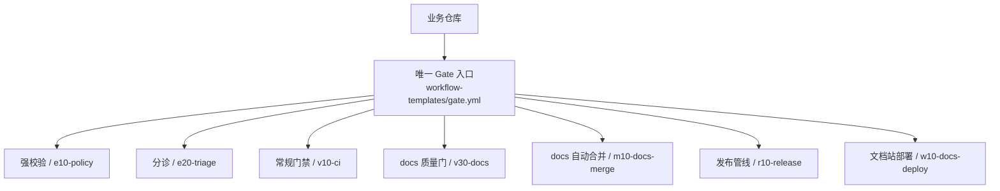

**图示来源**   
- [workflow-templates/gate.yml:28-89](file://workflow-templates/gate.yml#L28-L89)

**Section sources**  
- [workflow-templates/gate.yml:1-26](file://workflow-templates/gate.yml#L1-L26)

## 可复用流水线概览

当前组织内由 Gate 调度的 reusable 角色如下：

| 阶段 | 工作流 | 作用 | 典型触发 | 主要约束 |
|---|---|---|---|---|
| 强校验 | `reusable-e10-policy.yml` | 来源、Tag、版本、CHANGELOG 校验 | push/PR/dispatch | 可能返回 `docs_only` 分支信号 |
| 分诊 | `reusable-e20-triage.yml` | 路由信号，识别 docs-only PR | push/PR/dispatch | 产出 `docs_only` 输出供 Gate 判断 |
| 常规门禁 | `reusable-v10-ci.yml` | 调用 `reusable-ci`，构建+测试 | main/dev/PR | PR 单 job 默认 30 分钟硬超时 |
| docs 质量门 | `reusable-v30-docs.yml` | 文档构建与质量检查 | docs-only PR | 需要每仓库配置 `secrets.DOCS_MERGE_PAT` |
| docs 自动合并 | `reusable-m10-docs-merge.yml` | squash + 删除分支 | 合并条件满足后 | 不能作用于 draft PR |
| 发布管线 | `reusable-r10-release.yml` | 构建、打包、上传 artifact、可选 push | tag `v*` | 仅在 push 到 tag 时真正发布 |
| 文档站部署 | `reusable-w10-docs-deploy.yml` | 聚合文档站并对外部署 | main 推送 | 双守卫 + `DOCS_SYNC_TOKEN` |

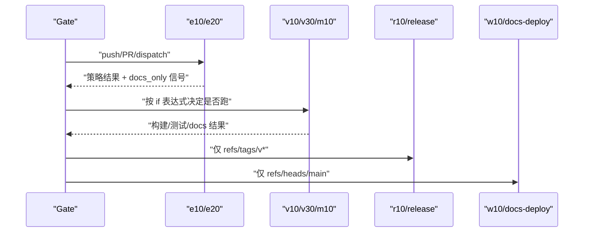

**图示来源**   
- [workflow-templates/gate.yml:28-89](file://workflow-templates/gate.yml#L28-L89)

## Gate 入口：按需区段、docs 快速通道与按 tag 发布

### 唯一 Gate 入口

每个业务仓应保留 `workflow-templates/gate.yml` 作为唯一入口。它承担三件事：

1. 声明统一的 concurrency 组 `gate-${{ github.workflow }}-${{ github.ref }}`；
2. 固定 top-level permissions，包括 `id-token: write`；
3. 在顶层按责任划分阶段（策略 → 分诊 → 验证 → docs → release → docs-deploy）。

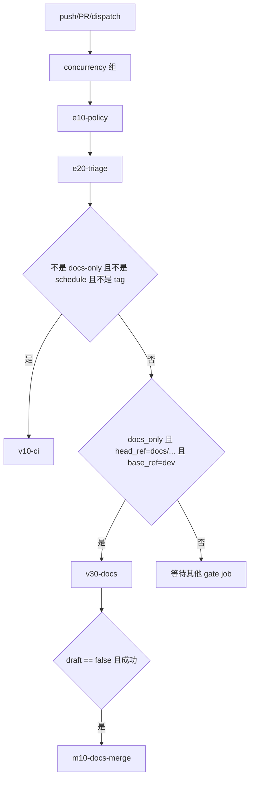

**图示来源**   
- [workflow-templates/gate.yml:17-26](file://workflow-templates/gate.yml#L17-L26)
- [workflow-templates/gate.yml:28-71](file://workflow-templates/gate.yml#L28-L71)

**Section sources**  
- [workflow-templates/gate.yml:1-26](file://workflow-templates/gate.yml#L1-L26)

### 按需启用的注释块

Gate 中部分区域采用“注释掉即禁用”的方式表达扩展点：

| 注释标记 | 实际含义 |
|---|---|
| `# v20-extension:` | 仓扩展验证区段，例如自定义自建池或外部端点链 |
| `# v40-heavy:` | 重线 AOT/长稳/全矩阵，通常放在 schedule/dispatch/main push |
| `# r10-release:` | 正式发布管线，已被打开并限制为 `refs/tags/v*` |
| `# w10-docs-deploy:` | 文档站部署，已被打开并限制为主分支推送 |

这些注释块来源于组织级设计约定：**普通仓不需要每条能力都运行；未启用的区段不应产生执行开销**。当你的仓确实发布 NuGet 包、构建文档站、运行重型验证时，再取消对应注释并补齐 with 参数。

完整形态见组织内部规范 `CI-GATE.md §8`。

**Section sources**  
- [workflow-templates/gate.yml:72-89](file://workflow-templates/gate.yml#L72-L89)

### docs 快速通道与 `secrets.DOCS_MERGE_PAT`

docs 快速通道由两条 job 构成：

- `v30-docs`：docs 质量门；
- `m10-docs-merge`：成功后自动合并 squash PR 并删除分支。

二者共同受以下条件约束：

1. 前置 policy/triage 均成功；
2. `needs.e20-triage.outputs.docs_only == 'true'`；
3. `startsWith(github.head_ref, 'docs/')`；
4. `github.base_ref == 'dev'`；
5. `m10-docs-merge` 还要求 `needs.v30-docs.result == 'success'`；
6. `pull_request.draft == false`。

`m10-docs-merge` 会接收 secret `DOCS_MERGE_PAT`。这是一个**每仓库独立配置**的要求：不同仓可以使用各自 PAT，权限范围应尽量符合最小授权原则。该 secret 不得泛化到所有业务仓库共用一个高权限 token。

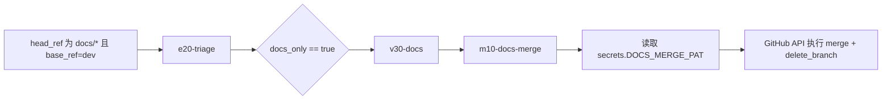

**图示来源**   
- [workflow-templates/gate.yml:56-71](file://workflow-templates/gate.yml#L56-L71)

**Section sources**  
- [workflow-templates/gate.yml:48-71](file://workflow-templates/gate.yml#L48-L71)

## 构建与测试：runners_matrix、test_projects、并发与缓存

### runners_matrix 与 runner 双形态

`reusable-ci` 明确支持两种 runner 形态：

| 形态 | 配置方式 | 行为 |
|---|---|---|
| GitHub 托管单腿 | 不设置 `runners_matrix` | 使用 `runner: ubuntu-latest` |
| 自建多腿 | 设置 `runners_matrix` 为 JSON 数组字符串 | 使用 `fromJSON(...)` 构造 matrix，忽略默认 `runner` |

核心逻辑等价于：

```yaml
matrix:
  os: ${{ fromJSON(inputs.runners_matrix != '' && inputs.runners_matrix || format('[\"{0}\"]', inputs.runner)) }}
```

因此：

- 空 `runners_matrix` 时退化为 `['ubuntu-latest']`；
- 非空 `runners_matrix` 时使用传入标签，如 `["win-ci","pve-ci"]`；
- 如果只传 `runner` 而不传 `runners_matrix`，则始终走单腿；
- 不要假设设置 `runner` 就能覆盖 `runners_matrix`，后者优先级更高。

### 何时选择自有 Runner

| 场景 | 推荐配置 | 原因 |
|---|---|---|
| 普通开源仓库、零基础设施 | 不设置 `runners_matrix`，使用 `runner: ubuntu-latest` | 无需维护宿主 |
| 中国网络下 setup-dotnet 下载 runtime 卡住 | `runners_matrix: '[\"own-linux\"]'` + `use_setup_dotnet: false` | 绕过基线 runtime 下载风险 |
| Windows/Linux 混合环境 | `runners_matrix: '[\"win-ci\",\"pve-ci\"]'` | 用平台标签替代 OS 枚举 |
| GPU/CPU/GitLab/私有云 Runner | 同上 | 把平台维度抽象为标签 |

### test_projects glob 模式

`test_projects` 默认为 `tests/*/*.csproj`，表示“只构建不测试时为空的测试路径”。

执行路径：

1. 若 `test_solution=true`，必须先设置 `solution`；
2. 否则遍历 `${TEST_PROJECTS}` 中的 glob 匹配项；
3. 每个存在的项目执行 `dotnet test`；
4. 不存在的项目被直接跳过；
5. 若设置 `test_filter`，则追加 `--filter`；
6. 每个项目最多失败重试 `RETRIES` 次，每次失败打印 warning，超出上限后报错。

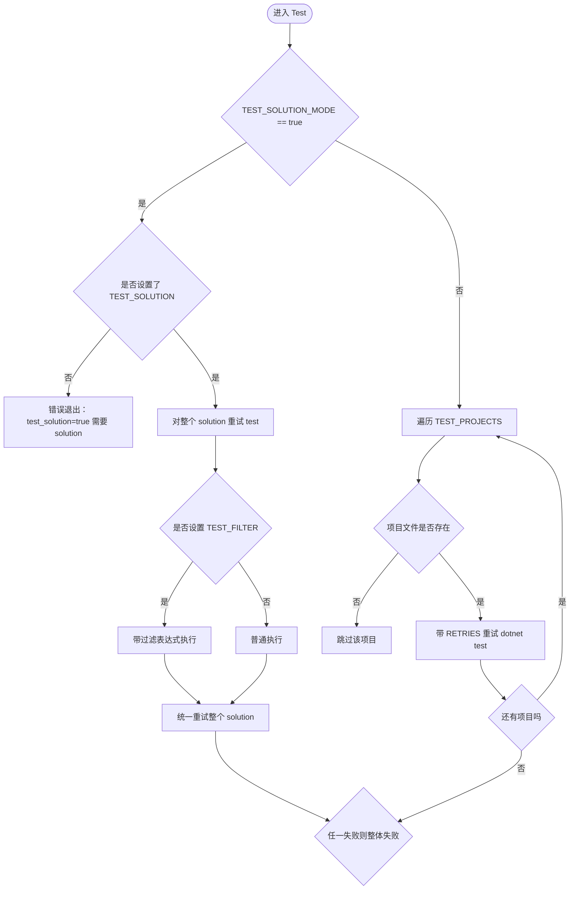

**图示来源**   
- [.github/workflows/reusable-ci.yml:109-164](file://.github/workflows/reusable-ci.yml#L109-L164)

### 条件化跳过测试

| 条件变量 | 来源 | 用途 |
|---|---|---|
| `BUILD_CONFIG` | `build_config` | Debug/Release 区分 |
| `TEST_SOLUTION_MODE` | `test_solution` | solution 级或逐 project |
| `TEST_SOLUTION` | `solution` | 完整 solution 路径 |
| `TEST_PROJECTS` | `test_projects` | glob 列表 |
| `TEST_FILTER` | `test_filter` | 测试过滤表达式 |
| `RETRIES` | `test_retries` | 每个项目重试次数 |

对大型解决方案的建议：

- PR 小变更使用 `test_filter` 缩小测试面；
- 主分支质量保障使用 `test_solution=true`，让 vstest 一次启动；
- 只在必要时开启全局重试，不要用它掩盖不稳定测试；
- 完全跳过测试时清空 `test_projects` 并保持 `test_solution=false`。

### 并发与缓存

#### Gate 级别并发

Gate 使用 `group: gate-${{ github.workflow }}-${{ github.ref }}` 并以 `cancel-in-progress: true` 取消同 ref 上的旧任务，避免同一 PR 或分支重复积压。

#### reusable-ci 并发

- `strategy.fail-fast: false` 允许一个 runner 失败时其余 runner 继续；
- `timeout-minutes: 30` 限制非 main 分支 PR 单 job；
- retry 位于每个项目的 step 内部，用于吸收 runner 噪音。

#### 缓存注意事项

`reusable-ci` 没有直接内置 dotnet restore cache；如需优化，应在调用仓 job 层使用 `actions/cache`，并以操作系统、SDK 和 dependency graph 稳定键为基础。不要为了期望缓存而跳过必要的 build/test。

**Section sources**  
- [.github/workflows/reusable-ci.yml:25-41](file://.github/workflows/reusable-ci.yml#L25-L41)
- [.github/workflows/reusable-ci.yml:109-164](file://.github/workflows/reusable-ci.yml#L109-L164)
- [workflow-templates/gate.yml:17-24](file://workflow-templates/gate.yml#L17-L24)

## 卫星 UI 预构建与 Node.js 工具链依赖

当 `ui_project_path` 非空时，工作流会在 .NET 构建前执行卫星 UI 预构建流程：

1. 使用 `ui_node_version`（默认 `20`）安装 Node.js；
2. 启用 npm cache，并使用 `${ui_project_path}/package-lock.json` 作为缓存依赖路径；
3. 切换到 `ui_project_path`，执行 `npm ci`；
4. 执行 `ui_build_command`（默认 `run build`）；
5. 生成 `dist` 产物，供后续 .NET 构建内嵌卫星资产；
6. 家族栈的 npm build 过程内置 vue-tsc 类型检查。

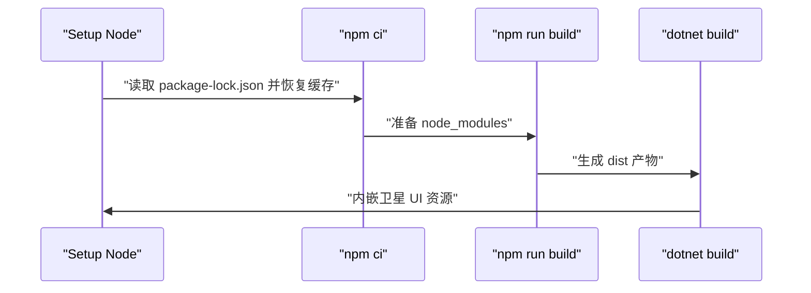

**图示来源**   
- [.github/workflows/reusable-ci.yml:43-58](file://.github/workflows/reusable-ci.yml#L43-L58)

**Section sources**  
- [.github/workflows/reusable-ci.yml:43-58](file://.github/workflows/reusable-ci.yml#L43-L58)

## NativeAOT 验证入口：install_aot_toolchain 与 Linux runner 组合

当前 `reusable-ci.yml` **没有名为 `enable_aot` 或 `aot_targets` 的标准输入项**。与之对应的实现是：

- `install_aot_toolchain`：布尔输入，默认 `false`；
- 仅当 `inputs.install_aot_toolchain && runner.os == 'Linux'` 时才安装 clang 与 zlib1g-dev；
- `runners_matrix` 负责提供 Linux runner 平台；
- 真正的 NativeAOT 编译/探针应由项目或自定义 job 驱动。

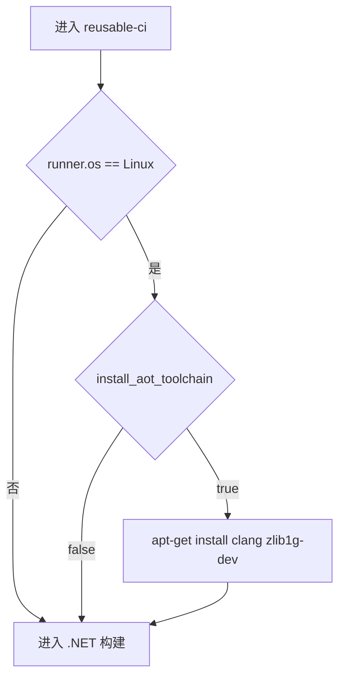

**图示来源**   
- [.github/workflows/reusable-ci.yml:36-41](file://.github/workflows/reusable-ci.yml#L36-L41)

如果使用自有 Linux runner 进行 NativeAOT 相关验证，推荐思路是：

1. 在 `runners_matrix` 中包含一个 Linux runner；
2. 设置 `install_aot_toolchain: true`；
3. 在项目中编写 NativeAOT 构建目标；
4. 将该 job 从常规 30 分钟 PR 单 job 拆分出来；
5. 避免在每个 PR 必要路径中都承担 AOT 工具链安装成本。

**Section sources**  
- [.github/workflows/reusable-ci.yml:16-35](file://.github/workflows/reusable-ci.yml#L16-L35)
- [.github/workflows/reusable-ci.yml:36-41](file://.github/workflows/reusable-ci.yml#L36-L41)

## NuGet 软下架工具：o10-nuget-unlist 的 dispatch 输入与 GA 包保护名单

`o10-nuget-unlist.yml` 是组织中央运维工具，用于 NuGet 包“软下架”——仅隐藏列表中可见版本，已安装消费者不受影响。它通过 `workflow_dispatch` 手动触发，每个调用必须传入三个必填输入：

| 输入 | 类型 | 必需 | 含义 |
|---|---|---:|---|
| `package_id` | string | 是 | NuGet 包 ID，例如 `KernLab.Tier.Contracts` |
| `version` | string | 是 | 包版本，例如 `1.0.0-alpha.19` |
| `confirm` | string | 是 | 确认词，必须是 `unlist` |

### 确认词机制

job 首先检查 `confirm` 是否为 `unlist`，如果不是立即失败。这是防止误触的手动入口防护。

### GA 包保护名单规则

随后会检查版本号：

- 含 `-` 的版本（如 `1.0.0-alpha.19`）被视为 prerelease，允许走此 workflow；
- 不含 prerelease 段的正式版/GA 版本会被拒绝，提示 “GA 包禁走本 workflow（unlist 走人工评审）”。

也就是说：

```bash
1.0.0        # 禁止：GA 包
1.0.0-beta   # 允许：prerelease
2.0.0-alpha.7 # 允许：prerelease
```

### 凭据与执行

- 凭据来自组织级 secret `NUGET_UNLIST_USER`；
- toolchain 使用 dotnet `9.0.x`；
- 底层命令最终调用 `dotnet nuget delete "$PACKAGE_ID" "$VERSION"`，并指向 `https://api.nuget.org/v3/index.json`；
- 成功后的回显包含包详情页链接，便于人工核对。

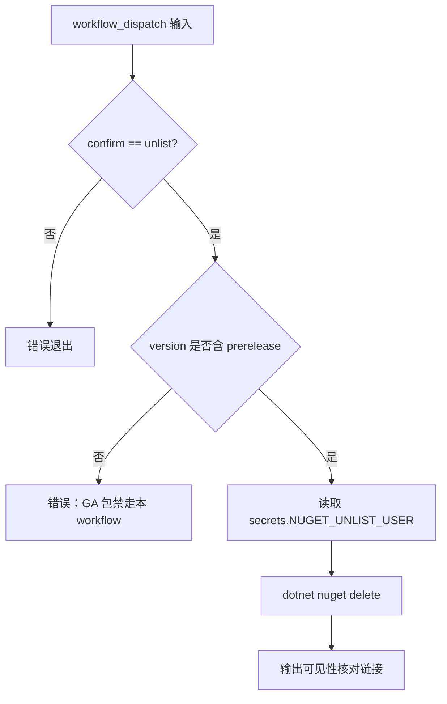

**图示来源**   
- [.github/workflows/o10-nuget-unlist.yml:15-64](file://.github/workflows/o10-nuget-unlist.yml#L15-L64)

**Section sources**  
- [.github/workflows/o10-nuget-unlist.yml:1-64](file://.github/workflows/o10-nuget-unlist.yml#L1-L64)

## 发布控制输入项：skip_pack、version 及其影响

### skip_pack

`skip_pack` 是 `reusable-release` 中的布尔输入，适用于尚未立项包工程的仓的空跑验证。

它同时影响：

- Pack 步骤；
- Upload packages artifact；
- Publish 步骤的 `if` 表达式中与 `skip_publish` 共同控制。

| `skip_pack` | behavior |
|---|---|
| `false` 或未传 | 扫描 `pack_root` 下的可打包项目并执行 `dotnet pack` |
| `true` | 跳过 pack、上传 nupkg/snupkg、以及 publish job |

**Section sources**  
- [.github/workflows/reusable-release.yml:14-21](file://.github/workflows/reusable-release.yml#L14-L21)
- [.github/workflows/reusable-release.yml:69-103](file://.github/workflows/reusable-release.yml#L69-L103)
- [.github/workflows/reusable-release.yml:118-136](file://.github/workflows/reusable-release.yml#L118-L136)

### version 与版本号来源

当前实现中没有 `version_source` 字段。版本号处理逻辑如下：

1. 如果调用方传入 `version`，使用显式值；
2. 否则使用 `${GITHUB_REF_NAME#preview-v}` 去掉可能的 `preview-` 前缀；
3. 再用 `${VERSION#v}` 去掉首字符 `v`；
4. 最终传给 `dotnet pack -p:Version=$VERSION`。

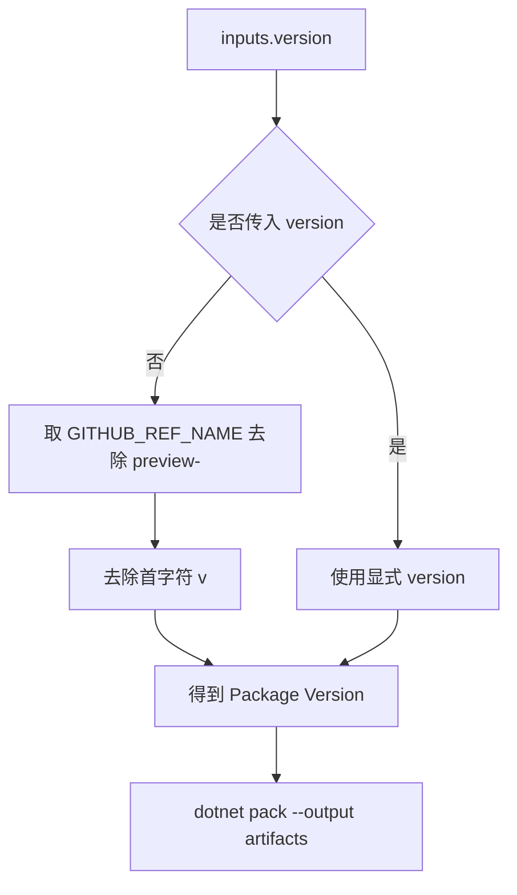

**图示来源**   
- [.github/workflows/reusable-release.yml:84-96](file://.github/workflows/reusable-release.yml#L84-L96)

### 发布 vs 空跑

`reusable-release` 只有一个真正的发布门：**仅 `github.event_name == 'push'` 才进入 publish job**。

因此：

- `workflow_dispatch` 只能用于构建、pack、上传 artifact 的空跑；
- Tag push 才会真正执行 NuGet push；
- 如果 `skip_pack=true`，则 publish job 被跳过；
- 如果 `skip_publish=true`，则发布留驻调用仓自己的 workflow。

### 对测试的影响

当 `run_tests=true` 时，`reusable-release` 会：

1. 可选构建完整 solution；
2. 根据 `test_projects` 或 `solution` 执行测试；
3. 每个项目最多尝试 `RETRIES + 1` 次，中间间隔 10 秒 sleep。

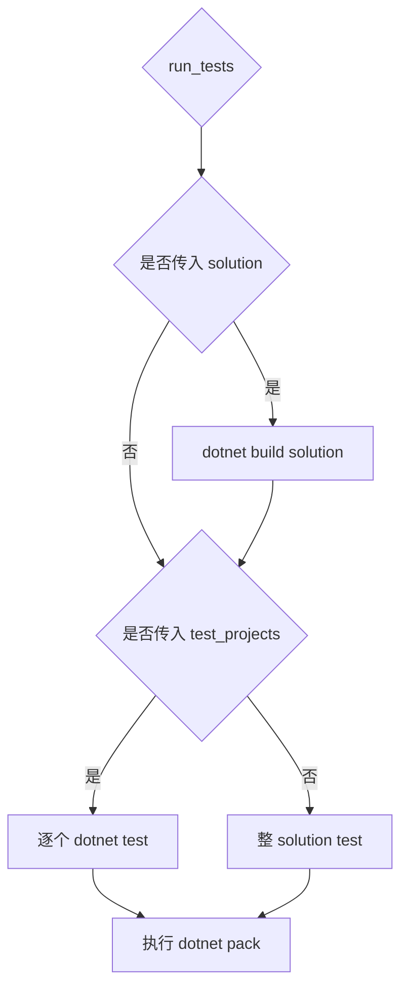

**图示来源**   
- [.github/workflows/reusable-release.yml:51-67](file://.github/workflows/reusable-release.yml#L51-L67)
- [.github/workflows/reusable-release.yml:69-103](file://.github/workflows/reusable-release.yml#L69-L103)

**Section sources**  
- [.github/workflows/reusable-release.yml:51-103](file://.github/workflows/reusable-release.yml#L51-L103)
- [.github/workflows/reusable-release.yml:118-172](file://.github/workflows/reusable-release.yml#L118-L172)

## 扩展现有 reusable workflow：继承而不是复制粘贴

最佳实践是：

1. 通过 Gate 或调用仓新增 job，复用现有 reusable；
2. 不在业务仓里复制 `.github/workflows/reusable-*.yml`；
3. 新增 reusable input 时必须使用 `default:`，让旧工作流仍能运行；
4. 新增必填 input 时应给出迁移路线，避免破坏历史调用；
5. 模板文件应与 reusable 的最小调用方式保持一致；
6. 不在业务仓重复声明 reusable 内部的 `timeout-minutes`。

### 推荐扩展结构

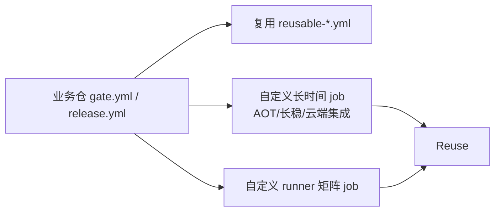

### 新增 input 时的兼容性规则

- Boolean input 默认应为保守行为；
- 新 input 必须有 `default:`，除非该能力本身就不需要旧仓升级；
- 若必须改变默认行为，先分阶段弃用，再强制；
- 需要上游设置的 input 应在文档中标注使用前必填；
- 模板文件应与 reusable 的 expect 契约一致。

**Section sources**  
- [workflow-templates/gate.yml:28-89](file://workflow-templates/gate.yml#L28-L89)
- [.github/workflows/reusable-ci.yml:10-41](file://.github/workflows/reusable-ci.yml#L10-L41)
- [.github/workflows/reusable-release.yml:12-50](file://.github/workflows/reusable-release.yml#L12-L50)

## 官方模板与本组织 reusable 的命名与设计差异

| 主题 | 官方通用写法常见做法 | 本组织实现 | 原因说明 |
|---|---|---|---|
| Runner 集合变量名 | 本地 matrix/os 中直接枚举 | `runners_matrix` | 将 JSON 数组字符串抽成单一 input，简化单 runner 与多 runner 分支 |
| 功能开关 | feature flag、job name、环境变量 | `install_aot_toolchain`、`test_solution`、`skip_pack` | 明确表达该输入触发的副作用，不混淆平台与功能 |
| UI 构建开关 | 无标准字段 | `ui_project_path` | 路径为空即关闭，减少 Boolean 开关膨胀 |
| 版本来源 | 常使用 `RELEASE_VERSION` 等环境变量 | `version` | 直接绑定 workflow_call input，减少环境变量契约漂移 |
| 调用方式 | 各仓自行管理或复制逻辑 | 组织级 reusable + Gate 入口 | 逻辑单源，降低跨仓修复成本 |
| PR 单 job 上限 | 无统一默认 | 30 分钟硬超时 | 避免 PR 无限占用 runner |

关键设计原因：`.github/workflows/reusable-ci.yml` 的文件注释明确了双 runner 形态设计意图，特别是中国网络环境下 setup-dotnet 基线 runtime 下载可能出现随机卡死，因此鼓励使用自带 SDK 的自建 runner 并关闭 `use_setup_dotnet`。

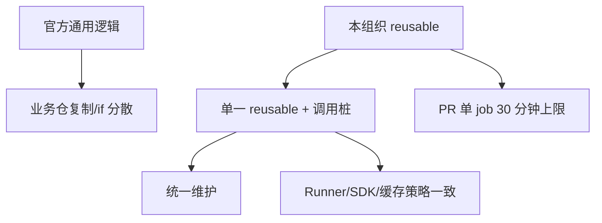

**图示来源**   
- [.github/workflows/reusable-ci.yml:1-15](file://.github/workflows/reusable-ci.yml#L1-L15)
- [.github/workflows/reusable-ci.yml:25-41](file://.github/workflows/reusable-ci.yml#L25-L41)

**Section sources**  
- [.github/workflows/reusable-ci.yml:1-41](file://.github/workflows/reusable-ci.yml#L1-L41)
- [.github/workflows/reusable-release.yml:1-12](file://.github/workflows/reusable-release.yml#L1-L12)

## 安全提醒

### 禁止打印 Secret、Token 与确认词

- 不要输出任何 `secrets.*` 明文；
- 不要把 `*KEY`、`*TOKEN`、`*SECRET` 类变量赋值给 echo 或 debug 变量；
- OIDC Token 由 GitHub 临时签发，不应写入 Action output、artifact 或日志；
- `o10-nuget-unlist` 的 `confirm` 虽然只是确认词，也应避免在非必要日志中放大展示；
- 日志中的敏感信息可能出现在原始 run log、download log 或远程调试链路。

### OIDC Token 使用边界

`reusable-release` 的 publish job 使用 `id-token: write` 与 `NuGet/login@v1`，通过 OIDC 登录 NuGet。需要注意：

- Trusted Publishing 需要在 nuget.org 登记 owner/repository/workflow；
- OIDC Token 绑定的是当前 caller workflow 的身份；
- reusable 载体仓自身身份 push 包会 401，因此需配置 `skip_publish: true`；
- 绝对不要 echo `steps.login.outputs.NUGET_API_KEY`、`NUGET_USER` 或其他凭据。

### DOCS_MERGE_PAT 与 DOCS_SYNC_TOKEN

- `DOCS_MERGE_PAT`：per-repo PAT，用于 docs 合并自动化；
- `DOCS_SYNC_TOKEN`：用于文档站聚合服务协调；
- 两者都应具有最小必要权限；
- 不要泛化到一个通用 token 给所有仓库复用；
- 不要在日志中展开其值。

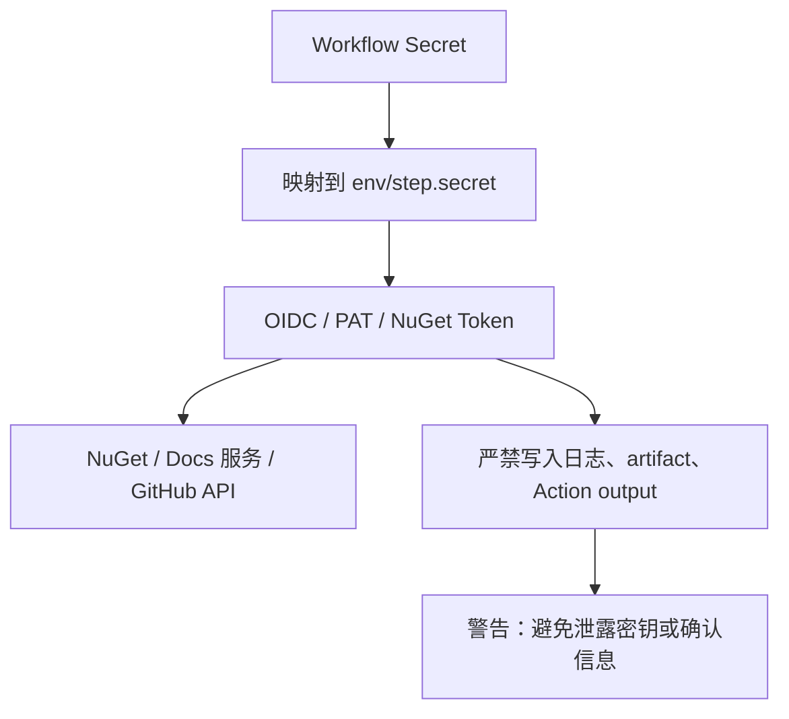

**图示来源**	
- [.github/workflows/reusable-release.yml:127-172](file://.github/workflows/reusable-release.yml#L127-L172)
- [workflow-templates/gate.yml:63-71](file://workflow-templates/gate.yml#L63-L71)
- [.github/workflows/o10-nuget-unlist.yml:15-28](file://.github/workflows/o10-nuget-unlist.yml#L15-L28)

**Section sources**  
- [.github/workflows/reusable-release.yml:1-12](file://.github/workflows/reusable-release.yml#L1-L12)
- [.github/workflows/reusable-release.yml:127-172](file://.github/workflows/reusable-release.yml#L127-L172)
- [workflow-templates/gate.yml:63-71](file://workflow-templates/gate.yml#L63-L71)
- [.github/workflows/o10-nuget-unlist.yml:15-64](file://.github/workflows/o10-nuget-unlist.yml#L15-L64)

## 性能与成本优化建议

### 避免不必要的 dotnet restore

- 首次运行总会还原；
- 不要为了节省一次 restore 跳过必须的 build 或 test；
- 在多 runner 矩阵下，谨慎为每个 runner 做强依赖缓存；
- 使用 `--no-build` 的前提是此前已有确定性构建。

**Section sources**	
- [.github/workflows/reusable-ci.yml:109-164](file://.github/workflows/reusable-ci.yml#L109-L164)

### 尽量并行测试

- `strategy.fail-fast: false` 避免某个 runner 失败中断其它 runner；
- `run_with_retry` 吸收 runner 噪音；
- 大仓库优先 `test_solution=true`，摊薄 vstest 进程初始化成本；
- 小 PR 优先 `test_filter`。

**Section sources**	
- [.github/workflows/reusable-ci.yml:25-35](file://.github/workflows/reusable-ci.yml#L25-L35)
- [.github/workflows/reusable-ci.yml:109-164](file://.github/workflows/reusable-ci.yml#L109-L164)

### 合理使用 artifact 作用域

- `reusable-release` 上传 `artifacts/*.nupkg` 与 `artifacts/*.snupkg`；
- 不要把源码、日志、trace 文件长期留存为 artifact；
- 短生命周期 artifact 应尽快查看或删除；
- 避免在不同 job 间传递不必要的大体积数据。

**Section sources**	
- [.github/workflows/reusable-release.yml:104-116](file://.github/workflows/reusable-release.yml#L104-L116)

### 控制 runner 数量与成本

- 每增加一个 `runners_matrix` 条目，就多一份 checkout、setup、restore、build 和 network overhead；
- 高成本 runner（Windows、GPU、自管集群）应先验证核心路径；
- 把 AOT、长稳、云平台集成移出常规 PR 单 job；
- Gate 顶层 concurrency 能有效避免同 ref 重复队列。

**Section sources**	
- [.github/workflows/reusable-ci.yml:25-41](file://.github/workflows/reusable-ci.yml#L25-L41)
- [workflow-templates/gate.yml:17-24](file://workflow-templates/gate.yml#L17-L24)

## 常见决策矩阵

### Runner 决策

| 你的情况 | 推荐配置 |
|---|---|
| 初次接入、使用 GitHub 托管机器 | 不设置 `runners_matrix`，使用 `runner: ubuntu-latest` |
| 已有 win/pve 等标签的自建 runner | `runners_matrix: '[\"win-ci\",\"pve-ci\"]'`，`use_setup_dotnet: false` |
| 只想验证 Linux | 不设置 `runners_matrix` |
| 运行 NativeAOT 工具链 | 选择 Linux runner，并设置 `install_aot_toolchain: true` |

### 测试策略

| 你的情况 | 推荐配置 |
|---|---|
| 小改动 PR | 设置 `test_filter` |
| 主分支质量保障 | 设置 `test_solution: true` 与 `solution` |
| 特定项目失败 | 单独传入该项目 path 或使用 filter |
| 不需要自动测试 | 清空 `test_projects`，保持 `test_solution: false` |

### 发布策略

| 你的情况 | 推荐配置 |
|---|---|
| 项目还没立项 NuGet | `skip_pack: true` |
| 使用可信发布 | 在 NuGet 登记 caller workflow |
| 想在调用仓自己 push | `skip_publish: true` |
| 只构建不出包 | `skip_pack: true` 且不传 `run_tests` |

### NuGet 软下架决策

| 你的情况 | 应该使用的入口 |
|---|---|
| 预发布包需要快速软下架 | `o10-nuget-unlist`，使用 prerelease 版本 |
| GA 版本需要下架 | 走人工评审，不走本 workflow |
| 正式回滚并发布新版本 | 结合 `r10-release` 与产品回滚流程 |

## 问题排查清单

| 现象 | 可能原因 | 建议操作 |
|---|---|---|
| PR 超 30 分钟 | PR 单 job 硬超时 | 将 AOT/长稳移至专用 job |
| setup-dotnet 下载卡顿 | 托管机网络环境 | 切到自带 SDK 的自建 runner 并关闭 `use_setup_dotnet` |
| UI 构建失败 | 缺少 Node 依赖或构建产物 | 确保存在 `package-lock.json`，`npm ci` 正常 |
| 未找到可打包项目 | `src` 下无 `<IsPackable>true</IsPackable>` | 立项包工程或显式传入 `pack_projects` |
| NuGet 推送 401 | OIDC 未登记或身份不符 | 登记 owner/repository/workflow，或设 `skip_publish: true` |
| 测试不执行 | `test_projects` 为空且 `test_solution=false` | 传入测试 glob 或开启 `test_solution` |
| 测试反复失败 | 时序敏感或 runner 噪音 | 调整 `test_retries`，先验证 filter 是否正确 |
| 点击 unlist 被拒绝 | confirm 不为 `unlist` 或版本是 GA | 改为 `confirm: unlist` 并使用 prerelease 版本 |
| docs 合并失败 | 未配置 `secrets.DOCS_MERGE_PAT` | 为当前仓库配置 per-repo PAT |

**Section sources**	
- [.github/workflows/reusable-ci.yml:25-41](file://.github/workflows/reusable-ci.yml#L25-L41)
- [.github/workflows/reusable-ci.yml:43-67](file://.github/workflows/reusable-ci.yml#L43-L67)
- [.github/workflows/reusable-release.yml:84-116](file://.github/workflows/reusable-release.yml#L84-L116)
- [.github/workflows/reusable-release.yml:127-172](file://.github/workflows/reusable-release.yml#L127-L172)
- [.github/workflows/o10-nuget-unlist.yml:15-64](file://.github/workflows/o10-nuget-unlist.yml#L15-L64)

## 结论

这个组织级 GitHub Actions 库的核心约定是“逻辑单源、调用桩极简、Gate 统一调度”。对高级用户而言，真正值得掌握的不是复制 workflow，而是：

- 在 `runners_matrix` 中抽象平台维度；
- 通过 `test_projects`、`test_solution`、`test_filter` 精确控制测试粒度；
- 使用 `ui_project_path`、`ui_node_version`、`ui_build_command` 打开卫星 UI 预构建；
- 在 Linux runner 上启用 `install_aot_toolchain` 进行 NativeAOT 工具链准备；
- 在 release 流水线中使用 `skip_pack`、`skip_publish`、`version`；
- 通过 Gate 的按需注释块启用 r10/release、w10/docs-deploy 等扩展；
- 用 `o10-nuget-unlist` 做预发布包软下架，但不用于 GA 包；
- 以 backward-compatible 的方式新增 reusable input。

遵循这些约定后，跨仓库 CI 行为更容易统一，安全边界也更清晰，维护成本也更可控。