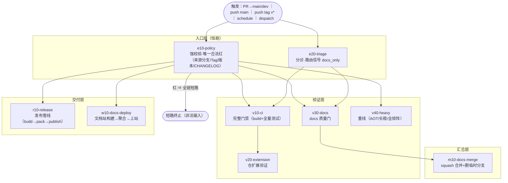

# KernLab CI 单入口分流设计（Workflow Gate）

> **版本**：0.2.7
> **日期**：2026-11-12
> **适用范围**：组织内全部代码仓（产品仓、支撑仓）
> **关联**：[BRANCHING.md](https://github.com/kernlab-dev/.github-private/blob/main/BRANCHING.md) §6/§6.2 · [CI-INFRA.md](https://github.com/kernlab-dev/.github-private/blob/main/CI-INFRA.md) §1.5/§2/§9/§10
> **变更记录**：0.2.7 Tier 试点收官判例链回写：①发布 PR 编译模式（`chore/release-*` → v10 `build_only`，测试步全 skip——与 tag 侧 run_tests=false 口径对齐）；②**rerun 快照判例**——rerun 复用原 run 的 referenced workflow 快照不解析 @main 最新（改 reusable 后须新事件触发，alpha.18→§4.1 递增 N 实锤）；③**secrets 不入 step if**——job 级 env 间接（actionlint 判例）；④**OIDC Trusted Publishing 排障实录**——政策字段错位/待激活态/账号归属逐一排除后仍 no-matching，终切 API key 双模（key 入各仓 repo secret，org secret 不达私有仓判例复用）；⑤**管道 exit 取末段判例**——sed 管道失败被吞产出 0 字节 workflow 入库（o10 首派 422 实锤），管道必须 pipefail 或单命令。0.2.6 新增 `o` 运维层（层码+注册表）：nuget-unlist 从 Tier 仓上收为组织中央单实例 `o10-nuget-unlist`（与 r10 发布↔回滚配套；.github 仓 PUBLIC → 组织 secret 原生投递）。0.2.5 r10 顶层授权判例入册：reusable publish job 的 id-token: write 必须由 caller 顶层授予，缺授权 = startup_failure（repo-template 实锤复现 Loom alpha.7；定位链：lab 同位交换 + P1/P2 双探针）。0.2.4 r10/w10 默认继承（触发自守卫+参数/paths 守卫内建），模板零注释块——仅 v20/v40（天然仓专属内容）保留 opt-in。0.2.3 workflow-templates 简化为单一 `gate.yml` 模板（旧 ci/policy/docs-deploy 三件套退役）——新建仓 Actions 一键实例化单入口。0.2.2 v10 缺省约定入模板（简单仓零参数零槽位文件；tests/*/*.csproj glob 顺序跑=组织口径，偏离才写 with/换槽位）。0.2.1 组织 reusable 文件名规范化（`reusable-<节点码>.yml`，与 §3 节点码一一对应；旧名文件暂留兼容，随各仓 gate 迁移退役）。0.2.0 按评审定案：**全统一入口**（release / docs-deploy 并入，无独立 workflow 文件）；节点命名规范化（层码+序号+语义名）；通用流程图定稿。0.1.0 初稿。

---

## 1. 核心原则

1. **一个仓一个工作流文件**：`gate.yml`（工作流名 `Gate`）。PR 门禁、docs 快速通道、发布、文档站、nightly、手动全部经由它分流——**没有独立入口**。
2. **入口强校验**：`e10-policy` 恒跑，是唯一合法的"红"；红 → 全链短路（非法输入不烧任何资源）。
3. **分诊路由**：`e20-triage` 恒跑恒成功，产出路由信号（`docs_only`）；`success()` 传递求值防线由此保证（CI-INFRA §9 判例①）。
4. **节点命名规范**：`<层码><序号>-<语义名>`，全仓全组织统一（§3）。
5. **单源收口**：执行逻辑全部在 dotgithub reusable；`gate.yml` 只剩触发块 + 节点接线 + 仓参数。

## 2. 通用执行流程图



## 3. 节点命名规范

**文件命名**（组织标准，一次定稿不再改）：

| 文件类型 | 规范 | 例 |
|---|---|---|
| 组织 reusable（dotgithub/.github/workflows/） | `reusable-<节点码>.yml` | `reusable-e10-policy.yml` |
| 仓槽位（仓/.github/workflows/） | `<节点码>.yml` | `v10-ci.yml`、`v40-heavy.yml` |
| 仓唯一入口 | `gate.yml`（工作流名 `Gate`） | — |

**格式**：`<层码><序号>-<语义名>`（job key 全小写 kebab；`name:` 显示中文）。

| 层码 | 层 | 语义 | 节点 |
|---|---|---|---|
| `e` | entry 入口层 | 强校验 + 路由信号；**恒跑** | `e10-policy`、`e20-triage` |
| `v` | verify 验证层 | 一切验证类执行（门禁/扩展/docs 门/重线） | `v10-ci`、`v20-extension`、`v30-docs`、`v40-heavy` |
| `m` | merge 汇合层 | 自动合并类收口 | `m10-docs-merge` |
| `r` | release 发布层 | tag 发布管线（串行内部阶段） | `r10-release` |
| `w` | web 文档站层 | 文档站构建/聚合/上站 | `w10-docs-deploy` |
| `o` | ops 运维层 | dispatch-only 运维工具（组织中央单实例，非仓 gate 节点） | `o10-nuget-unlist` |

序号规则：层内**并行**节点用同段序号（v10/v20/v30/v40 互不依赖并行铺开）；层内**串行**链序号递增（如 Traffic 的 `v20-build → v21-test → v22-e2e`）。新增节点必须落在既有层码内；新增层码须先改本规范（本文件 PR）。

## 4. 路由矩阵（每个节点的 `if` 全集）

| 节点 | if 条件（语义） | runner |
|---|---|---|
| `e10-policy` | 无（恒跑） | ubuntu-latest |
| `e20-triage` | 无（恒跑；非 PR 上下文内部返回 `docs_only=false`） | ubuntu-latest |
| `v10-ci` | policy 绿 ∧ ¬schedule ∧ ¬tag ∧ ¬快速通道 | linux-h / runners_matrix |
| `v20-extension` | policy 绿 ∧ v10 绿（¬schedule ∧ ¬快速通道） | 按仓 |
| `v30-docs` | policy 绿 ∧ 快速通道（docs/* ∧ dev ∧ 纯文档） | ubuntu-latest |
| `v40-heavy` | policy 绿 ∧（schedule ∨ dispatch ∨ push main） | linux-l/linux-h |
| `m10-docs-merge` | policy 绿 ∧ 快速通道 ∧ v30 绿 ∧ 非 draft | ubuntu-latest |
| `r10-release` | push ∧ tag `v*`（e10 的 tag policy 前置已在入口完成） | 按 release 配置 |
| （PR 路由补充）v10 `build_only` | 来源 `chore/release-*` ∧ 目标 dev——发布 PR 编译模式（版本 bump 零代码变更，测试不重复跑） | v10 缺省 |
| `w10-docs-deploy` | push ∧ main（**paths 守卫**：job 第一步无文档路径显式跳过） | ubuntu-latest |

**快速通道** = 来源 `docs/*` ∧ 目标 `dev` ∧ diff 纯文档（`.github/**` 恒非 docs）。

**路由效果对照**：

| 场景 | 激活节点 |
|---|---|
| docs/* 纯文档 PR → dev | e10, e20, v30, m10（自动合并删分支；~2 分钟） |
| feat 代码 PR → dev | e10, e20, v10, v20（完整门禁；v40 不跑） |
| docs/* 夹代码 PR → dev | 同上（triage 判 false，双条件门缺内容条件） |
| 非法来源 PR（feat→main 等） | e10 红，**全链短路**（秒级） |
| push main | e10, e20, w10（paths 守卫），v40（重线） |
| tag v* push | e10（tag policy 前置），r10（发布管线） |
| schedule nightly | e10, e20, v40 |
| dispatch 手动 | e10, e20 + 指定节点（inputs 选择） |

## 5. 传递 skip 防线（三原则 + 一纪律）

1. **入口恒跑**：e10/e20 不挂任何 `if`。e20 非 PR 上下文内部返回成功。
2. **e10 是唯一合法的红**：红=非法输入，下游短路是正确行为（省资源池）。
3. **caller 顶层授权 ≥ 被调用 reusable 所需**：r10 的 OIDC publish 要求顶层 `id-token: write`——缺授权 = 整个 workflow startup_failure（判例：Loom alpha.7、repo-template 2026-11-12 探针复现）。gate 模板已固化 `contents: read + id-token: write`。
4. **下游禁用隐式 `success()`**：凡挂 `needs` 的节点一律显式 `!cancelled() && needs.<父>.result == 'success' && <业务条件>`（CI-INFRA §9 判例①）。
4. **纪律：gate.yml 自身的修改**必须在合并前 `workflow_dispatch` 冒烟验证——单文件形态下 gate.yml 语法错误波及面是全事件（含发布），靠冒烟兜底（判例：charter 孤儿键 startup_failure×5）。

## 6. 单文件形态的安全边界

release 并入单文件后的风险与缓解：

| 风险 | 缓解 |
|---|---|
| gate.yml 语法错误波及发布 | §5 纪律 4：改动必 dispatch 冒烟；actionlint 进本地提交流程 |
| PR 事件拿到发布 secrets | GitHub 原生：fork PR 不投递 secrets；组织内同仓 PR 无此面；发布 secrets 只配在 `r10-release` 的 `secrets:` 映射，其他节点不可见 |
| 误触发发布 | r10 的 if 锁定 `tag v*` push 事件；e10 tag policy（Tag↔props/CHANGELOG/分支可达）在入口已完成，不合法 tag 入口即红 |

## 7. 单源 reusable 清单（dotgithub）

| reusable | 消费节点 | 状态 |
|---|---|---|
| `reusable-e10-policy.yml` | e10（PR 段 + tag 段） | 已有 |
| `reusable-e20-triage.yml` | e20 | 已有（无条件常跑形态） |
| `reusable-v10-ci.yml` | v10 | 已有 |
| `reusable-v30-docs.yml` | v30 | 已有 |
| `reusable-m10-docs-merge.yml` | m10 | 已有 |
| `reusable-r10-release.yml` | r10 | 已有 |
| `reusable-w10-docs-deploy.yml` | w10 | 已有 |

本设计**不新增 reusable**，只改仓侧拓扑。

## 8. 仓内桩形态（`gate.yml` 目标全文）

```yaml
name: Gate

on:
  push:
    branches: [main]
    tags: ['v*']
  pull_request:
    branches: [main, dev]
  schedule:
    - cron: '0 18 * * *'        # 仓按需
  workflow_dispatch:

concurrency:
  group: gate-${{ github.workflow }}-${{ github.ref }}
  cancel-in-progress: true

permissions:
  contents: read
  # ★ r10-release 的 OIDC publish 要求顶层 id-token: write——缺授权 = 整个 workflow
  #   startup_failure（Loom alpha.7 / repo-template 实锤，CI-GATE §5 判例④）
  id-token: write

jobs:
  # ── 入口层（恒跑）──
  e10-policy:
    name: 强校验（来源/Tag/版本）
    uses: kernlab-dev/.github/.github/workflows/reusable-e10-policy.yml@main
    with:
      version_project: 'src/....csproj'   # 仓参数
      changelog_file: 'CHANGELOG.md'

  e20-triage:
    name: 分诊（路由信号）
    uses: kernlab-dev/.github/.github/workflows/reusable-e20-triage.yml@main

  # ── 验证层 ──
  v10-ci:
    name: 完整门禁（build+全量测试）
    needs: [e10-policy, e20-triage]
    if: >-
      ${{ !cancelled() && needs.e10-policy.result == 'success' && github.event_name != 'schedule' &&
          !startsWith(github.ref, 'refs/tags/') &&
          !(needs.e20-triage.outputs.docs_only == 'true' &&
            startsWith(github.head_ref, 'docs/') && github.base_ref == 'dev') }}
    uses: kernlab-dev/.github/.github/workflows/reusable-v10-ci.yml@main
    # ★简单仓到此为止——零参数零槽位文件。缺省约定（=组织口径）：
    #   自动发现根 sln ｜ tests/*/*.csproj glob 逐个顺序跑 ｜ ubuntu-latest ｜ Release ｜ 重试 0
    # 需要"不合群"定制时才写东西：传参差异（Loom：solution 一次成型+过滤器）→ 加 with 行；
    # 整体换掉（Tier：matrix→六套件链；Traffic：五件套链）→ 换本仓槽位 uses: ./.github/workflows/v10-ci.yml
    # with:                                  # ← 参数仅在偏离组织缺省时出现
    #   runner: linux-h
    #   use_setup_dotnet: false

  v20-extension:                          # 仓扩展（Tier: matrix→raft 套件 / Traffic: build→test→e2e）
    name: 仓扩展验证
    needs: [e10-policy, e20-triage, v10-ci]
    if: >-
      ${{ !cancelled() && needs.e10-policy.result == 'success' && needs.v10-ci.result == 'success' &&
          github.event_name == 'pull_request' }}
    runs-on: linux-h
    steps: []                             # 仓专属步骤

  v30-docs:
    name: docs 质量门
    needs: [e10-policy, e20-triage]
    if: >-
      ${{ !cancelled() && needs.e10-policy.result == 'success' && needs.e20-triage.outputs.docs_only == 'true' &&
          startsWith(github.head_ref, 'docs/') && github.base_ref == 'dev' }}
    uses: kernlab-dev/.github/.github/workflows/reusable-v30-docs.yml@main

  v40-heavy:
    name: 重线（AOT/长稳/全矩阵）
    needs: [e10-policy, e20-triage]
    if: >-
      ${{ !cancelled() && needs.e10-policy.result == 'success' &&
          (github.event_name == 'schedule' || github.event_name == 'workflow_dispatch' ||
           (github.event_name == 'push' && github.ref == 'refs/heads/main')) }}
    runs-on: linux-l
    steps: []                             # 仓专属步骤（Loom AOT 探针 / Tier 长稳等）

  # ── 汇合层 ──
  m10-docs-merge:
    name: docs 自动合并（squash+删分支）
    needs: [e10-policy, e20-triage, v30-docs]
    if: >-
      ${{ !cancelled() &&
          needs.e10-policy.result == 'success' && needs.e20-triage.outputs.docs_only == 'true' &&
          startsWith(github.head_ref, 'docs/') && github.base_ref == 'dev' &&
          needs.v30-docs.result == 'success' &&
          github.event.pull_request.draft == false }}
    uses: kernlab-dev/.github/.github/workflows/reusable-m10-docs-merge.yml@main
    secrets:
      DOCS_MERGE_PAT: ${{ secrets.DOCS_MERGE_PAT }}

  # ── 交付层 ──
  r10-release:
    name: 发布管线（tag v*）
    needs: [e10-policy]
    if: >-
      ${{ !cancelled() && needs.e10-policy.result == 'success' &&
          github.event_name == 'push' && startsWith(github.ref, 'refs/tags/v') }}
    uses: kernlab-dev/.github/.github/workflows/reusable-r10-release.yml@main
    with:
      dotnet_version: '8.0.x'             # 仓参数
    secrets:
      NUGET_USER: ${{ secrets.NUGET_USER }}
      # ...仓发布 secrets

  w10-docs-deploy:
    name: 文档站（构建→聚合→上站）
    needs: [e10-policy]
    if: >-
      ${{ !cancelled() && needs.e10-policy.result == 'success' &&
          github.event_name == 'push' && github.ref == 'refs/heads/main' }}
    runs-on: ubuntu-latest
    steps:
      - uses: actions/checkout@11d5960a326750d5838078e36cf38b85af677262 # v4
        with:
          fetch-depth: 0
      - name: paths 守卫（无文档路径显式跳过）
        run: |
          git diff --name-only "${{ github.event.before }}...${{ github.sha }}" \
            | grep -Eq '^(docs-site/|src/.*/docs/|.*\.md$|toc\.yml$)' || {
            echo "非文档 push——跳过文档站发布"; exit 0; }
      # ...docfx 构建 → 聚合 dispatch（原 docs-deploy 内容）
```

Loom 专项外围（org runner watchdog 等基础设施自动化）**不属于仓工作流体系**，保持独立文件白名单：`win-runner-watchdog.yml` 类。bench-nightly / platform-matrix / provider-matrix 并入 `v40-heavy`/`n` 扩展节点或保留白名单，试点时逐仓裁定。

## 9. 迁移方案

| 阶段 | 内容 | 状态 |
|---|---|---|
| 0 | 传递 skip 根治（triage 无条件常跑） | ✅ .github#12 + 7 仓（tier build-test-pack 实证恢复） |
| 1 | 设计稿评审（本文 0.2.0） | 🔵 待定稿 |
| 2 | Tier 试点：`gate.yml` 单文件落地（删 ci.yml/policy.yml/release.yml/docs-deploy.yml），dispatch 冒烟 + 一个真实 PR 验证全路由 | 待定稿 |
| 3 | 其余 6 仓机械推广 + workflow-templates 更新（新建仓只有 `gate.yml` 模板） | 待阶段 2 |
| 4 | Cohort：随其 #49 落地按本模板直接接线 | 排队 |
| 5 | rulesets（需 Team）：required check 仅 `Gate` 一个 | 远期 |

**回滚**：revert 仓侧 PR 即回多文件形态。
**每仓迁移 checklist**：①policy 段入 e10（含 version_project/changelog 参数）②release 内容入 r10 ③docs-deploy 内容入 w10（paths 守卫）④重线/AOT 入 v40 ⑤扩展链显式条件化 ⑥删四个旧文件 ⑦dispatch 冒烟（PR/push/tag 四事件至少冒烟 PR+tag）⑧secrets 迁移核对（NUGET_*/DOCS_*）。

## 10. 兼容性影响

- PR 状态检查：`CI`+`Policy` 两个 → `Gate` 一个（required check 将来只挂它）；
- 非法来源 PR：秒级红（原为 policy 红照烧全量）；
- tag 发布：`Release` 独立 run 消失，变 `Gate` run 内的 `r10-release` 节点（发布历史按 tag 过滤依然成立）；
- docs-deploy：paths 触发的独立 run 消失，变 main push run 内节点（无文档路径时该节点内部显式跳过，秒级空转）；
- 运行列表：PR 事件 2 run → 1 run，push/tag 事件各自 1 run；
- workflow 名变更 `CI→Gate`：历史 run 按旧名保留，检查名以新 run 为准（迁移窗口内两者并存，无冲突）。

## 11. 决策记录

| # | 决策 | 结论 | 依据 |
|---|---|---|---|
| D1 | policy 红时重门禁短路 | **短路** | 非法来源注定不能合；省 30 分钟 linux-h |
| D2 | 单入口命名 | **`gate.yml` / Gate**，节点按 §3 层码规范 | 统一入口语义；文件名=职责名 |
| D3 | docs-deploy / release 归属 | **全部并入单入口**（0.2.0 评审定案，推翻 0.1.0 的"关键路径隔离"） | 统一入口分流；语法错误风险由 §5 纪律 4 冒烟兜底 |
